Chapter 4 Introduction to Data Structures

1.  What data structures are?

- Data structures are ways to organize and store data in a computer so
  it’s easy to access and manage 🡪 Important tools in programming

- The following are some of the widely used data
  structures:

> 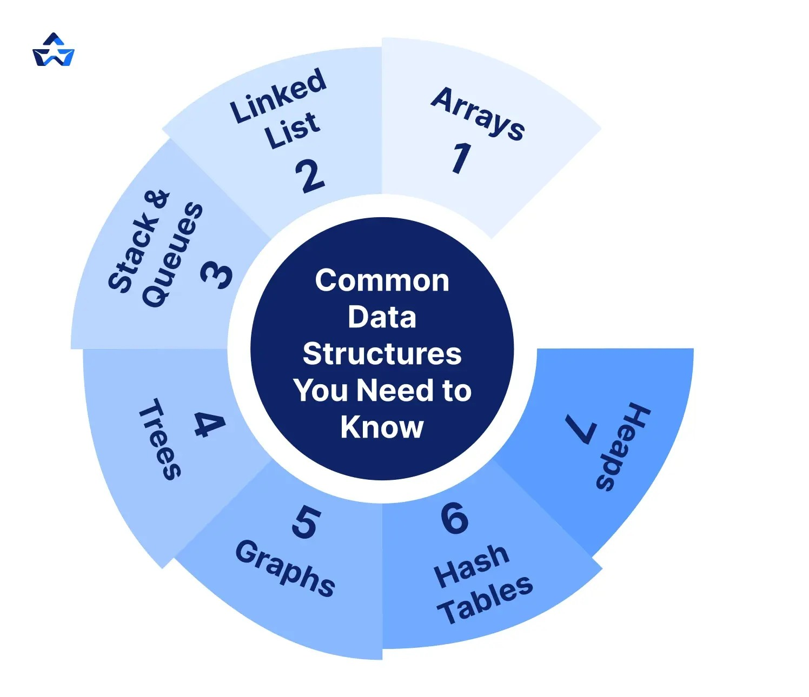 style="width:2.11521in;height:1.82437in" />

1.  Arrays

    Arrays are basic data structures that store multiple items of the
    same type in one memory block.

    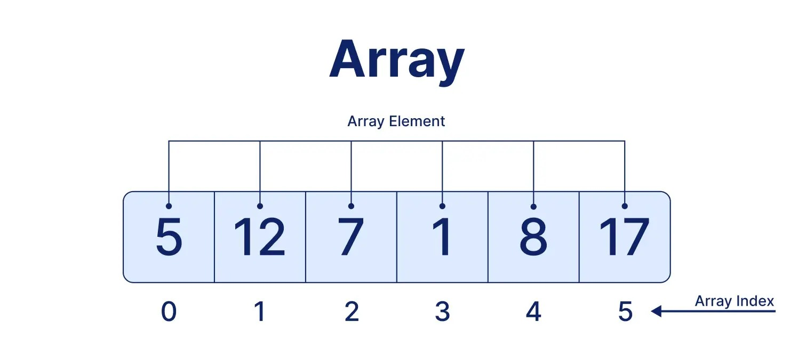

    Each element in an array can be accessed using an index, which
    represents its position. In most programming languages, array
    indexing starts from 0.

| Index | 0   | 1   | 2   | 3   | 4   | 5   |
|:------|:----|:----|:----|:----|:----|:----|
| Array | 5   | 12  | 7   | 1   | 8   | 17  |

> For example, accessing index 2 gives the value 30.

2.  Linked List

    Another frequent data structure is linked lists, which are made up
    of a sequence of nodes (as shown in the figure) connected by links.

    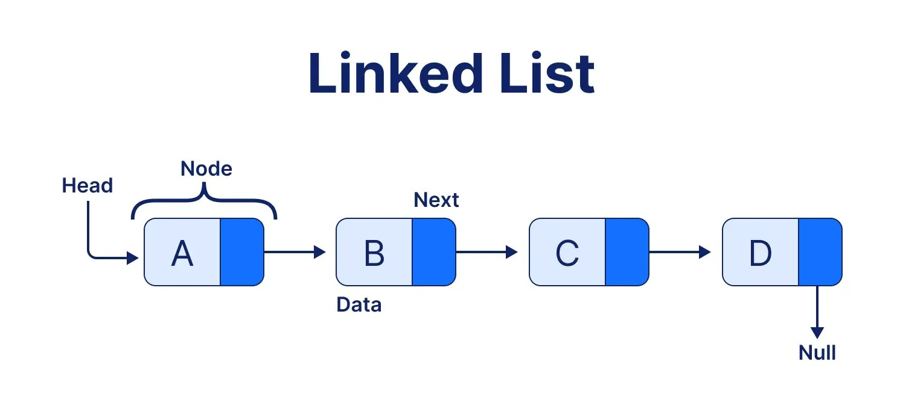

    Each node in a linked list typically contains two parts:

- **Data:** Stores the actual value.

- **Link (Pointer):** Stores a reference to the next node.

> The last node points to NULL, indicating that there are no more nodes
> in the sequence.

1.  Stacks and Queues

    Stacks and queues are linear data structures that organize data
    based on specific order principles.

- Stacks (LIFO – Last In, First Out)

  LIFO = The last element added to the stack is the first one to be
  removed.

  For example, a stack of plates!! In a canteen, you will take the last
  plate placed on top right? So it is the first plate taken away.

  Two common stack operations are:

<!-- -->

- **Push:** Adds an element to the top of the stack

- **Pop:** Removes the top element from the stack

> 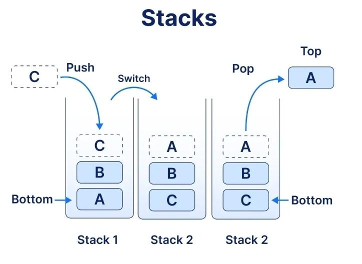 style="width:2.51389in;height:1.67361in" />

- Queues (FIFO – First In, First Out)

  FIFO = The first element added to the queue is the first one to be
  removed.

  For example, people waiting in a line are generally served in the
  order they arrive!!

  Two common queue operations are:

<!-- -->

- **Enqueue:** Adds an element to the rear of the queue.

- **Dequeue:** Removes an element from the front of the queue.

> 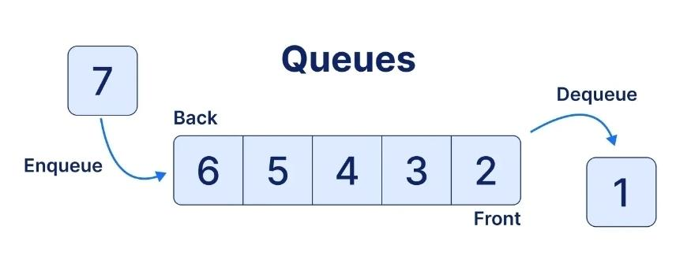 style="width:3.13194in;height:1.29167in" />

1.  Trees

    A tree is a nonlinear data structure consisting of nodes connected
    by edges in a hierarchical structure, starting from a root node and
    extending into branches of other nodes.

    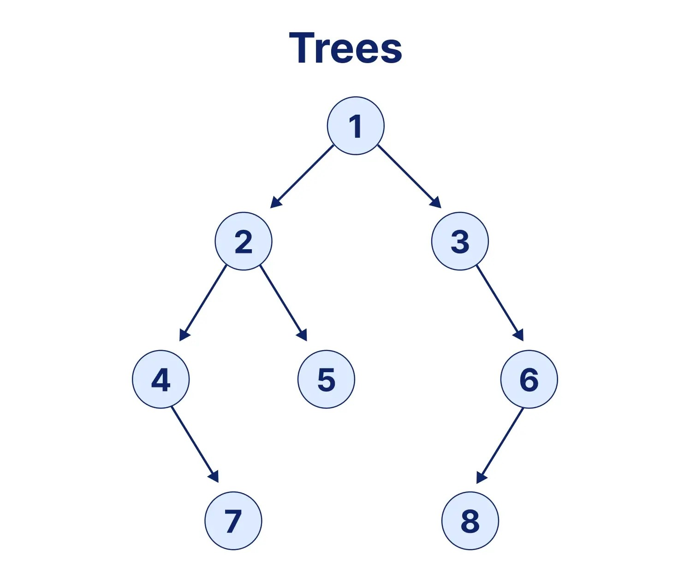\
    Terms used in trees!!

- **Root:** The topmost node of a tree.

- **Parent:** A node that has one or more child nodes.

- **Child:** A node connected below another node.

- **Leaf:** A node that has no children.

  1.  Graphs

      A graph is a data structure consisting of nodes (also known as
      vertices) and the connections between them (also known as edges).

      Commonly used to represent relationships and connections between
      different objects.

      For example, they can represent social networks, maps, and
      computer networks.

      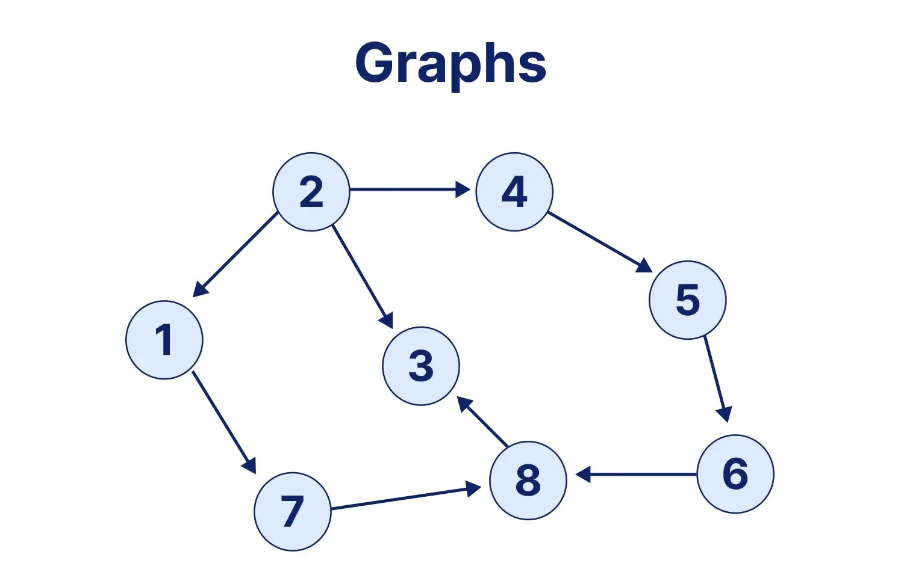

  2.  Hash Table

      A hash table is a fast method of storing and searching item where
      the search item is put through a hash function before being stored
      in the computer’s memory. It assigns values to specific positions
      of an array.

      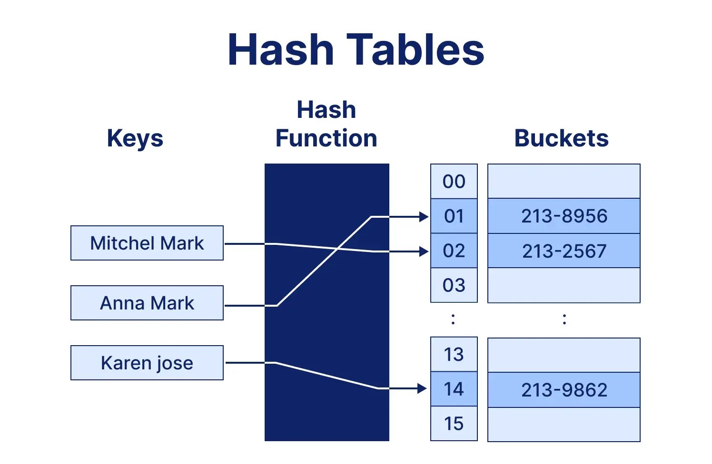

  3.  Heaps

      A heap is a data structure that keeps data
      organized, with min-heaps having the smallest value on top and
      max-heaps having the largest.

      Heaps are commonly used in priority queues and
      scheduling systems.

      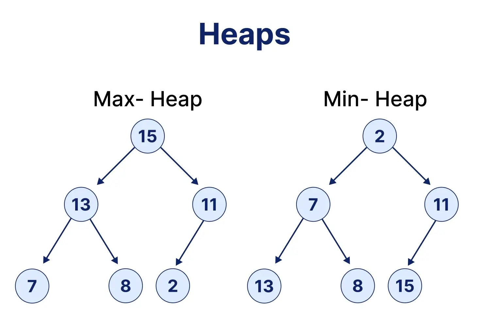

      A heap is a specialized tree-based data structure that follows a
      specific ordering rule.

<!-- -->

- **Min-Heap:** The parent node is smaller than or equal to its child
  nodes, so the smallest element is at the root.

- **Max-Heap:** The parent node is greater than or equal to its child
  nodes, so the largest element is at the root.

> [<u>https://www.bosscoderacademy.com/blog/beginners-guide-to-data-structures-and-algorithms</u>](https://www.bosscoderacademy.com/blog/beginners-guide-to-data-structures-and-algorithms)

2.  Abstract Data Types

- Abstract Data Type (ADT) is a conceptual model. It
  defines what a data structure does without dictating how it does it.
  By separating the logical properties from the physical implementation,
  ADTs allow for cleaner, more maintainable code.

- In simple terms, an ADT focuses on **what a data
  structure does rather than how it works internally**.

- For example, a Stack ADT defines that elements are
  added using push and removed using pop, following the LIFO principle.
  However, it does not specify whether the stack must be implemented
  using an array or a linked list.

> 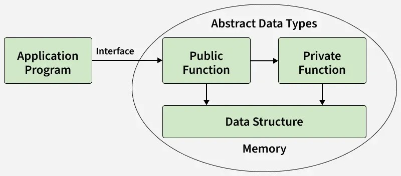 style="width:3.11806in;height:1.44444in" />
>
> As depicted in the diagram, the following features
> of ADTs are highlighted:
>
> ▪︎ Only the essentials are exposed, omitting
> implementation details (Abstraction).
>
> ▪︎ Data and its related operations are bundled into
> a single unit (Encapsulation).
>
> ▪︎ You can change the underlying implementation
> (e.g., from an Array to a Linked List) without affecting how the rest
> of the program uses the ADT (Data Independence).
>
> Common Examples of ADTs:

- Queue: A linear structure following the FIFO (First
  In, First Out) principle.

  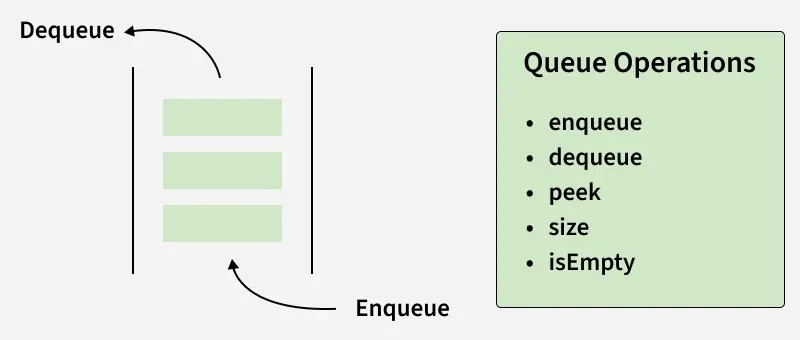

<!-- -->

- List: A sequential collection of elements

  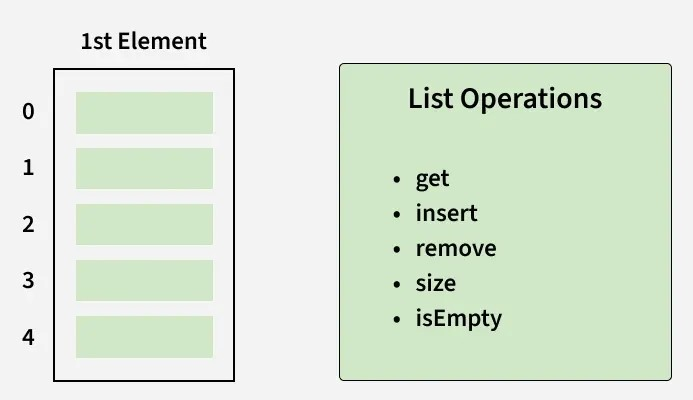

<!-- -->

- Stack: A linear structure following the LIFO (Last
  In, First Out) principle.

  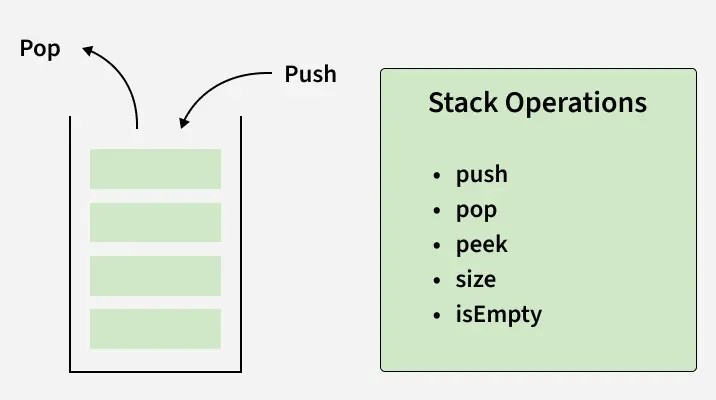

  Differences Between ADTs and UDTs

  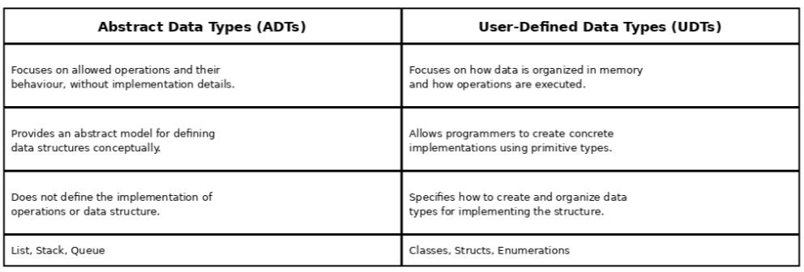

Advantages of Abstract Data Types (ADT)

- Modularity: Simplifies complex systems by breaking
  them into smaller, manageable pieces.

- Security & Integrity: Information hiding helps
  control access to internal data and reduces accidental
  modification.

- Reusability: Once defined, the interface can be
  reused across different projects regardless of the backend
  logic.

Disadvantages of Abstract Data Types (ADT)

- Performance Overhead: The layers of abstraction can
  sometimes lead to slightly higher memory or CPU usage.

- Initial Complexity: Designing a robust ADT requires
  more upfront planning and a steeper learning curve for
  beginners.

[<u>https://www.geeksforgeeks.org/dsa/abstract-data-types/</u>](https://www.geeksforgeeks.org/dsa/abstract-data-types/)

3.  Operations such as traversing, search, insertion
    and deletion

- Traversing**:**

  Traversing a data structure means to visit the
  elements stored in it. It visits data in a systematic manner. This can
  be done with any type of data structures (e.g. array, stack, queue,
  linked list).

  For example, consider a list containing \[10, 20,
  30, 40\]. Traversing the list means visiting each element one by
  one.

  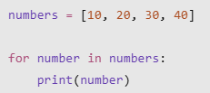
  Output:
  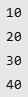

<!-- -->

- Searching:

  Searching means to find a particular element in the
  given data-structure. It is considered as successful when the required
  element is found. Searching is the operation which we can perform on
  data-structures like array, linked-list, tree, graph, etc.

  For example, searching for the number 30 in a
  list:

  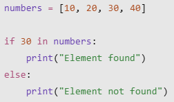 Output:
  Element found

<!-- -->

- Insertion:

  Insertion is an operation used to add an element to a data structure.
  The element can be added at a specific position or according to the
  rules of the data structure. In some cases, insertion may require
  additional memory or may be limited by the capacity of the structure.

  The insertion operation has different names in certain data
  structures. In a stack, it is called Push. In a queue, it is called
  Enqueue.

  Example:

  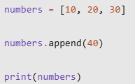 Output: \[10, 20, 30, 40\]

<!-- -->

- Deletion:

  Deletion is an operation used to remove an existing element from a
  data structure. The element to be removed depends on the structure and
  the operation being performed. In a stack, deletion is called Pop,
  while in a queue, it is called Dequeue.

  Example:

  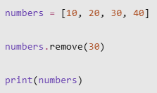 Output: \[10, 20, 40\]

> Some other method :
>
> ° Update
>
> It updates the data in the data structure. You can
> also update any specific data by giving some condition in loop like
> select approach.
>
> For example:
>
> 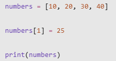 style="width:1.60425in;height:0.84032in" /> Output:
> \[10, 25, 30, 40\]
>
> The value at index 1 changes from 20 to 25.
>
> ° Sort
>
> Sorting data in a particular order (ascending or
> descending).
>
> For example:
>
> 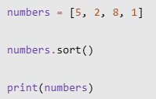 style="width:1.38202in;height:0.87504in" /> Output:
> \[1, 2, 5, 8\]
>
> There are different sorting algorithms, such as
> Bubble Sort, Selection Sort, Insertion Sort, Merge Sort, and Quick
> Sort. These algorithms will be explained in more detail in the chapter
> about searching and sorting.
>
> [<u>https://www.geeksforgeeks.org/dsa/common-operations-on-various-data-structures/</u>](https://www.geeksforgeeks.org/dsa/common-operations-on-various-data-structures/)

4.  Q n A Time

<!-- -->

1.  What is the core definition of Data
    Structures?

    A. Methods to organize and store data in a
    database so it's secure and encrypted

    B. Ways to organize and store data in a computer
    so it's easy to access and manage

    C. Techniques to organize and store data in a
    network so it's fast to transfer and share

    D. Processes to organize and store data in a
    system so it's compressed and archived

2.  Stacks and Queues are classified as linear
    structures but with different principles. Which is correct?

    A. Both are FIFO - First In First Out

    B. Both are LIFO - Last In First Out

    C. Stack is LIFO - Last In First Out, Queue is
    FIFO - First In First Out

    D. Stack is FIFO -First In First Out, Queue is
    LIFO - Last In First Out

3.  Insertion in Stack and Queue has special names.
    Which is correct?

    A. In Stack called Enqueue, in Queue called
    Push

    B. In Stack called Push, in Queue called
    Enqueue

    C. In Stack called Pop, in Queue called
    Dequeue

    D. In both Stack and Queue called Merge

4.  What does traversing a data structure mean
    ?

    A. Visiting data in a systematic manner

    B. Adding an element, unsuccessful when structure
    is full

    C. Deleting an element, called Pop in Stack and
    Dequeue in Queue

    D. Creating concrete implementations using
    primitive types

5.  What is ADT (Abstract Data Types)?

    A. Concrete implementation creating data types
    using primitive types like int char

    B. Basic structure storing multiple items of same
    type in one memory block completely

    C. Operation visiting element stored in structure
    in systematic manner for processing

    D. Conceptual model defining what data structure
    does without dictating how it does

6.  Which operation changes the value of an existing
    element without adding or removing an element?

    A. Traversing

    B. Searching

    C. Insertion

    D. Update

7.  Which of the following describes a
    Min-Heap?

    A. The largest element is always at the
    root.

    B. The smallest element is always at the
    root.

    C. Elements are removed in the order they were
    inserted.

    D. Elements are stored without any ordering
    rules.

    Answer Key:

<!-- -->

1.  B

2.  C

3.  B

4.  A

5.  D

6.  D

7.  B
