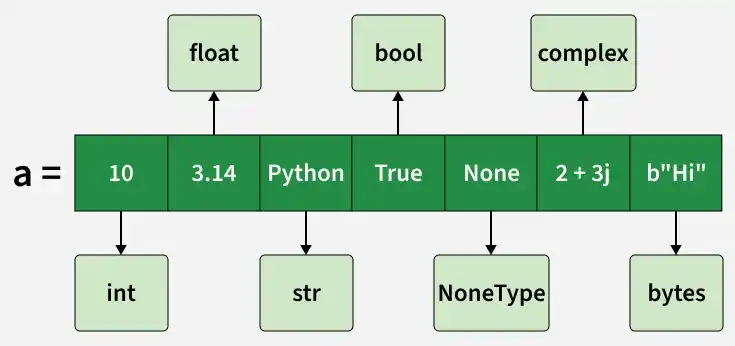
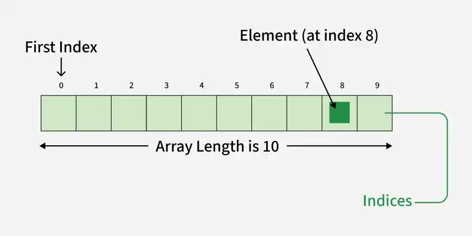
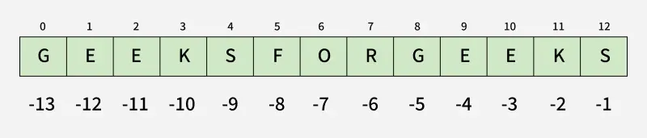
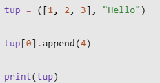
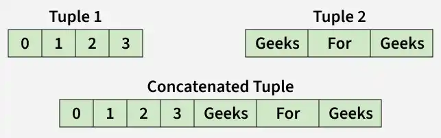
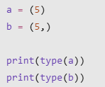
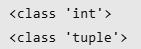
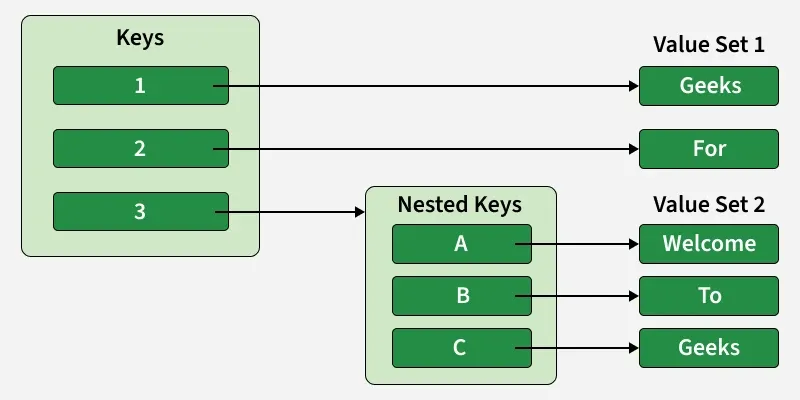
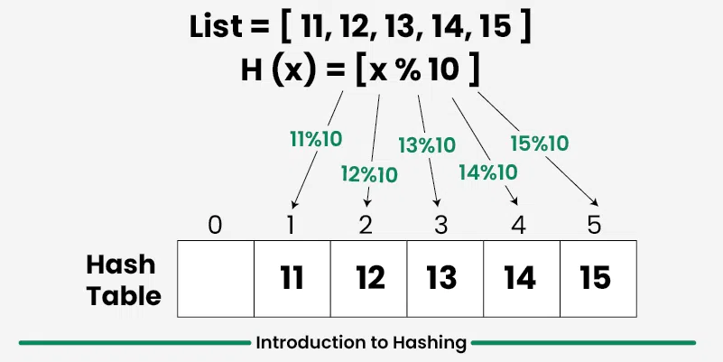
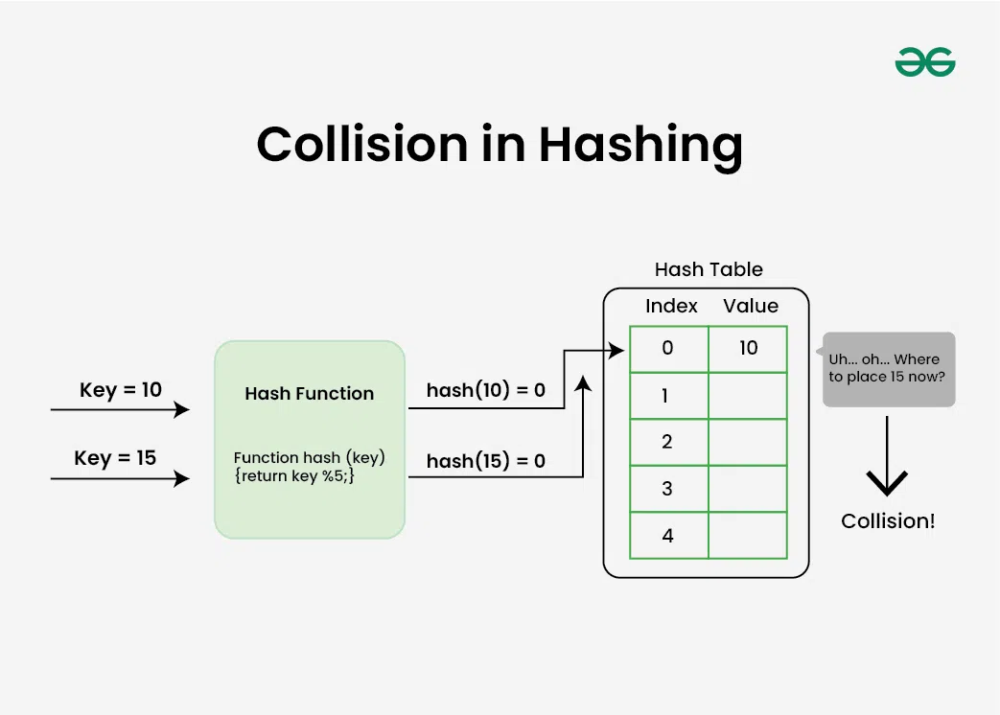

**CHAPTER 5 -- FUNDAMENTAL**

**a. Lists and Arrays**

- 
- 

**List** is a built-in data structure used to store an ordered
collection of items. They are dynamic, resizable and capable of storing
multiple data types.

*A list can contain elements of different data types.*

- List elements can be changed, updated, added, or removed after the
  list is created.

- Elements maintain the order in which they are inserted.

- Elements are accessed using their position, starting from index 0.

Lists can be created in several ways, such as:

1\. Using Square Brackets: Square brackets \[\] are used to create a
list directly.

<table>
<colgroup>
<col style="width: 49%" />
<col style="width: 50%" />
</colgroup>
<thead>
<tr>
<th>
a = [1, 2, 3]

print(a)

b = ["apple", "banana"]

print(b)
</th>
<th>
Output:

[1, 2, 3]

['apple', 'banana']
</th>
</tr>
</thead>
<tbody>
</tbody>
</table>

2\. Using list() Constructor: A list can also be created by passing an
iterable (such as
[tuple](https://www.geeksforgeeks.org/python/python-tuples/),
[string](https://www.geeksforgeeks.org/python/python-string/) or another
list) to the
[list()](https://www.geeksforgeeks.org/python/python-list-function/)
constructor.

<table>
<colgroup>
<col style="width: 49%" />
<col style="width: 50%" />
</colgroup>
<thead>
<tr>
<th>
a = list((1, 2, 3, 'apple', 4.5))

print(a)

b = list("GFG")

print(b)
</th>
<th>
Output:

[1, 2, 3, 'apple', 4.5]

['G', 'F', 'G']
</th>
</tr>
</thead>
<tbody>
</tbody>
</table>

3\. Creating List with Repeated Elements: A list with repeated elements
can be created using the multiplication (\*) operator.

<table>
<colgroup>
<col style="width: 49%" />
<col style="width: 50%" />
</colgroup>
<thead>
<tr>
<th>
a = [2] * 5

b = [0] * 7

​

print(a)

print(b)
</th>
<th>
Output:

[2, 2, 2, 2, 2]

[0, 0, 0, 0, 0, 0, 0]
</th>
</tr>
</thead>
<tbody>
</tbody>
</table>

Elements in a list are accessed using indexing. Python uses zero-based
indexing, meaning a\[0\] represents the first element. Negative indexing
is also supported, where -1 accesses the last element.

<table>
<colgroup>
<col style="width: 49%" />
<col style="width: 50%" />
</colgroup>
<thead>
<tr>
<th>
a = [10, 20, 30]

print(a[0])

print(a[-1])
</th>
<th>
Output:

10

30
</th>
</tr>
</thead>
<tbody>
</tbody>
</table>

Elements can be added to a list using the following methods:

1\. append(): Adds an element at the end of the list.

<table>
<colgroup>
<col style="width: 49%" />
<col style="width: 50%" />
</colgroup>
<thead>
<tr>
<th>
a = [1, 2]

a.append(3)

print(a)
</th>
<th>
Output:

[1, 2, 3]
</th>
</tr>
</thead>
<tbody>
</tbody>
</table>

2\. insert(): Adds an element at a specific position.

<table>
<colgroup>
<col style="width: 49%" />
<col style="width: 50%" />
</colgroup>
<thead>
<tr>
<th>
a = [1, 3]

a.insert(1, 2)

print(a)
</th>
<th>
Output:

[1, 2, 3]
</th>
</tr>
</thead>
<tbody>
</tbody>
</table>

3\. extend(): Adds multiple elements to the end of the list.

<table>
<colgroup>
<col style="width: 49%" />
<col style="width: 50%" />
</colgroup>
<thead>
<tr>
<th>
a = [1, 2]

a.extend([3, 4])

print(a)
</th>
<th>
Output:

[1, 2, 3, 4]
</th>
</tr>
</thead>
<tbody>
</tbody>
</table>

Since lists are mutable, elements can be updated by assigning new values
using their index.

<table>
<colgroup>
<col style="width: 49%" />
<col style="width: 50%" />
</colgroup>
<thead>
<tr>
<th>
a = [10, 20, 30, 40, 50]

a[1] = 25

print(a)
</th>
<th>
Output:

[10, 25, 30, 40, 50]
</th>
</tr>
</thead>
<tbody>
</tbody>
</table>

Elements can be removed from a list using the following methods:

1\. remove(): Removes the first occurrence of an element.

<table>
<colgroup>
<col style="width: 49%" />
<col style="width: 50%" />
</colgroup>
<thead>
<tr>
<th>
a = [1, 2, 3]

a.remove(2)

print(a)
</th>
<th>
Output:

[1, 3]
</th>
</tr>
</thead>
<tbody>
</tbody>
</table>

2\. pop(): Removes the element at a specific index or the last element
if no index is specified.

<table>
<colgroup>
<col style="width: 49%" />
<col style="width: 50%" />
</colgroup>
<thead>
<tr>
<th>
a = [1, 2, 3]

a.pop()

print(a)
</th>
<th>
Output:

[1, 2]
</th>
</tr>
</thead>
<tbody>
</tbody>
</table>

3\. del statement: Deletes an element at a specified index.

<table>
<colgroup>
<col style="width: 49%" />
<col style="width: 50%" />
</colgroup>
<thead>
<tr>
<th>
a = [1, 2, 3]

del a[1]

print(a)
</th>
<th>
Output:

[1, 3]
</th>
</tr>
</thead>
<tbody>
</tbody>
</table>

4\. clear(): removes all items.

<table>
<colgroup>
<col style="width: 49%" />
<col style="width: 50%" />
</colgroup>
<thead>
<tr>
<th>
a = [1, 2, 3]

a.clear()

print(a)
</th>
<th>
Output:

[]
</th>
</tr>
</thead>
<tbody>
</tbody>
</table>

We can use loop to [<u>Iterate Over a
list</u>](https://www.geeksforgeeks.org/python/iterate-over-a-list-in-python/),
allowing operations to be performed on each element.

<table>
<colgroup>
<col style="width: 49%" />
<col style="width: 50%" />
</colgroup>
<thead>
<tr>
<th>
a = ['apple', 'banana', 'cherry']

for item in a:

print(item)
</th>
<th>
Output:

apple

banana

cherry
</th>
</tr>
</thead>
<tbody>
</tbody>
</table>

A nested list is a list that contains another list as its element. It is
commonly used to represent matrices or tabular data. Nested elements can
be accessed by chaining multiple indexes.

<table>
<colgroup>
<col style="width: 49%" />
<col style="width: 50%" />
</colgroup>
<thead>
<tr>
<th>
a = [[1, 2], [3, 4]]

print(a[0])

print(a[1][0])
</th>
<th>
Output:

[1, 2]

3
</th>
</tr>
</thead>
<tbody>
</tbody>
</table>

<https://www.geeksforgeeks.org/python/python-lists/>

**Array** is a collection of elements stored at contiguous memory
locations, used to hold multiple values of the same data type. Unlike
[<u>Lists</u>](https://www.geeksforgeeks.org/python/python-lists/),
which can store mixed types, arrays are homogeneous and require a
typecode during initialization to define the data type.

<table>
<colgroup>
<col style="width: 49%" />
<col style="width: 50%" />
</colgroup>
<thead>
<tr>
<th>
import array as arr

a = arr.array('i', [1, 2, 3])

​

# accessing first array

print(a[0])

​

# adding element to array

a.append(5)

print(a)
</th>
<th>
Output:

1

array('i', [1, 2, 3, 5])
</th>
</tr>
</thead>
<tbody>
</tbody>
</table>

<u>Explanation:</u> parameter 'i' is the typecode, it tells Python to
treat the elements as signed integers (\[1, 2, 3\]) of a specific byte
size (usually 2 or 4 bytes).

**Difference Between List and Array in Python**

| **Basis** | **List** | **Array** |
|:--:|:--:|:--:|
| **Data Type Handling** | Can store mixed data types | Stores only one data type |
| **Memory Usage** | Uses more memory due to flexible storage | Uses less memory because of uniform data type |
| **Performance** | Slower for numerical operations | Faster for numeric computations |
| **Flexibility** | Supports easy insertion, deletion and resizing | Less flexible due to fixed type and size constraints |
| **Arithmetic Operations** | Cannot perform element-wise arithmetic directly | Supports element-wise arithmetic |
| **Built-in Support** | Available by default in Python | Requires importing the array module |
| **Best Use Case** | General-purpose and mixed-type data | Numeric and scientific data processing |
| **Data Consistency** | Allows mixed values without restriction | Enforces strict type consistency |

<https://www.geeksforgeeks.org/python/python-arrays/>

<https://www.geeksforgeeks.org/python/difference-between-list-and-array-in-python/>

**b. Strings**

Strings are sequence of characters written inside quotes. It can include
letters, numbers, symbols and spaces. Python does not have a separate
character type.

- A single character is treated as a string of length one.

- Strings are commonly used for text handling and manipulation.

Strings can be created using either single ('...') or double ("...")
quotes. Both behave the same.

<table>
<colgroup>
<col style="width: 49%" />
<col style="width: 50%" />
</colgroup>
<thead>
<tr>
<th style="text-align: left;">
a = 'GFG'

b = "GeeksForGeeks"

print(a)

print(b)
</th>
<th>
Output:

GFG

GeeksForGeeks
</th>
</tr>
</thead>
<tbody>
</tbody>
</table>

Multi-line Strings, use triple quotes ('''...''' ) or ( """...""") for
strings that span multiple lines. Newlines are preserved.

<table>
<colgroup>
<col style="width: 49%" />
<col style="width: 50%" />
</colgroup>
<thead>
<tr>
<th style="text-align: left;">
s = """I am Learning

Python String on GeeksforGeeks"""

print(s)

​

s = '''I'm a

Geek'''

print(s)
</th>
<th>
Output:

I am Learning

Python String on GeeksforGeeks

I'm a

Geek
</th>
</tr>
</thead>
<tbody>
</tbody>
</table>

Accessing characters in string, strings are indexed sequences. Positive
indices start at 0 from the left, negative indices start at -1 from the
right as represented in below image:

Positive and Negative Indexing

Example 1: Access specific characters through positive indexing.

<table>
<colgroup>
<col style="width: 49%" />
<col style="width: 50%" />
</colgroup>
<thead>
<tr>
<th style="text-align: left;">
s = "ABCDEF"

print(s[0])

print(s[4])
</th>
<th>
Output:

A

E
</th>
</tr>
</thead>
<tbody>
</tbody>
</table>

*Note: Accessing an index out of range will cause an IndexError. Only
integers are allowed as indices and using a float or other types will
result in a TypeError.*

Example 2: Read characters from the end using [negative
indices](https://www.geeksforgeeks.org/python/slicing-with-negative-numbers-in-python/)<u>.</u>

<table>
<colgroup>
<col style="width: 49%" />
<col style="width: 50%" />
</colgroup>
<thead>
<tr>
<th style="text-align: left;">
s = "ABCDEF"

print(s[-3])

print(s[-5])
</th>
<th>
Output:

D

B
</th>
</tr>
</thead>
<tbody>
</tbody>
</table>

String slicing,
[slicing](https://www.geeksforgeeks.org/python/string-slicing-in-python/)
<u>i</u>s a way to extract a portion of a string by specifying the start
and end indexes. The syntax for slicing is string\[start:end\], where
start starting index and end is stopping index (excluded).

<table>
<colgroup>
<col style="width: 49%" />
<col style="width: 50%" />
</colgroup>
<thead>
<tr>
<th style="text-align: left;">
s = "ABCDEF"

print(s[1:4])

print(s[:3])

print(s[3:])

print(s[::-1])
</th>
<th>
Output:

BCD

ABC

DEF

FEDCBA
</th>
</tr>
</thead>
<tbody>
</tbody>
</table>

Looping through strings, Strings are iterable, which means we can access
each character one by one using a loop.

<table>
<colgroup>
<col style="width: 49%" />
<col style="width: 50%" />
</colgroup>
<thead>
<tr>
<th style="text-align: left;">
s = "ABCDEF"

for char in s:

print(char)
</th>
<th>
Output

A

B

C

D

E

F
</th>
</tr>
</thead>
<tbody>
</tbody>
</table>

Explanation**:** for loop goes through the string in order and each
iteration prints the next character.

String immutability, strings are immutable, meaning their values cannot
be changed after creation. Any modification to a string creates a new
string instead of altering the original one.

<table>
<colgroup>
<col style="width: 49%" />
<col style="width: 50%" />
</colgroup>
<thead>
<tr>
<th style="text-align: left;">
s = "aBCDEF"

s = "A" + s[1:]

print(s)
</th>
<th style="text-align: left;">
Output:

ABCDEF
</th>
</tr>
</thead>
<tbody>
</tbody>
</table>

Explanation: original string "aBCDEF" is not modified. A new string is
created by combining "A" with s\[1:\] (rest of the string).

<table>
<colgroup>
<col style="width: 49%" />
<col style="width: 50%" />
</colgroup>
<thead>
<tr>
<th style="text-align: left;">
s = "ABCD EF"

s1 = "H" + s[1:]

s2 = s.replace("ABC", "abc")

​

print(s1)

print(s2)
</th>
<th>
Output:

HBCD EF

abcD EF
</th>
</tr>
</thead>
<tbody>
</tbody>
</table>

Explanation:

- s1: slice from index 1 onward and prepend "H".

- s2: replace("ABC", "abc") returns a new string.

Common string methods, python provides various built-in methods to
manipulate strings. Below are some of the most useful methods:

1\. len(): returns the total number of characters in a string (including
spaces and punctuation).

<table>
<colgroup>
<col style="width: 49%" />
<col style="width: 50%" />
</colgroup>
<thead>
<tr>
<th style="text-align: left;">
s = "GeeksforGeeks"

print(len(s))
</th>
<th style="text-align: left;">
Output:

13
</th>
</tr>
</thead>
<tbody>
</tbody>
</table>

2\. upper() and lower():
[upper()](https://www.geeksforgeeks.org/python/python-string-upper/)
method converts all characters to uppercase whereas,
[lower()](https://www.geeksforgeeks.org/python/python-string-lower/)
method converts all characters to lowercase.

<table>
<colgroup>
<col style="width: 49%" />
<col style="width: 50%" />
</colgroup>
<thead>
<tr>
<th style="text-align: left;">
s = "Hello World"

print(s.upper())

print(s.lower())
</th>
<th style="text-align: left;">
Output:

HELLO WORLD

hello word
</th>
</tr>
</thead>
<tbody>
</tbody>
</table>

3\. strip() and replace():
[strip()](https://www.geeksforgeeks.org/python/python-string-strip/)
removes leading and trailing whitespace from the string and
[replace()](https://www.geeksforgeeks.org/python/python-string-replace/)
replaces all occurrences of a specified substring with another.

<table>
<colgroup>
<col style="width: 49%" />
<col style="width: 50%" />
</colgroup>
<thead>
<tr>
<th style="text-align: left;">
s = " ABC "

print(s.strip())

​

s = "Python is fun"

print(s.replace("fun", "awesome"))
</th>
<th style="text-align: left;">
Output:

ABC

Python is awesome
</th>
</tr>
</thead>
<tbody>
</tbody>
</table>

Concatenating and Repeating Strings

1\. Concatenation: Strings can be combined by using + operator.

<table>
<colgroup>
<col style="width: 49%" />
<col style="width: 50%" />
</colgroup>
<thead>
<tr>
<th style="text-align: left;">
s1 = "Hello"

s2 = "World"

print(s1 + " " + s2)
</th>
<th style="text-align: left;">
Output:

Hello World
</th>
</tr>
</thead>
<tbody>
</tbody>
</table>

2\. Repetition: A string can be repeated multiple times using \*.

<table>
<colgroup>
<col style="width: 49%" />
<col style="width: 50%" />
</colgroup>
<thead>
<tr>
<th style="text-align: left;">
s = "Hello "

print(s * 3)
</th>
<th style="text-align: left;">
Output:

Hello Hello Hello
</th>
</tr>
</thead>
<tbody>
</tbody>
</table>

Formatting Strings

1\. Using f-strings:
[f-strings](https://www.geeksforgeeks.org/python/formatted-string-literals-f-strings-python/)
allows to directly insert variables and expressions inside a string
using {} brackets.

<table>
<colgroup>
<col style="width: 49%" />
<col style="width: 50%" />
</colgroup>
<thead>
<tr>
<th style="text-align: left;">
name = "Jake"

age = 22

print(f"Name: {name}, Age: {age}")
</th>
<th style="text-align: left;">
Output:

Name: Jake, Age: 22
</th>
</tr>
</thead>
<tbody>
</tbody>
</table>

2\. Using format():
[format()](https://www.geeksforgeeks.org/python/python-string-format-method/)
method allows inserting values into placeholders {} inside a string.

<table style="width:99%;">
<colgroup>
<col style="width: 99%" />
</colgroup>
<thead>
<tr>
<th style="text-align: left;">
s = "My name is {} and I am {} years
old.".format( "Emily", 22)

print(s)
</th>
</tr>
</thead>
<tbody>
<tr>
<td style="text-align: left;">
Output:

My name is Emily and I am 22 years old
</td>
</tr>
</tbody>
</table>

String membership testing,
[<u>in</u>](https://www.geeksforgeeks.org/python/python-in-keyword/)
keyword is used to check whether a substring exists inside a string. It
returns True if the substring is found, otherwise it returns False.

<table>
<colgroup>
<col style="width: 49%" />
<col style="width: 50%" />
</colgroup>
<thead>
<tr>
<th style="text-align: left;">
s = "GeeksforGeeks"

print("Geeks" in s)

print("GfG" in s)
</th>
<th style="text-align: left;">
Output:

True

False
</th>
</tr>
</thead>
<tbody>
</tbody>
</table>

**c. Tupple**

A tuple is an immutable ordered collection of elements.

- Tuples are similar to lists, but unlike lists, they cannot be changed
  after their creation.

- Can hold elements of different data types.

- These are ordered, heterogeneous and immutable.

A tuple is created by placing all the items inside parentheses (),
separated by commas. A tuple can have any number of items.

<table>
<colgroup>
<col style="width: 49%" />
<col style="width: 50%" />
</colgroup>
<thead>
<tr>
<th>
tup = ()

print(tup)

​

# Using String

tup = ('Geeks', 'For')

print(tup)

​

# Using List

li = [1, 2, 4, 5, 6]

print(tuple(li))

​

# Using Built-in Function

tup = tuple('Geeks')

print(tup)
</th>
<th>
Output:

()

('Geeks', 'For')

(1, 2, 4, 5, 6)

('G', 'e', 'e', 'k', 's')
</th>
</tr>
</thead>
<tbody>
</tbody>
</table>

Tuples can store elements of different data types, such as integers,
strings, lists and dictionaries, within a single structure.

<table style="width:99%;">
<colgroup>
<col style="width: 99%" />
</colgroup>
<thead>
<tr>
<th>
tup = (5, 'Welcome', 7.5, True, [1, 2, 3], {'key': 'value'})

print(tup)

Output

(5, 'Welcome', 7.5, True, [1, 2, 3], {'key': 'value'})
</th>
</tr>
</thead>
<tbody>
</tbody>
</table>

Although a tuple cannot have its elements reassigned, it can contain
mutable objects such as lists and dictionaries. These objects can still
be modified internally, even though the tuple's element references
cannot be replaced.

 Output : (\[1, 2, 3, 4\],
'Hello')

**Tuple Basic Operations**

1\. Accessing of Tuples

We can access the elements of a tuple by using indexing and
[slicing](https://www.geeksforgeeks.org/python/tuple-slicing-python/),
similar to how we access elements in a list. Indexing starts at 0 for
the first element and goes up to n-1, where n is the number of elements
in the tuple. Negative indexing starts from -1 for the last element and
goes backward.

<table>
<colgroup>
<col style="width: 49%" />
<col style="width: 50%" />
</colgroup>
<thead>
<tr>
<th>
tup = tuple("Geeks")

print(tup[0])

print(tup[1:4])

print(tup[:3])

​

# Tuple unpacking

tup = ("Geeks", "For", "Geeks")

​

# This line unpack values of Tuple1

a, b, c = tup

print(a)

print(b)

print(c)
</th>
<th>
Output:

G

('e', 'e', 'k')

('G', 'e', 'e')

Geeks

For

Geeks
</th>
</tr>
</thead>
<tbody>
</tbody>
</table>

2\. Concatenation of Tuples

Tuples can be concatenated using the + operator. This operation combines
two or more tuples to create a new tuple.

*Note: Only tuples can be concatenated with tuples. Combining a tuple
with other types like lists will raise an error. Tuples themselves can
contain mixed datatypes.*

*Concatenation of two tuples*

<table>
<colgroup>
<col style="width: 49%" />
<col style="width: 50%" />
</colgroup>
<thead>
<tr>
<th>
tup1 = (0, 1, 2, 3)

tup2 = ('Geeks', 'For', 'Geeks')

tup3 = tup1 + tup2

print(tup3)
</th>
<th>
Output:

(0, 1, 2, 3, 'Geeks', 'For', 'Geeks')
</th>
</tr>
</thead>
<tbody>
</tbody>
</table>

Most Common Tuple Mistake

To create a tuple containing only one element, a comma must be included
after the element. Parentheses alone do not make it a tuple.

 Output :

<https://www.geeksforgeeks.org/python/python-tuples/>

**d. Dictionaries and Hash Tables**

**Dictionary** is a data structure that stores information in key-value
pairs. While keys must be unique and immutable (like strings or
numbers), values can be of any data type, whether mutable or immutable.
This makes dictionaries ideal for accessing data by a specific name
rather than a numeric position like in list.

This example shows how a dictionary stores data using keys and values.

<table>
<colgroup>
<col style="width: 49%" />
<col style="width: 50%" />
</colgroup>
<thead>
<tr>
<th>
data = { "name": "Jake", "age": 22 }

print(data)
</th>
<th>
Output:

{'name': 'Jake', 'age': 22}
</th>
</tr>
</thead>
<tbody>
</tbody>
</table>

Explanation**:** "name" and "age" are keys, "Jake" and 22 are their
values and dictionary stores data in key:value format

A dictionary is created by writing key-value pairs inside { }, where
each key is connected to a value using colon (:). A dictionary can also
be created using
[<u>dict()</u>](https://www.geeksforgeeks.org/python/python-dict-function/)
function.

<table>
<colgroup>
<col style="width: 49%" />
<col style="width: 50%" />
</colgroup>
<thead>
<tr>
<th>
a = {"x": 1, "y": 2}

print(a)

​

b = dict(name="Sam", age=20)

print(b)
</th>
<th>
Output:

{'x': 1, 'y': 2}

{'name': 'Sam', 'age': 20}
</th>
</tr>
</thead>
<tbody>
</tbody>
</table>

A value in a dictionary is accessed by using its key. This can be done
either with square brackets \[ \] or with the
[<u>get()</u>](https://www.geeksforgeeks.org/python/python-dictionary-get-method/)
method. Both return the value linked to the given key.

<table>
<colgroup>
<col style="width: 49%" />
<col style="width: 50%" />
</colgroup>
<thead>
<tr>
<th>
d = {"name": "Kat", "age": 21}

​

print(d["name"]) # Access using key

print(d.get("age")) # Access using get()
</th>
<th style="text-align: left;">
Output:

Kat

21
</th>
</tr>
</thead>
<tbody>
</tbody>
</table>

*Note: Accessing a missing key with \[ \] raises a KeyError, while get()
is safer because it returns None (or a default value) instead of an
error.*

New items are added to a dictionary using the assignment operator (=) by
giving a new key a value. If an existing key is used with the assignment
operator, its value is updated with the new one.

<table>
<colgroup>
<col style="width: 49%" />
<col style="width: 50%" />
</colgroup>
<thead>
<tr>
<th>
d = {"name": "Sam"}

​

d["age"] = 21 # Adding a new key-value pair

d["name"] = "Alex" # Updating an existing value

print(d)
</th>
<th>
Output:

{'name': 'Alex', 'age': 21}
</th>
</tr>
</thead>
<tbody>
</tbody>
</table>

Dictionary items can be removed using built-in deletion methods that
work on keys:

1\. **del** removes an item using its key

<table>
<colgroup>
<col style="width: 49%" />
<col style="width: 50%" />
</colgroup>
<thead>
<tr>
<th>
d = {"a": 1, "b": 2}

del d["a"]

print(d)
</th>
<th>
Output:

{'b': 2}
</th>
</tr>
</thead>
<tbody>
</tbody>
</table>

2\. **pop()** removes the item with the given key and returns its value

<table>
<colgroup>
<col style="width: 49%" />
<col style="width: 50%" />
</colgroup>
<thead>
<tr>
<th>
d = {"a": 1, "b": 2}

​

val = d.pop("a")

print(val)

print(d)
</th>
<th>
Output:

1

{'b': 2}
</th>
</tr>
</thead>
<tbody>
</tbody>
</table>

3\. **popitem()** removes and returns the last inserted key-value pair

<table>
<colgroup>
<col style="width: 49%" />
<col style="width: 50%" />
</colgroup>
<thead>
<tr>
<th>
d = {"a": 1, "b": 2}

print(d.popitem())
</th>
<th>
Output:

('b', 2)
</th>
</tr>
</thead>
<tbody>
</tbody>
</table>

4\. **clear()** removes all items from the dictionary

<table>
<colgroup>
<col style="width: 49%" />
<col style="width: 50%" />
</colgroup>
<thead>
<tr>
<th>
d = {"a": 1, "b": 2}

d.clear()

print(d)
</th>
<th>
Output:

{}
</th>
</tr>
</thead>
<tbody>
</tbody>
</table>

Iterating Through a Dictionary, a dictionary can be traversed using a
for loop to access its keys, values or both key-value pairs by using the
built-in methods keys(), values() and items().

**1. [<u>Iterate
keys</u>](https://www.geeksforgeeks.org/python/python-dictionary-keys-method/):**
Returns all keys from the dictionary.

<table>
<colgroup>
<col style="width: 49%" />
<col style="width: 50%" />
</colgroup>
<thead>
<tr>
<th>
d = {"a": 1, "b": 2}

for key in d:

print(key)
</th>
<th>
Output:

a

b
</th>
</tr>
</thead>
<tbody>
</tbody>
</table>

**2. [<u>Iterate
values</u>](https://www.geeksforgeeks.org/python/python-dictionary-values/):**
Returns all values from the dictionary.

<table>
<colgroup>
<col style="width: 49%" />
<col style="width: 50%" />
</colgroup>
<thead>
<tr>
<th>
d = {"a": 1, "b": 2}

for value in d.values():

print(value)
</th>
<th>
Output:

1

2
</th>
</tr>
</thead>
<tbody>
</tbody>
</table>

**3.** **[<u>Iterate key-value
pairs</u>](https://www.geeksforgeeks.org/python/python-dictionary-items-method/):**
Returns all key-value pairs as tuples.

<table>
<colgroup>
<col style="width: 49%" />
<col style="width: 50%" />
</colgroup>
<thead>
<tr>
<th>
d = {"a": 1, "b": 2}

for key, value in d.items():

print(key, value)
</th>
<th>
Output

a 1

b 2
</th>
</tr>
</thead>
<tbody>
</tbody>
</table>

A [<u>nested
dictionary</u>](https://www.geeksforgeeks.org/python/python-nested-dictionary/)
is a dictionary that contains another dictionary as one of its values.
Below diagram shows how a nested dictionary works, where key 3 points to
another dictionary inside the main dictionary.

*Representation of Nested Dictionary*

The arrows show how each key is connected to its corresponding value.

<table>
<colgroup>
<col style="width: 49%" />
<col style="width: 50%" />
</colgroup>
<thead>
<tr>
<th>
d = {

"student": {

"name": "Sam",

"age": 20

}

}

​

print(d["student"]["name"])
</th>
<th>
Output”

Sam
</th>
</tr>
</thead>
<tbody>
</tbody>
</table>

<https://www.geeksforgeeks.org/python/python-dictionary/>

**Hashing** is the process of using a hash function to transform a key
into a hash value. A hash table uses this value to determine the
location where the corresponding data should be stored or searched for.
Hashing uses mathematical formulas known as hash functions to do the
transformation. This technique determines an index or location for the
storage of an item in a data structure called Hash Table.

*For example, using the modulo method:\
H(x) = x % 10*

*Introduction to Hashing and Example of Hash Function*

A hash function is a function that takes an input (or key) of arbitrary
size and converts it into a fixed-size value, called a hash value or
hash code.

This function converts any large number into a value between 0 and 9,
making it suitable for indexing in a hash table. Hashing enables
efficient storage and fast retrieval of data.

Collisions happen when two or more keys point to the same array index.
Chaining, open addressing, and double hashing are a few techniques for
resolving collisions.

*Collision in Hashing*

<https://www.geeksforgeeks.org/dsa/hash-table-data-structure/>

e\. Sets

Set is a built-in Python data type used to store a collection of unique
items.

- Stores only unique elements; duplicate values are automatically
  removed.

- Unordered collection, so elements do not have a fixed position and
  cannot be accessed using indexes.

- Supports fast search, insertion and deletion operations using hashing
  internally.

**Example:** This example shows how to create a set with some numbers
and check its type.

<table>
<colgroup>
<col style="width: 49%" />
<col style="width: 50%" />
</colgroup>
<thead>
<tr>
<th style="text-align: left;">
s = {10, 50, 20}

print(s)

print(type(s))
</th>
<th>
Output

{10, 50, 20}

&lt;class 'set'&gt;
</th>
</tr>
</thead>
<tbody>
</tbody>
</table>

*Note: There is no specific order for set elements to be printed*

Type casting,
[set()](https://www.geeksforgeeks.org/python/python-set-function/)
method is used to convert other data types, such as lists or tuples,
into sets.

<table>
<colgroup>
<col style="width: 49%" />
<col style="width: 50%" />
</colgroup>
<thead>
<tr>
<th style="text-align: left;">
s = set(["a", "b", "c"])

print(s)
</th>
<th style="text-align: left;">
Output:

{'b', 'a', 'c'}
</th>
</tr>
</thead>
<tbody>
</tbody>
</table>

Check unique and Immutable, Sets cannot have duplicate values. While you
cannot modify the individual elements directly, you can still add or
remove elements from the set.

<table>
<colgroup>
<col style="width: 49%" />
<col style="width: 50%" />
</colgroup>
<thead>
<tr>
<th style="text-align: left;">
# a set cannot have duplicate
values

s = {"Geeks", "for", "Geeks"}

print(s)

​

# values of a set cannot be changed

s[1] = "Hello"

print(s)
</th>
<th style="text-align: left;">
Output:

<em>{'Geeks', 'for'} 
TypeError: 'set' object does not support item assignment</em>
</th>
</tr>
</thead>
<tbody>
</tbody>
</table>

Explanation:

- s = {"Geeks", "for", "Geeks"} duplicates are removed, only unique
  values remain.

- s\[1\] = "Hello" Error, set elements cannot be changed directly. Only
  add() or remove() can modify a set.

Heterogeneous Element, sets can store heterogeneous elements in it,
i.e., a set can store a mixture of string, integer, boolean, etc
datatypes.

<table>
<colgroup>
<col style="width: 49%" />
<col style="width: 50%" />
</colgroup>
<thead>
<tr>
<th style="text-align: left;">
s = {"Geeks", "for", 10, 52.7,
True}

print(s)
</th>
<th>
Output

{True, 52.7, 'Geeks', 10, 'for'}
</th>
</tr>
</thead>
<tbody>
</tbody>
</table>

Methods for Sets

1\. Adding elements:
[add()](https://www.geeksforgeeks.org/python/set-add-python/) function
is used to insert new elements into a set. It automatically ignores
duplicates.

<table>
<colgroup>
<col style="width: 49%" />
<col style="width: 50%" />
</colgroup>
<thead>
<tr>
<th style="text-align: left;">
s = {"a", "b", "c"}

s.add("d")

print(s)
</th>
<th>
Output:

{'c', 'd', 'a', 'b'}
</th>
</tr>
</thead>
<tbody>
</tbody>
</table>

2\. Union:
[union()](https://www.geeksforgeeks.org/python/union-function-python/)
function combines two sets and returns a new set with all unique
elements.

<table>
<colgroup>
<col style="width: 49%" />
<col style="width: 50%" />
</colgroup>
<thead>
<tr>
<th style="text-align: left;">
a = {"x", "y"}

b = {"y", "z"}

u = a.union(b)

print(u)
</th>
<th>
Output:

{'z', 'y', 'x'}
</th>
</tr>
</thead>
<tbody>
</tbody>
</table>

3\. Intersection:
[intersection()](https://www.geeksforgeeks.org/python/intersection-function-python/)
function returns a new set containing elements that are common to both
sets.

<table>
<colgroup>
<col style="width: 49%" />
<col style="width: 50%" />
</colgroup>
<thead>
<tr>
<th style="text-align: left;">
a = {1, 2, 3}

b = {2, 3, 4}

i = a.intersection(b)

print(i)
</th>
<th style="text-align: left;">
Output:

{2,3}
</th>
</tr>
</thead>
<tbody>
</tbody>
</table>

4\. Difference:
[difference()](https://www.geeksforgeeks.org/python/python-set-difference/)
function returns a set containing elements that are in the first set but
not in the second.

<table>
<colgroup>
<col style="width: 49%" />
<col style="width: 50%" />
</colgroup>
<thead>
<tr>
<th style="text-align: left;">
a = {1, 2, 3}

b = {2, 3, 4}

d = a.difference(b)

print(d)
</th>
<th style="text-align: left;">
Output:

{1}
</th>
</tr>
</thead>
<tbody>
</tbody>
</table>

5\. Clear: clear() function removes all elements from a set, leaving it
empty.

<table>
<colgroup>
<col style="width: 49%" />
<col style="width: 50%" />
</colgroup>
<thead>
<tr>
<th style="text-align: left;">
s = {1, 2, 3}

s.clear()

print(s)
</th>
<th>
Output

set()
</th>
</tr>
</thead>
<tbody>
</tbody>
</table>

**Operators for Sets**

Sets and frozen sets support the following operators:

| **Operators**    | **Notes**                                        |
|:-----------------|:-------------------------------------------------|
| **key in s**     | containment check                                |
| **key not in s** | non-containment check                            |
| **s1 == s2**     | s1 is equivalent to s2                           |
| **s1 != s2**     | s1 is not equivalent to s2                       |
| **s1 \<= s2**    | s1 is subset of s2                               |
| **s1 \< s2**     | s1 is proper subset of s2                        |
| **s1 \>= s2**    | s1 is superset of s2                             |
| **s1 \> s2**     | s1 is proper superset of s2                      |
| **s1 \| s2**     | the union of s1 and s2                           |
| **s1 & s2**      | the intersection of s1 and s2                    |
| **s1 - s2**      | the set of elements in s1 but not s2             |
| **s1 ˆ s2**      | the set of elements in precisely one of s1 or s2 |

<https://www.geeksforgeeks.org/python/sets-in-python/>

**g. QnA Timeee!**

1\. What is a Python list used for?\
A. Storing an ordered collection of items\
B. Storing only numbers\
C. Sorting data automatically\
D. Creating a fixed-size collection\
\
2\. Which statement about Python lists is true?\
A. Lists cannot be changed after creation.\
B. Lists can store items of different data types.\
C. Lists always store items in random order.\
D. Lists can only contain strings.

3\. What does it mean that strings are immutable?\
A. They cannot contain spaces.\
B. Their values cannot be changed after they are created.\
C. They can store only one character.\
D. They must be written inside parentheses.

4\. Which statement best describes a tuple?\
A. An ordered, immutable collection\
B. An unordered collection of key-value pairs\
C. An ordered collection that can always be changed\
D. A collection that stores only strings

5\. What is a dictionary used to store?\
A. Items in numeric order only\
B. A sequence of characters\
C. A collection of unchangeable values only

D. Key-value pairs\
\
6\. What must be true about dictionary keys?\
A. They must be lists.\
B. They must all be strings.

C. They must be unique and immutable.\
D. They can be repeated in the same dictionary.

7\. How to create an empty list in Python?

A list = \[\]

B list = list()

C list = {}

D Both A and B

8\. How to create an empty tuple in Python?

A tup = ()

B tup = tuple()

C tup = \[\]

D Both A and B

9\. What is the correct way to access a value in a Python dictionary?

A. By using its index\
B. By using its key\
C. By using the append() method\
D. By using the sort() method

10\. What is the output of the following program?

set1 = {0, 2, 4, 6, 8};

set2 = {1, 2, 3, 4, 5};

print(set1 & set2)

A {0, 1, 2, 3, 4, 5, 6, 8}

B {0, 1, 3, 5, 6, 8}

C {2, 4}

D {0, 8, 6}

Answer Key

1\. A

2\. B

3\. B

4\. A

5\. D

6\. C

7\. D

8\. D

9\. B

10\. C
