**CHAPTER 6 – ADVANCED DATA STRUCTURE**

**a. Linked List**

A linked list is a type of linear data structure individual items are
not necessarily at contiguous locations. The individual items are called
nodes and connected with each other using links.

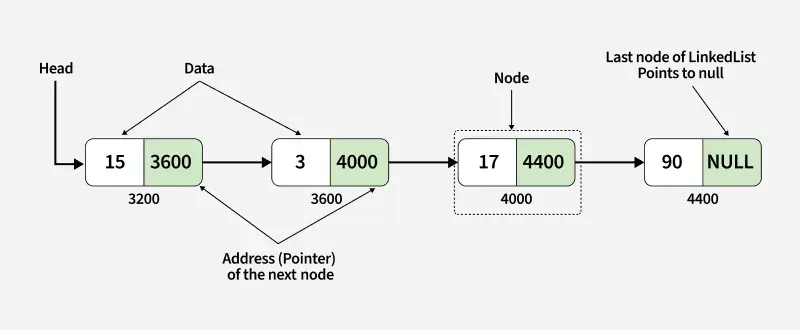

- A node contains two things first is data and second is a link that
  connects it with another node.

- The first node is called the head node and we can traverse the whole
  list using this head and next links.

Creating a Node Class in which we have defined a \_\_init\_\_ function
to initialize the node with the data passed as an argument and a
reference with None because if we have only one node then there is
nothing in its reference.

**class** **Node**:

**def** \_\_init\_\_(self, data):

self.data = data

self.next = **None**

Below is a simple example to create a singly linked list with three
nodes containing integer data.

<table style="width:99%;">
<colgroup>
<col style="width: 99%" />
</colgroup>
<thead>
<tr>
<th style="text-align: left;">
class Node:

def __init__(self, data):

self.data = data

self.next = None

​

# Create nodes

node1 = Node(15)

node2 = Node(3)

node3 = Node(17)

node4 = Node(90)

​

# Link nodes

node1.next = node2

node2.next = node3

node3.next = node4

​

head = node1 # Head points to the first node

​

# Traverse and print the linked list

current = head

while current:

print(current.data, end=" -&gt; ")

current = current.next

print("None")
</th>
</tr>
</thead>
<tbody>
<tr>
<td>
Output

15 -&gt; 3 -&gt; 17 -&gt; 90 -&gt; None
</td>
</tr>
</tbody>
</table>

Linked lists come in different forms depending on how nodes are
connected. Each type has its own advantages and is used based on problem
requirements. The main types of linked lists are:

<table style="width:32%;">
<colgroup>
<col style="width: 32%" />
</colgroup>
<thead>
<tr>
<th><ul>
<li>
<a
href="https://www.geeksforgeeks.org/dsa/singly-linked-list-tutorial/">Singly
Linked List</a>
</li>
</ul></th>
</tr>
</thead>
<tbody>
</tbody>
</table>

Advantage of singly linked list:

- Dynamic size (no fixed limit like arrays)

- Efficient insertion and deletion at beginning and end. We also have
  insertion at the middle efficient if we have reference or pointer to
  the node after which we need to insert.

- Can implement complex data structures like stack, queue, graph

Disadvantage of singly linked list:

- Extra memory required for storing pointers

- No direct/random access (need traversal)

- Cache unfriendly (not stored in contiguous memory)

<table style="width:32%;">
<colgroup>
<col style="width: 32%" />
</colgroup>
<thead>
<tr>
<th><ul>
<li>
<a
href="https://www.geeksforgeeks.org/dsa/doubly-linked-list/">Doubly
Linked List</a>
</li>
</ul></th>
</tr>
</thead>
<tbody>
</tbody>
</table>

A doubly linked list is a more complex data structure than a singly
linked list, but it offers several advantages. The main advantage of a
doubly linked list is that it allows for efficient traversal of the list
in both directions. This is because each node in the list contains a
pointer to the previous node and a pointer to the next node. This allows
for quick and easy insertion and deletion of nodes from the list, as
well as efficient traversal of the list in both directions.

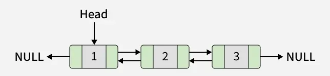

In a data structure, a doubly linked list is represented using nodes
that have three fields:

1.  Data

2.  A pointer to the next node (next)

3.  A pointer to the previous node (prev)

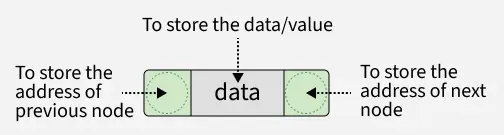

Here is how a node in a Doubly Linked List is typically represented:

class Node:

def \_\_init\_\_(self, data):

\# To store the value or data.

self.data = data

​

\# Reference to the previous node

self.prev = None

​

\# Reference to the next node

self.next = None

*Each node in a Doubly Linked List contains the data it holds, a pointer
to the next node in the list, and a pointer to the previous node in the
list. By linking these nodes together through the next and prev
pointers, we can traverse the list in both directions (forward and
backward), which is a key feature of a Doubly Linked List.*

Advantages of Doubly Linked List

- Bidirectional Traversal - You can traverse forward (using next) as
  well as backward (using prev).

- Efficient Deletion - Given a pointer to a node, you can delete it in
  O(1) time (no need to traverse from the head), since you can update
  both prev and next.

- Insertion at Both Ends - Insertion at head or tail is efficient
  because you can update both directions easily.

- Easy to Implement Deque / Navigation Features - Useful for undo/redo,
  browser history, and music playlist navigation, where both forward and
  backward movement is needed.

Disadvantages of Doubly Linked List

- Extra Memory Per Node - Each node requires an additional pointer
  (prev), making DLL more memory-consuming than singly linked list.

- More Complex Implementation - Both prev and next must be handled
  carefully during insertion and deletion, which increases chances of
  errors (broken links, null pointer issues)

- Slower Operations Due to Overhead - Extra pointer manipulations during
  insertion/deletion cause slightly more overhead compared to singly
  linked list.

- Not Cache-Friendly - Like singly linked list, nodes are scattered in
  memory, so traversals may be slower compared to arrays due to poor
  locality of reference.

<table style="width:36%;">
<colgroup>
<col style="width: 36%" />
</colgroup>
<thead>
<tr>
<th><ul>
<li>
<a
href="https://www.geeksforgeeks.org/dsa/circular-linked-list/">Circular
Linked List</a>
</li>
</ul></th>
</tr>
</thead>
<tbody>
</tbody>
</table>

A circular linked list is a data structure where the last node points
back to the first node, forming a closed loop.

- Structure: All nodes are connected in a circle, enabling continuous
  traversal without encountering NULL.

- Difference from Regular Linked List: In a regular linked list, the
  last node points to NULL, whereas in a circular linked list, it points
  to the first node.

- Uses: Ideal for tasks like scheduling and managing playlists, where
  smooth and repeated.

Circular linked lists are basically of two types from [singly linked
lists](https://www.geeksforgeeks.org/dsa/singly-linked-list-tutorial/)
and [doubly linked
lists](https://www.geeksforgeeks.org/dsa/doubly-linked-list/):

**1. Circular Singly Linked List**

In Circular Singly Linked List, each node has just one pointer called
the "next" pointer. The next pointer of the last node points back to the
first node and this results in forming a circle. In this type of Linked
list, we can only move through the list in one direction.

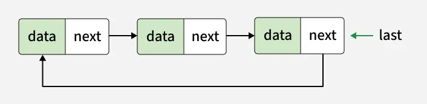

**2. Circular Doubly Linked List:**

In circular doubly linked list, each node has two pointers prev and
next, similar to doubly linked list. The prev pointer points to the
previous node and the next points to the next node. Here, in addition to
the last node storing the address of the first node, the first node will
also store the address of the last node.

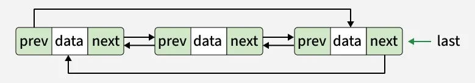

Note: Here, we will use the singly linked list to explain the working of
circular linked lists.

Representation of a Circular Singly Linked List

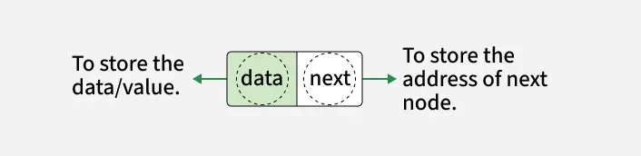

*The structure of a circular linked list.*

Create/Declare a Node of Circular Linked List

**class** **Node**:

**def** \_\_init\_\_(self, data):

self.data = data

self.next = **None**

In the code above, each node has **data** and a **pointer** to the next
node. When we create multiple nodes for a circular linked list, we only
need to connect the last node back to the first one.

Example of creating a circular linked list with three nodes (10, 20, 30,
40, 50):

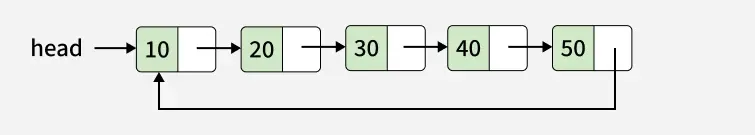

<https://www.geeksforgeeks.org/python/python-linked-list/>

<https://www.geeksforgeeks.org/dsa/singly-linked-list-tutorial/>

<https://www.geeksforgeeks.org/dsa/doubly-linked-list/>

<https://www.geeksforgeeks.org/dsa/circular-linked-list/>

**b. Stacks**

Stack is a linear data structure that follows the Last-In/First-Out
(LIFO) principle.

- The last inserted element is removed first

- Insertion operation is called push

- Deletion operation is called pop

- Both operations happen at the top of the stack

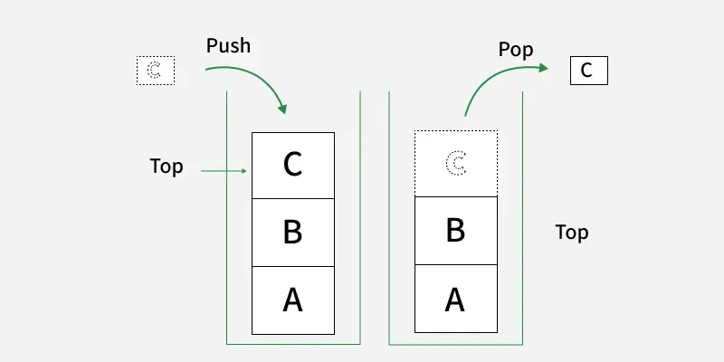

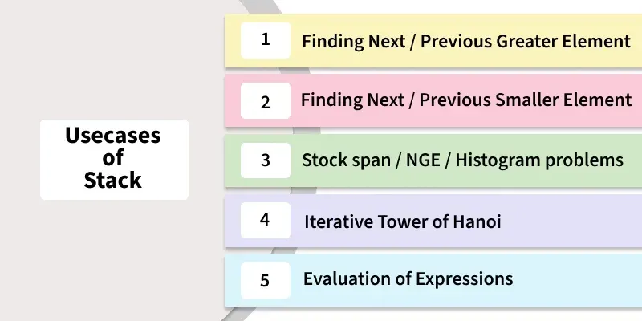

Python does not have a built-in stack type, but stacks can be
implemented using different data structures. Below are some common ways
to implement a stack:

1\. Using a List: [Python
lists](https://www.geeksforgeeks.org/python/python-lists/) support stack
operations using built-in methods like
[append()](https://www.geeksforgeeks.org/python/python-list-append-method/)
and
[pop()](https://www.geeksforgeeks.org/python/python-list-pop-method/).

- append() adds an element to the top of the stack

- While pop() removes the top element

Here, elements are added to the stack using append() and removed using
pop() in LIFO order.

<table>
<colgroup>
<col style="width: 50%" />
<col style="width: 50%" />
</colgroup>
<thead>
<tr>
<th style="text-align: left;">
st = []

st.append("a")

st.append("b")

st.append("c")

print(st)

print(st.pop())

print(st.pop())
</th>
<th>
Output:

['a', 'b', 'c']

c

b
</th>
</tr>
</thead>
<tbody>
</tbody>
</table>

<https://www.geeksforgeeks.org/python/stack-in-python/>

**c. Queues**

Queue is a linear data structure that stores items in a First In First
Out
([<u>FIFO</u>](https://www.geeksforgeeks.org/dsa/fifo-first-in-first-out-approach-in-programming/))
manner. The item that is added first will be removed first. Queues are
widely used in real-life scenarios, like ticket booking, or CPU task
scheduling, where first-come, first-served rule is followed.

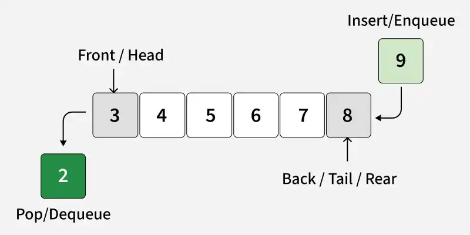

There are various ways to implement a queue in
[<u>Python</u>](https://www.geeksforgeeks.org/python/python-programming-language-tutorial/)
by following ways:

1\. Using list

[<u>Lists</u>](https://www.geeksforgeeks.org/python/python-lists/) can
be used as queues, but removing elements from front requires shifting
all other elements, making it O(n).

<table style="width:99%;">
<colgroup>
<col style="width: 99%" />
</colgroup>
<thead>
<tr>
<th style="text-align: left;">
q = []

q.append('a')

q.append('b')

q.append('c')

​

print("Initial queue:", q)

​

print("Elements dequeued from queue:")

print(q.pop(0))

print(q.pop(0))

print(q.pop(0))

​

print("Queue after removing elements:", q)
</th>
</tr>
</thead>
<tbody>
<tr>
<td>
Output

Initial queue: ['a', 'b', 'c']

Elements dequeued from queue:

a

b

c

Queue after removing elements: []
</td>
</tr>
</tbody>
</table>

**Explanation:** add elements using append() and removed from the front
using pop(0). After removing all elements, queue is empty.

2\. Using collections.deque

[Deque](https://www.geeksforgeeks.org/python/deque-in-python/)
(double-ended queue) is preferred over a list for queues because both
append() and popleft() run in O(1) time.

<table style="width:99%;">
<colgroup>
<col style="width: 99%" />
</colgroup>
<thead>
<tr>
<th style="text-align: left;">
from collections import deque

q = deque()

​

q.append('a')

q.append('b')

q.append('c')

print("Initial queue:", q)

​

print("Elements dequeued from the queue:")

print(q.popleft())

print(q.popleft())

print(q.popleft())

​

print("Queue after removing elements:", q)
</th>
</tr>
</thead>
<tbody>
<tr>
<td>
Output:

Initial queue: deque(['a', 'b', 'c'])

Elements dequeued from the queue:

a

b

c

Queue after removing elements: deque([])
</td>
</tr>
</tbody>
</table>

**Explanation:** popleft() efficiently removes the first element without
shifting, making deque ideal for queues.

[*https://www.geeksforgeeks.org/python/queue-in-python/*](https://www.geeksforgeeks.org/python/queue-in-python/)

**d. Trees**

A tree is a hierarchical, non-linear data structure made up of nodes
connected by edges. It starts with a single root node, and every child
node has exactly one parent, creating a parent-child relationship. Trees
are widely used to represent hierarchical data such as file systems,
organizational structures, XML/HTML documents and decision trees.

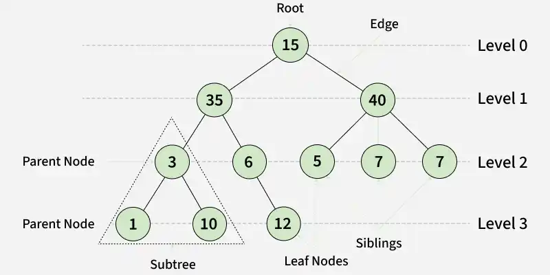

*Representation of Trees*

Basic Tree Terminologies

- Root Node: The topmost node of a tree that has no parent. Every
  non-empty tree has exactly one root node. (Example: A)

- Parent Node: A node that has one or more child nodes. (Example: B is
  the parent of D and E.)

- Child Node: A node directly connected below a parent node. (Example: D
  and E are the children of B.)

- Leaf Node (External Node): A node that has no children. (Example: F,
  G, H, I, J, and K are leaf nodes.)

- Internal Node: A node that has at least one child. (Example: A, B, C,
  and E are internal nodes.)

- Ancestor: Any node on the path from the root to a given node.
  (Example: A and B are ancestors of E.)

- Descendant: Any node that lies below another node in the tree.
  (Example: D and E are descendants of B.)

- Sibling: Nodes that share the same parent. (Example: D and E are
  siblings because both have parent B.)

- Level of a Node: The number of edges from the root node to that node.
  The root node is always at level 0.

- Neighbor: The parent or child of a node is called its neighbor.

- Subtree: A tree formed by any node along with all of its descendants.

A tree is built using nodes, where each node stores some data and
references to its child nodes. In Python, a node can be represented by
creating a class with a data field and a list to store its children.

Here, a simple Node class to represent a node in a tree.

**class** **Node**:

**def** \_\_init\_\_(self, data):

self.data = data

self.children = \[\]

Explanation:

- data stores the value of the node.

- children is a list that stores references to all child nodes.

- Each object created from the Node class represents one node in the
  tree.

Types of Tree Data Structures

Trees come in different forms, each designed for specific use cases.
Below are some of the most commonly used tree data structures.

1\. Binary Tree: a tree in which each node can have at most two
children, called the left child and right child. It is commonly used to
represent hierarchical data and forms the basis for many other tree
structures.

2\. Binary Search Tree (BST): a special type of binary tree where:

- The left subtree contains values smaller than the parent node.

- The right subtree contains values greater than the parent node.

This ordering makes searching, insertion and deletion more efficient.

3\. AVL Tree: a self-balancing Binary Search Tree. After every insertion
or deletion, it automatically balances itself so that the height
difference between the left and right subtrees of any node is at most 1.

4\. Red Black Tree: another self-balancing Binary Search Tree. It uses
color-based balancing rules to maintain an approximately balanced
structure, ensuring efficient search, insertion and deletion operations.

5\. B-Tree: a balanced tree in which each node can contain multiple keys
and multiple child nodes. It is widely used in databases and file
systems because it minimizes disk access and efficiently handles large
amounts of data.

6\. B+ Tree: a variation of the B-Tree in which all data is stored in
the leaf nodes, while internal nodes are used only for searching. The
leaf nodes are linked together, making B+ Trees ideal for fast
sequential access and database indexing.

Tree traversal technique is the process of visiting every node in a tree
exactly once in a specific order. Different traversal techniques are
used depending on how the tree needs to be processed. Three most common
depth-first traversal techniques are:

1.  Inorder Traversal: Visits the left subtree, then the root node, and
    finally the right subtree.

2.  Preorder Traversal: Visits the root node first, followed by the left
    subtree and then the right subtree.

3.  Postorder Traversal: Visits the left subtree, then the right
    subtree, and finally the root node.

<https://www.geeksforgeeks.org/python/trees-in-python/>

**e. Binary Trees**

Representation of binary tree, each node in a binary tree has three
parts:

- Data

- Pointer to the left child

- Pointer to the right child

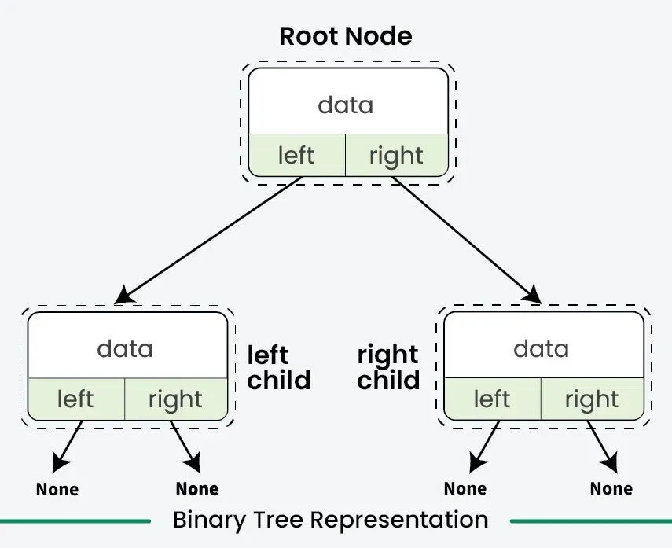

*Binary Tree Representation*

Syntax to declare a Node of Binary Tree in Python:

\# A Python class that represents

\# an individual node in a Binary Tree

class Node:

def \_\_init\_\_(self, key):

self.left = None

self.right = None

self.val = key

Here’s an example of creating a Binary Tree in Python with four nodes
(2, 3, 4, 5)

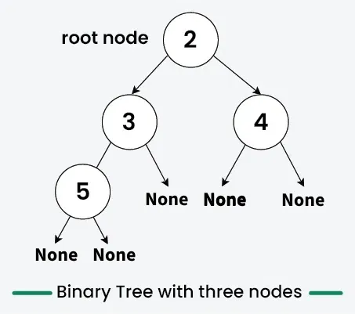

*Creating a Binary Tree having four nodes*

class Node:

def \_\_init\_\_(self, d):

self.data = d

self.left = None

self.right = None

​

\# Initialize and allocate memory for tree nodes

firstNode = Node(2)

secondNode = Node(3)

thirdNode = Node(4)

fourthNode = Node(5)

​

\# Connect binary tree nodes

firstNode.left = secondNode

firstNode.right = thirdNode

secondNode.left = fourthNode

In the above code, there are four tree nodes (firstNode, secondNode,
thirdNode, fourthNode that having values 2,3,4 and 5 respectively)

- After creating three nodes, we have connected these node to form the
  tree structure like mentioned in above image.

- link secondNode to the left child of firstNode by firstNode.left =
  secondNode.

- link thirdNode to the right child of firstNode by firstNode.right =
  thirdNode.

- link fourthNode to the left child of secondNode by secondNode.left =
  fourthNode.

Following is a list of common operations that can be performed on a
binary tree:

1\. Traversal in Binary Tree

Traversal in Binary Tree involves visiting all the nodes of the binary
tree. Tree Traversal algorithms can be classified broadly into two
categories, DFS and BFS:

\- Depth-First Search (DFS) algorithms: DFS explores as far down a
branch as possible before backtracking. It is implemented using
recursion. The main traversal methods in DFS for binary trees are:

- [Preorder
  Traversal](https://www.geeksforgeeks.org/python/preorder-traversal-of-binary-tree-in-python/)
  (current-left-right): Visits the node first, then left subtree,
  then right subtree.

- [Inorder
  Traversal](https://www.geeksforgeeks.org/python/inorder-traversal-of-binary-tree-in-python/)
  (left-current-right): Visits left subtree, then the node, then
  the right subtree.

- [Postorder
  Traversal](https://www.geeksforgeeks.org/python/postorder-traversal-of-binary-tree-in-python/)
  (left-right-current): Visits left subtree, then right subtree, then
  the node.

\- Breadth-First Search (BFS) algorithms: BFS explores all nodes at the
present depth before moving on to nodes at the next depth level. It is
typically implemented using a queue. BFS in a binary tree is commonly
referred to as [Level Order
Traversal](https://www.geeksforgeeks.org/dsa/level-order-tree-traversal/).

2\. Insertion in Binary Tree

Inserting elements means add a new node into the binary tree. There is
no such ordering of elements in the binary tree, First creates a root
node in case of empty tree. Then subsequent insertions involve
iteratively searching for an empty place at each level of the tree. When
an empty left or right child is found then new node is inserted there.
By convention, insertion always starts with the left child node.

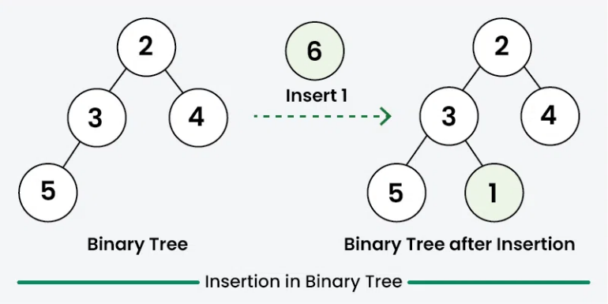

*Insertion in Binary Tree*

3\. Searching in Binary Tree

Searching for a value in a binary tree means looking through the tree to
find a node that has that value. Since binary trees do not have a
specific order like binary search trees, we typically use any traversal
method to search. The most common methods are depth-first search
(DFS) and breadth-first search (BFS). In DFS, we start from the root and
explore the depth nodes first. In BFS, we explore all the nodes at the
present depth level before moving on to the nodes at the next level. We
continue this process until we either find the node with the desired
value or reach the end of the tree. If the tree is empty or the value
isn’t found after exploring all possibilities, we conclude that the
value does not exist in the tree.

4\. Deletion in Binary Tree

Deleting a node from a binary tree means removing a specific node while
keeping the tree’s structure. First, we need to find the node that want
to delete by traversing through the tree using any traversal method.
Then replace the node’s value with the value of the last node in the
tree (found by traversing to the rightmost leaf), and then delete that
last node. This way, the tree structure won’t be effected. And remember
to check for special cases, like trying to delete from an empty tree, to
avoid any issues.

**Note:** There is no specific rule of deletion but we always make sure
that during deletion the binary tree proper should be preserved.

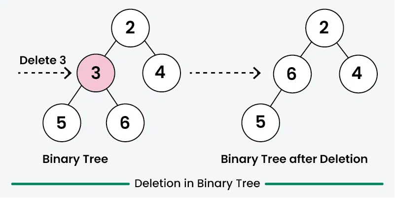

*Deletion in Binary Tree*

<https://www.geeksforgeeks.org/python/binary-tree-in-python/>

**f. Heaps**

Heap queue or heapq in Python

A heap queue (also called a priority queue) is a data structure that
allows quick access to the smallest (min-heap) or largest (max-heap)
element.

\- By default, heaps are implemented as min-heaps.

\- Smallest element is always at the root and largest element is located
among the leaf nodes of the heap.

\- Python provides a built-in module called heapq that allows to create
and work with heap queues

Example: Converting a normal list into a heap using heapify().

<table>
<colgroup>
<col style="width: 50%" />
<col style="width: 50%" />
</colgroup>
<thead>
<tr>
<th style="text-align: left;">
import heapq

li = [25, 20, 15, 30, 40]

heapq.heapify(li)

print("Heap queue:", li)
</th>
<th style="text-align: left;">
Output:

Heap queue: [15, 20, 25, 30, 40]
</th>
</tr>
</thead>
<tbody>
</tbody>
</table>

Explanation: heapq.heapify(li) rearranges the list into a heap where the
smallest element is at the root. It does not fully sort the list.

Heap queue provides an efficient way to implement priority queues and
maintain elements in heap order with minimal code and high performance,
useful in algorithms like Dijkstra's, Huffman encoding or any task
requiring quick access to smallest element, and ideal for managing
sorted data dynamically without full sorting after each operation.

Key Operations of a Heap

Heaps support several essential operations that help manage data
efficiently while maintaining heap property.

| Operation | Function | Description |
|:---|:---|:---|
| Create | heapq.heapify() | Converts a regular list into a valid min-heap |
| Push | heapq.heappush() | Adds a new element to the heap while maintaining the heap property |
| Pop | heapq.heappop() | Removes and returns the smallest element from the heap |
| Peek | heap\[0\] | Accesses the smallest element without removing it |
| Push and Pop | heapq.heappushpop() | Pushes a new element and removes the smallest element in one step |
| Replace | heapq.heapreplace() | Removes the smallest element and inserts a new element in one operation |

- Appending and Popping Elements

Elements can be inserted and removed while maintaining the heap
property:

[heapq.heappush(heap,
item)](https://www.geeksforgeeks.org/python/python-heapq-heappush-method/)
adds a new element to the heap.

[heapq.heappop(heap)](https://www.geeksforgeeks.org/python/python-heapq-heappop-method/)
removes and returns the smallest element.

<https://www.geeksforgeeks.org/python/heap-queue-or-heapq-in-python/>

**g. Basic Graph Concepts**

Graph is a non-linear data structure consisting of vertices and edges.
The vertices are sometimes also referred to as nodes and the edges are
lines or arcs that connect any two nodes in the graph. More formally a
Graph is composed of a set of vertices( V ) and a set of edges( E ). The
graph is denoted by G(V, E).

Imagine a game of football as a web of connections, where players are
the nodes and their interactions on the field are the edges. This web of
connections is exactly what a graph data structure represents, and it’s
the key to unlocking insights into team performance and player dynamics
in sports.

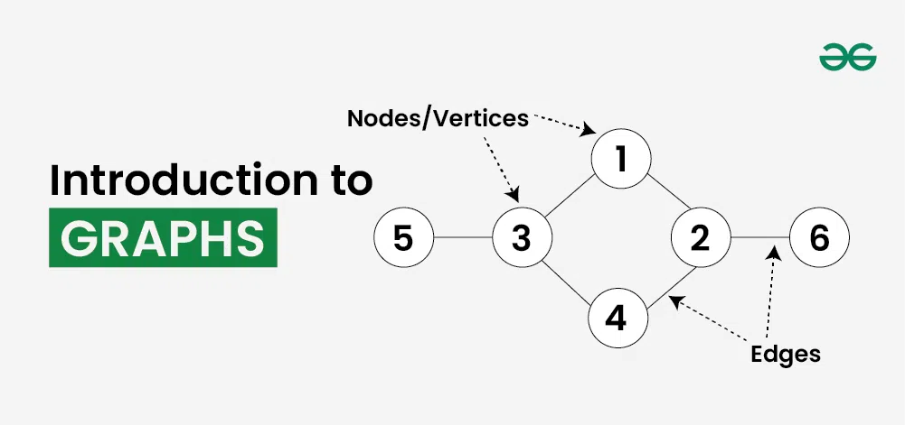

*Introduction to Graphs*

Components of Graph Data Structure

º Vertices: Vertices are the fundamental units of the graph. Sometimes,
vertices are also known as vertex or nodes. Every node/vertex can be
labeled or unlabelled.

º Edges: Edges are drawn or used to connect two nodes of the graph. It
can be ordered pair of nodes in a directed graph. Edges can connect any
two nodes in any possible way. There are no rules. Sometimes, edges are
also known as arcs. Every edge can be labelled/unlabelled.

There are multiple ways to store a graph, following are the most common
representations of graph data structure:

| ʘ Adjacency Matrix Representation of Graph Data Structure |
|:----------------------------------------------------------|

In this method, the graph is stored in the form of the 2D matrix where
rows and columns denote vertices. Each entry in the matrix represents
the weight of the edge between those vertices. 

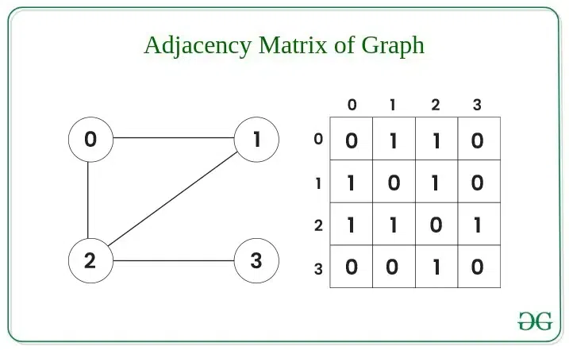

*Adjacency Matrix of Graph*

| ʘ Adjacency List Representation of Graph |
|:-----------------------------------------|

This graph is represented as a collection of linked lists. There is an
array of pointer which points to the edges connected to that vertex. 

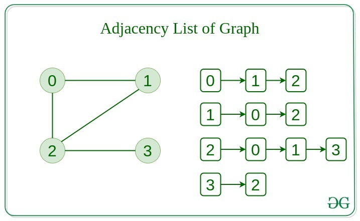

*Adjacency List of Graph*

Comparison between Adjacency Matrix and Adjacency List

When the graph contains a large number of edges then it is good to store
it as a matrix because only some entries in the matrix will be empty. An
algorithm such
as [Prim’s](https://www.geeksforgeeks.org/dsa/prims-minimum-spanning-tree-mst-greedy-algo-5/) and [Dijkstra](https://www.geeksforgeeks.org/dsa/dijkstras-shortest-path-algorithm-greedy-algo-7/) adjacency
matrix is used to have less complexity.

| Action           | Adjacency Matrix | Adjacency List |
|:-----------------|:-----------------|:---------------|
| Adding Edge      | O(1)             | O(1)           |
| Removing an edge | O(1)             | O(N)           |
| Initializing     | O(N\*N)          | O(N)           |

**Difference between Tree and Graph**

Tree is a restricted type of Graph Data Structure, just with some more
rules. Every tree will always be a graph but not all graphs will be
trees. [Linked
List](https://www.geeksforgeeks.org/dsa/linked-list-data-structure/), [Trees](https://www.geeksforgeeks.org/dsa/binary-tree-data-structure/),
and [Heaps](https://www.geeksforgeeks.org/dsa/heap-data-structure/) all
are special cases of graphs. 

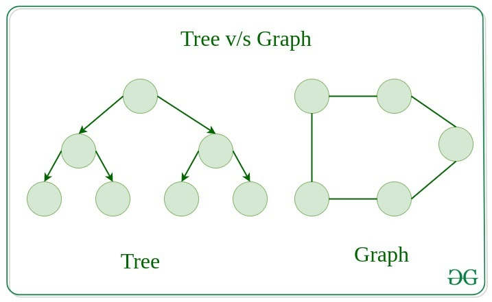

*Tree vs Graph*

<https://www.geeksforgeeks.org/python/introduction-to-graphs-in-python/>

h\. QnA Timeee!

1\. What is a linked list?\
A. A linear structure whose nodes are connected by links\
B. A fixed structure whose values occupy consecutive locations\
C. A sorted structure whose values are stored in separate files\
D. A circular structure whose nodes contain several data fields

2\. What does a node in a linked list typically contain?\
A. Two data fields and no connection to other nodes\
B. A data field and a link to another node\
C. A position number and a list of all other nodes\
D. A memory address and a fixed-size array of values

3\. What principle does a stack follow?\
A. First-In/First-Out (FIFO)\
\
B. First-In/Last-Out (FILO)\
C. Random-In/Random-Out (RIRO)

D. Last-In/First-Out (LIFO)

4\. What is the operation for removing the top element from a stack
called?\
A. Push\
B. Insert\
C. Append\
D. Pop

5\. In a FIFO queue, which item is removed first?\
A. The item added last\
B. The item added first\
C. The largest item\
D. A random item

6\. Which method is used to remove and return the front element from a
queue.Queue object?

A. pop()

B. popleft()

C. remove()

D. get()

7\. Which real-life activity is an example of queue usage?\
A. Ticket booking\
B. Drawing a picture\
C. Sorting a photo album\
D. Writing a story

8\. What type of data structure is a tree?\
A. Linear and sequential\
B. Hierarchical and non-linear\
C. Circular and linear\
D. Random and unordered

9\. What are the bottom-most nodes in a binary tree called?\
A. Roots\
B. Parents\
C. Leaves\
D. Branches

10\. What is the primary characteristic of a min-heap data structure?

A. The smallest element is at the leaf nodes.

B. Each parent node is larger than its children.

C. The smallest element is always at the root.

D. Elements are stored in a random order.

Answer Keys:

1\. A

2\. B

3\. D

4\. D

5\. B

6\. D

7\. A

8\. B

9\. C

10\. C
