CHAPTER 10 – RECURSION AND GRAPHS

**Base and Recursive Cases**

- **What is RECURSION?**

  Recursion : A programming technique where a function call itself to
  solve a problem.

  The way : Instead of solving the entire problem in ONE step, the
  function handles a SMALLER version of the same problem and keeps
  repeating till it reaches a condition that allows it to stop.

  Have u ever been pranked when opening gift boxes??

  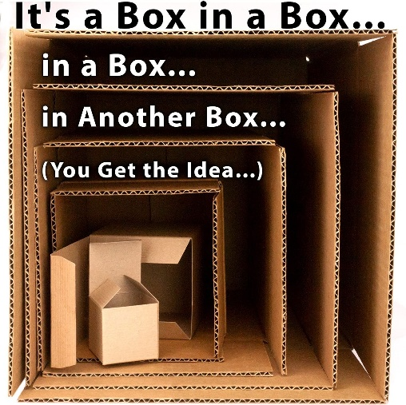

  **Figure 10.1 – Gift Box**

  Open the largest box 🡪 find a smaller box inside 🡪 Open that one 🡪
  find an even smaller box. It is repeating the process until you reach
  the final box, which contains the item you are looking for.

  Recursion works in a similar way!! A function keeps calling itself
  with a smaller or simpler input until it reaches a problem that it can
  solve directly.

A recursive function generally contains two important parts for
recursive solution:

1.  Base case: The condition that tells the function when to stop
    calling itself.

2.  Recursive case: The part where the function calls itself to solve a
    smaller version of the original problem.

- **Base case**

> The base case is the condition that STOPS recursion.
>
> It represents the simplest version of the problem that can be answered
> directly without making another recursive call.
>
> 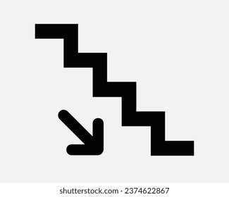 style="width:1.36806in;height:1.17984in"
> alt="1,886 Vector Stair Case Royalty-Free Images, Stock Photos &amp; Pictures ..." />
>
> Imagine walking down a staircase. You keep moving down one step at a
> time, but eventually you reach the ground floor. You cannot continue
> going down the same staircase. The ground floor acts like the BASE
> CASE.
>
> For example, consider a countdown that starts at n and stops at 0.
> Without a suitable stopping condition, a recursive function may keep
> calling itself until Python raises a “RecursionError”.
>
> 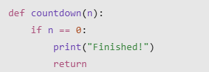 style="width:2.04177in;height:0.70837in" />

- n == 0 is the base-case condition.

- When n reaches 0, the function prints "Finished!".

- return ends the current function call.

<!-- -->

- **Recursive case**

  The recursive case is the part of a function that calls itself with a
  smaller or simpler input.

  Countdown example! The recursive case decreases the number by 1 each
  time:

  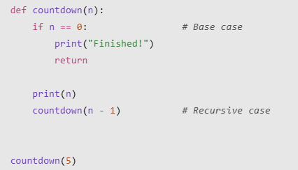

  Output:

  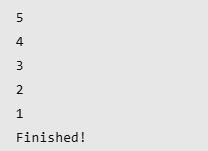

  Process Explanation:

1.  The function receives 5 and prints it.

2.  It calls itself with 4.

3.  The next call prints 4 and calls itself with 3.

4.  This continues until the function receives 0.

5.  The base case is reached, so no further recursive call is made.

> A recursive function must make progress toward its base case. In the
> countdown example, the input decreases by 1 with every call.
>
> 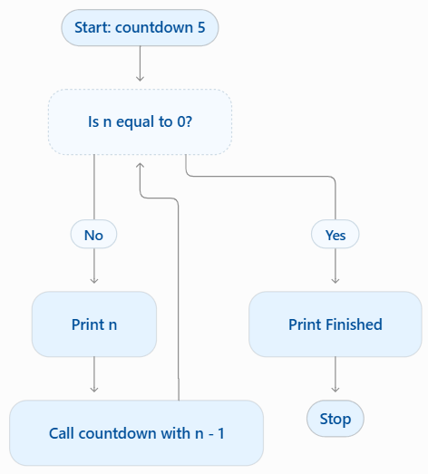 style="width:3.27795in;height:3.63213in" />

- **Factorial Example**

  The factorial of a number is the product of all positive integers from
  that specific number to 1. For instance:

  ``` math
  5! = 5 \times 4 \times 3 \times 2 \times 1 = 120
  ```

  Base case 🡪\
  ``` math
  0! = 1
  ```

  Recursive case 🡪\
  ``` math
  n! = n \times (n - 1)!
  ```

  In Python:

  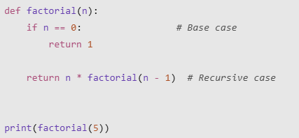

  Output: 120

  The breakdown of the code!

  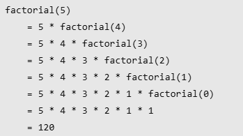

  This example assumes that n is a non-negative integer. Otherwise, it
  should check the input is valid before calculating the factorial.

  IF a recursive function DOES NOT reach a base case, in Python it might
  continue making calls until it reaches its recursion limit 🡪
  “RecursionError”

**Recursion Versus Iteration**

- Both are two ways of repeating a process in programming.

<!-- -->

- **What is ITERATION?**

  A programming technique that repeats a block of instructions using
  loops. Python commonly uses two types of loops:

<!-- -->

- for loop 🡪 Repeats instructions for each item in a sequence or over a
  specified range.

- while loop 🡪 Repeats instructions as long as a condition remains true.

> Input: 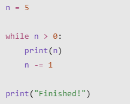 style="width:1.50702in;height:1.2084in" /> Output:
> 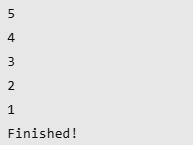 style="width:1.61225in;height:1.21127in" />
>
> Looks the same like the Recursion one before, right?
>
> The loop repeats while n \> 0. Each repetition decreases n by 1 until
> the condition becomes false.

- **Sooo, what’s the difference?**

| Aspect | Recursion | Iteration |
|----|----|----|
| Repetition Method | Function calls itself | Uses loops |
| Stopping Condition | Base case | Loop Condition |
| Memory Usage | Uses extra memory for unfinished function calls | Less additional memory (repeat instructions and not creating a new one) |
| Code Structure | Can make certain problems easier to express with shorter code. | Can be easier to understand for simple repetitive tasks. |
| Performance | Takes some additional processing time | Less additional processing work |

- **Factorial Example on Recursion vs Iteration**

| Recursion | Iteration |
|----|----|
| 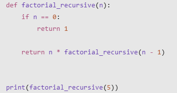 | 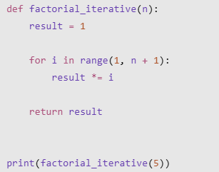 |
| Repeatedly calls the same function with smaller number | Repeatedly multiplies numbers using a for loop |

> Output for both : 120

- **Advantages and Disadvantages**

<table style="width:84%;">
<colgroup>
<col style="width: 18%" />
<col style="width: 31%" />
<col style="width: 34%" />
</colgroup>
<thead>
<tr>
<th></th>
<th><p>Recursion</p></th>
<th><p>Iteration</p></th>
</tr>
</thead>
<tbody>
<tr>
<td><p>Advantages</p></td>
<td><p>-Can make problems involving smaller versions of the same problem
easier to express.</p>
<p>-Can produce shorter and more readable code for certain problems.</p>
<p>-Is useful for naturally recursive structures and algorithms, such as
tree traversal.</p></td>
<td><p>-Often uses less additional memory for simple repetitive
tasks.</p>
<p>-Avoids the overhead of repeatedly calling a function.</p>
<p>-Is generally straightforward for counting and repeating
operations.</p></td>
</tr>
<tr>
<td><p>Disadvantages</p></td>
<td><p>-Uses additional memory for active function calls.</p>
<p>-Function calls introduce overhead.</p>
<p>-Incorrect stopping conditions can cause infinite recursion or a
RecursionError</p></td>
<td><p>-Some problems can require more complicated loop logic.</p>
<p>-Problems involving nested or recursively structured data may be less
natural to express using loops.</p></td>
</tr>
</tbody>
</table>

**Graphs: Vertices and Edges**

- **What is a graph?**

  A graph is a non-linear data structure used to represent relationships
  or connections between different objects.

  Unlike a list, which arranges elements in a sequence, a graph
  represents how different elements are connected to one another.

  A graph consists of two main components:

  - Vertices (nodes): Represent individual objects or points.

  - Edges: Represent connections between pairs of vertices.

  In Math\
  ``` math
  G = (V,E)
  ```

<!-- -->

- G : represents the graph.

- V : represents the set of vertices.

- E : represents the set of edges.

>  style="width:1.20246in;height:1.95918in" /> style="width:2.40813in;height:2.03061in"
> alt="Relation of Edges with Vertices. : r/blendermemes" />
>
> Context : Legs 🡪 Edges, Head/Body 🡪 Vertex(Node)
>
> Serious Example :
>
> 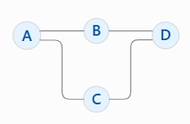 style="width:2.06122in;height:1.34512in" />
>
> In this graph:

- A, B, C, and D are vertices.

- The lines connecting them are edges.

- A is connected to B and C.

- B is connected to A and D.

- C is connected to A and D.

- D is connected to B and C.

  - **Types of Graphs**

    Classified according to how their vertices are connected

  1)  Undirected Graph

      Edges DO NOT have a specific direction. Connection between two
      vertices works in both directions.

      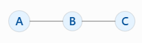

      A is connected to B then B is also connected to A, so does B and C
      relationship.

      HMMMM, if u have a bestieee, ur relationship is mutual and has no
      direction right? Just like that!! ^^

  2)  Directed Graph

      This one, the edges have a specific direction and the connections
      are represented by arrows.

      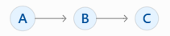

      A points to B but it does not automatically mean that B points
      back to A.

      It is only 1 direction…. Just like you like your crush but she/he
      doesn’t like you back! Oops…

  3)  Weighted Graph

      Each edge has an assigned numerical value called a weight.

      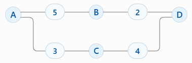

      The edge of A and B weighs 5.

      For example! If vertices represent cities, the numbers on the
      edges could represent the distances between them 😊

  4)  Unweighted Graph

      Edges do not have assigned weights. Each edge simply represents a
      connection.

      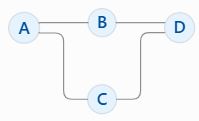

      You need to remember this!! Unweighted graphs are important
      because BFS (in further lesson) can be used to find paths
      containing the fewest edges.

**Adjacency Lists**

- **What is an ADJACENCY LIST?**

  An adjacency list is a method of representing a graph by storing a
  list of neighboring vertices for each vertex.

  For example, consider this undirected graph:

  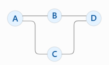

  Adjacency list :

| Vertex | Neighbors |
|--------|-----------|
| A      | B, C      |
| B      | A, D      |
| C      | A, D      |
| D      | B, C      |

In Python

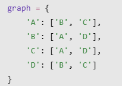 print(graph\['A'\]) 🡪 \['B',
'C'\]

To go through all neighbors of A:

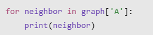 Output :
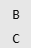

In Python, Undirected vs Directed Graph

| Undirected Graph | Directed Graph |
|----|----|
| 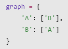 | 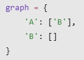 |
| A & B mutually connected | A is connected to B but not B to A |

- **Adjacency List VS. Adjacency Matrix**

  An adjacency matrix uses a two-dimensional table to show whether pairs
  of vertices are connected.

  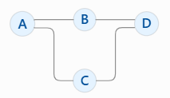

  The Matrix!!

  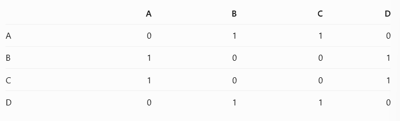

Description:

- 1 means that an edge exists between the two vertices.

- 0 means that there is no edge.

- The diagonal values are 0 because this example has no edges connecting
  a vertex to itself.

**Breadth-First Search (BFS)**

- **What is Breadth-First Search?**

  A graph traversal algorithm that explores vertices level by level,
  starting from a selected vertex.

  Instead of following one path as far as possible, BFS first explores
  all the immediate neighbours of the starting vertex. It then explores
  the neighbours of those vertices, continuing outward.

  Like when we drop a small stone into a still pond. Ripples spread
  outward from the point where the stone lands. The water closest to the
  starting point is reached first, followed by areas farther away.
  Similar with BFS !! it explores nearby vertices before exploring more
  distant ones.

- **Understanding the Queue**

  BFS uses a data structure called a queue to keep track of which
  vertices need to be explored.

  As we know, queue follows the FIFO (First In, First Out) principle.
  Which means the first item added to the queue is the first item
  removed.

  Think of people waiting in a line:

<!-- -->

- The first person to join the line is served first.

- New people join at the back.

- People leave from the front.

> A queue works in the same way. In Python, collections.deque provides
> an efficient way to add and remove items from opposite ends of a
> queue.

- **How BFS works**

  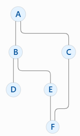 Start the BFS traversal at
  vertex A

1.  Step 1: Start at A

- A as visited.

- Add A to the queue.

> Queue: \[A\]

1.  Step 2: Explore A

- Remove A from the front of the queue.

- Its neighbors are B and C.

- Mark B and C as visited.

- Add them to the queue.

> Queue: \[B, C\]

1.  Step 3: Explore B

- Remove B from the queue.

- Its neighbors are A, D, and E.

- A has already been visited.

- Add D and E to the queue.

> Queue: \[C, D, E\]

1.  Step 4: Explore C

- Remove C from the queue.

- Its neighbors are A and F.

- A has already been visited.

- Add F to the queue.

> Queue: \[D, E, F\]

1.  Step 5: Explore D

- Remove D from the queue.

- Its only neighbor is B, which has already been visited.

> Queue: \[E, F\]

1.  Step 6: Explore E

- Remove E from the queue.

- Its neighbors are B and F.

- Both have already been visited.

> Queue: \[F\]

1.  Step 7: Explore F

- Remove F from the queue.

- Its neighbors are C and E, which have already been visited.

> Queue: \[\]
>
> The queue is now empty, so BFS finishes. The traversal order:
>
> ``` math
> A \rightarrow B \rightarrow C \rightarrow D \rightarrow E \rightarrow F
> ```
>
> The quick table:
>
> 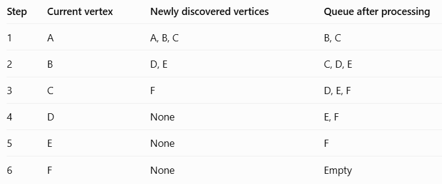 style="width:5.11137in;height:2.13205in" />
>
> In Python
>
> 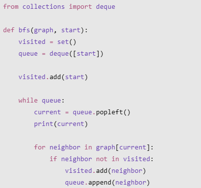 style="width:2.85431in;height:2.67375in" />
>
> 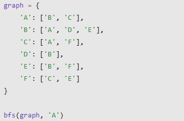 style="width:2.79592in;height:1.83314in" />
>
> The output:
>
> A
>
> B
>
> C
>
> D
>
> E
>
> F
>
> Each line code explanation:
>
> 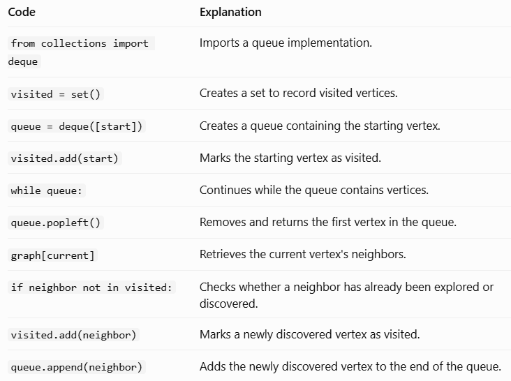 style="width:5.08359in;height:3.79186in" />
>
> The code marks a vertex as visited when it is added to the queue,
> rather than waiting until it is removed. This prevents the same vertex
> from being added multiple times by different neighbours.
>
> Application of BFS

- Maze exploration: Exploring possible paths through a maze.

- Social networks: Finding people or accounts within a certain number of
  connections.

- Network exploration: Discovering devices or nodes reachable from a
  starting point.

- Shortest paths in unweighted graphs: Finding a route with the fewest
  edges.

**Depth-First Search (DFS)**

- **What is Breadth-First Search?**

  A graph traversal algorithm that explores as far as possible along one
  path before returning to explore other paths.

  Unlike BFS, which explores level by level, DFS focuses on following
  one branch deeply before backtracking.

  Imagine exploring a building with several corridors. You choose one
  corridor and keep walking until you reach a dead end. You then return
  to the last intersection and try another corridor. This is similar to
  how DFS explores a graph.

- **How DFS works?**

  From the previous graph

  

  Starting from A:\
  ``` math
  A \rightarrow B \rightarrow D \rightarrow E \rightarrow F \rightarrow C
  ```

  The process is:

1.  Start at A.

2.  Visit B.

3.  Continue to D.

4.  D has no unvisited neighbors, so return to B.

5.  Visit E.

6.  Continue to F.

7.  Visit C.

8.  No more unvisited vertices remain.

> DFS can use a stack, which follows the LIFO (Last In, First Out)
> principle to remember which vertices it should explore next.
>
> DFS can also be implemented using recursion, because each recursive
> call explores another connected vertex.
>
> In Python (Short Recursive Implementation)
>
> 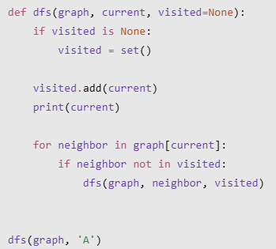 style="width:2.42374in;height:2.18761in" />

- **BFS vs. DFS**

  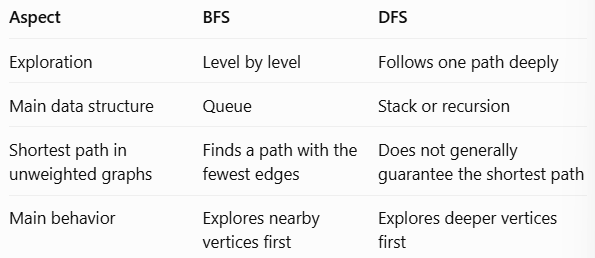

**Visited Nodes**

- **What are Visited Nodes?**

  Nodes that have already been discovered or explored during a graph
  traversal.

  When exploring a graph, an algorithm needs to keep track of which
  vertices it has already encountered.

  This is important because graphs can contain cycles.

  <u>A cycle</u> is a path that starts at a vertex and eventually
  returns to that same vertex.

  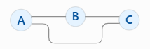 \*Imagine the nodes are
  room numbers

  You enter Room A, then Room B, and eventually discover that another
  corridor leads back to Room A.

  You do not need to explore Room A again because you have already
  visited it.

  In Python

  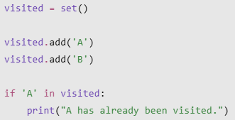 Output: A has already been
  visited.

- **Visited Nodes in BFS**

  On the previous graph

  

  Starting from A, the algorithm discovers B and C. Later, when it
  explores B, it encounters A again.

  However, A is already in the visited set, so it is not added to the
  queue again.

  A disconnected graph contains separate groups of vertices that cannot
  be reached from one another.

  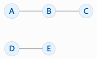

  If BFS starts at A, it can visit A, B, and C, but it cannot reach D or
  E.

  This is because there is no path connecting the two groups.

  Therefore, BFS starting from one vertex explores only the vertices
  reachable from that starting vertex.

**Path Reconstruction**

- **What is Path Reconstruction?**

  - The process of recovering the sequence of vertices that connects a
    starting vertex to a destination.

  - With BFS, the algorithm discovers vertices and explores their
    neighbours. However, simply knowing that a destination has been
    visited does not automatically tell us the route used to reach it.

  - To recover the route, we can record the parent (also called the
    predecessor) of each newly discovered vertex.

  - A parent is the vertex from which the current vertex was first
    discovered.

  - Think of going somewhere! Instead of remembering every possible
    road, you write down the previous location at each step. Once you
    reach your destination, you can follow those records backward to
    find the route.

  - For example,

    

    BFS starts at A. When a vertex is first discovered, record the
    vertex from which it was reached.

<!-- -->

- B is discovered from A, so its parent is A.

- C is discovered from A, so its parent is A.

- D is discovered from B, so its parent is B.

- E is discovered from B, so its parent is B.

- F is discovered from C, so its parent is C.

> In Python, we can make the parent dictionary
>
> 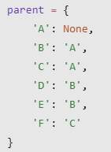 style="width:1.14583in;height:1.56841in" /> Vertex A 🡪 no parent, it’s
> where the traversal begins

- With the previous graph, suppose we want to find the path from A 🡪 F

  Start at F 🡪 Collect parent information backward

  ``` math
  F \rightarrow C \rightarrow A
  ```

  Reverse it to obtain the path from starting vertex

  ``` math
  A \rightarrow C \rightarrow F
  ```

  In Python

  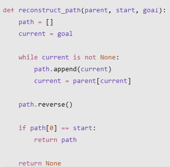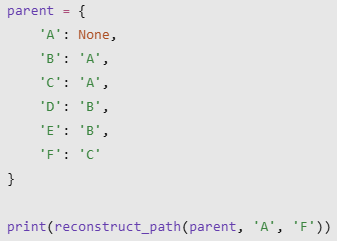 Output: \['A', 'C', 'F'\]

  Code Explanation

  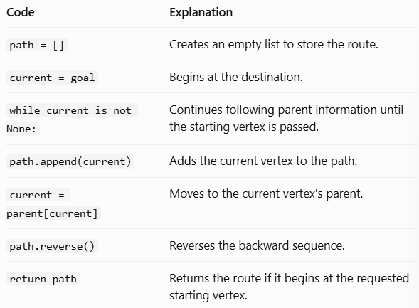

<!-- -->

- **How is it useful?**

  It is useful when an algorithm needs to provide an actual route rather
  than simply determine whether a destination can be reached.

  What can it do?

<!-- -->

- Showing the route through a maze.

- Displaying a sequence of connected locations.

- Finding a route through a network.

- Showing how one vertex is connected to another.

> BFS can record parent information during traversal, allowing a path to
> be reconstructed afterward.

**Unweighted Shortest Paths**

- **What is a Shortest Path?**

  A path : A sequence of connected vertices that allows us to travel
  from one vertex to another.

  A shortest path : A path with the smallest possible length between the
  starting vertex and the destination.

  In an unweighted graph, the length of a path is measured by the number
  of edges it contains.

  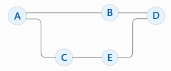 There are 2 possible paths

  1)  Two Edges Route

      ``` math
      A \rightarrow B \rightarrow D
      ```

  2)  Three Edges Route

      ``` math
      A \rightarrow C \rightarrow E \rightarrow D
      ```

  Therefore, the first route is the shortest path because it uses fewer
  edges!

- **Shortest Path with BFS**

  Starts from A 🡪 Think of it
  as levels 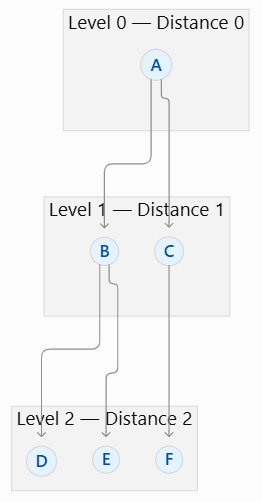

  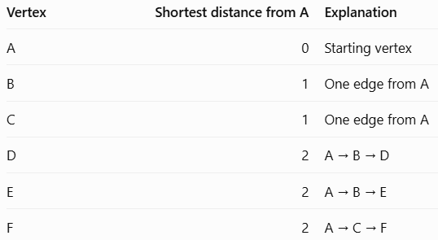

  This level-by-level exploration is what allows BFS to find the minimum
  number of edges from the starting vertex.

  In Python

  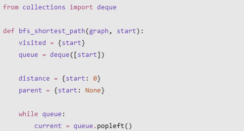

  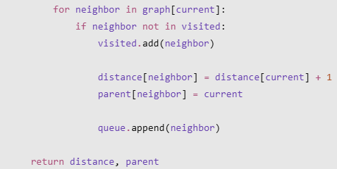

  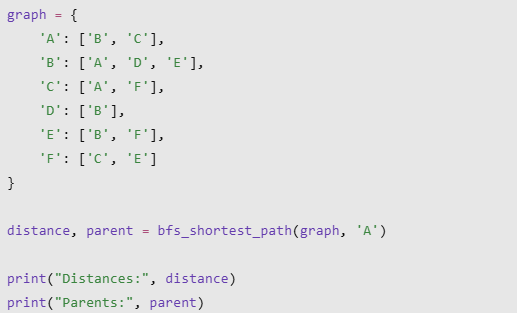

  Output:

  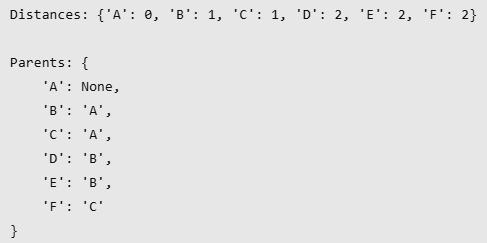

  The distance dictionary stores the shortest number of edges from A to
  each reachable vertex.

  The parent dictionary stores the previous vertex on the discovered
  shortest path.

- **The Limitation**

  It cannot be applied when it comes to weighted graphs! Because BFS
  finds the shortest path based on the number of edges only!

  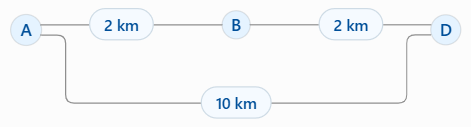

  There are two routes from A to D:

<!-- -->

- A → D: 1 edge, with a total distance of 10 km.

- A → B → D: 2 edges, with a total distance of 4 km.

> BFS considers A → D shorter because it contains fewer edges. However,
> the route through B is shorter in terms of physical distance.

**Q n A Timeee!! Wait… This time we have something different** 😊

**Practical Exercise!!**

1)  Identify the Recursive Cases

    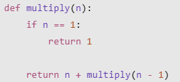

    Identify:

    - The base case

    - The recursive case

    - The result of multiply(4)

2)  Write two Python functions that print numbers from 1 to 5:

- One using recursion.

- One using a for loop.

Explain one difference between the two implementations.

3)  Create an adjacency list

    Consider a graph with these undirected connections:

- A connects to B and C.

- B connects to D.

- C connects to D and E.

- D connects to E.

Write its adjacency list using a Python dictionary.

4)  Find a shortest path

    With the same graph, find a shortest path from A to E.

    Show:

- The distance from A to E.

- The parent dictionary.

- The reconstructed path.

Answer Key

1)  The base case : if n == 1: return 1

    The recursive case : return n + multiply(n - 1)

    Multiply(4)

    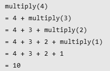

2)  Recursive Version

    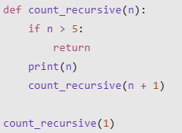

    Iterative Version

     Both outputs are the
    same 

    The difference is:

- Recursion: A function calls itself repeatedly until it reaches a base
  case.

- Iteration: A loop repeats instructions until its condition is no
  longer satisfied.

3)  Adjacency List

    

4)  Distance: A → C → E

    Parent Dictionary:

    

    Reconstructing the path :

    1)  Start from E and follow its parent until reaching A: E ← C ← A

    2)  Reverse the order to obtain the path from A to E: A → C → E

Reference

- [Introduction to Recursion — Introduction to Computer Science in
  Python: Principles and Practice (18 Jun
  2026)](https://introcs-python.cs.luc.edu/recursion/recursionintro.html)
  : https://introcs-python.cs.luc.edu/recursion/recursionintro.html

- [Recursion](https://introcs.cs.princeton.edu/python/23recursion/) :
  https://introcs.cs.princeton.edu/python/23recursion/

- [6.101: Recursion and
  Iteration](https://web.mit.edu/6.102/www/sp26/classes/11-recursive-data-types/recursion-and-iteration-review.html)
  :
  https://web.mit.edu/6.102/www/sp26/classes/11-recursive-data-types/recursion-and-iteration-review.html

- <https://courses.ics.hawaii.edu/ics311_f26/Notes/Topic-14A.html>

- <https://jhu-dsa.github.io/notes/28-shortest-path/index.html>

- <https://www.cs.cornell.edu/courses/cs312/2007sp/lectures/lec26.html>
