**CHAPTER 8 – SEARCHING AND SORTING**

**a. Linear Search**

Linear Search checks each element of a list one by one until the desired
element is found or the list ends. Given an array of n elements and an
element x, find whether element x is present in the array. Return the
index of the first occurrence of **x** in the array, or -1 if it doesn’t
exist.

Examples:

***Input:** arr\[\] = \[10, 50, 30, 70, 80, 20, 90, 40\], x = 30*

*\
**Output :** 2*

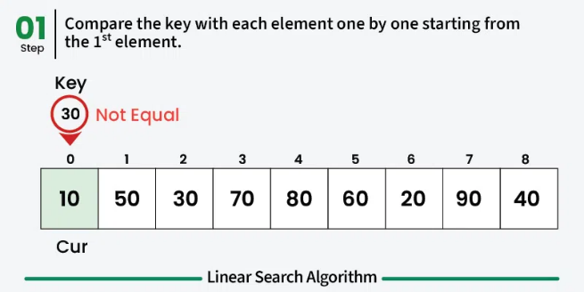
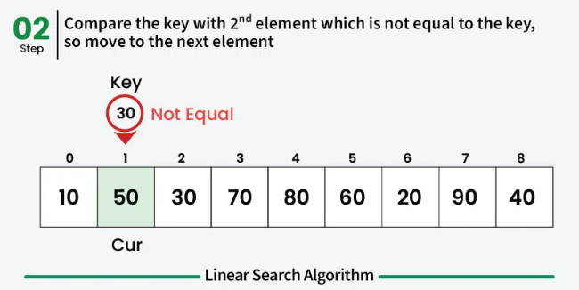

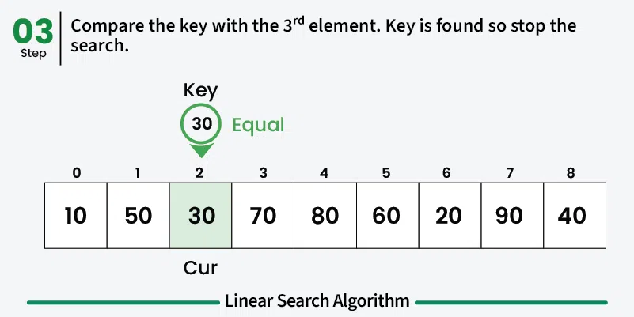

Explanation: For *array \[10, 50, 30, 70, 80, 20, 90, 40\], the element
to be searched is 30 and it is at index 2. So, the output is 2.*

**Explanation**: A simple approach is to do a **linear search**, i.e

- Start from the leftmost element of arr\[\] and one by one compare x
  with each element of arr\[\].

- If x matches with an element, return the index.

- If x doesn't match with any of the elements, return -1.

**Using Iterative Approach**

This takes an array arr and a target element to search. Iterates through
each element of the array and compares it with the target. If the target
is found, it returns its index; otherwise, it returns -1.

<table>
<colgroup>
<col style="width: 49%" />
<col style="width: 50%" />
</colgroup>
<thead>
<tr>
<th style="text-align: left;">
def linear_search(arr, x):

for i in range(len(arr)):

if arr[i] == x:

return i

return -1

​

arr = [10, 23, 45, 70, 11, 15]

x = 70

res = linear_search(arr, x)

​

if res != -1:

print("Element found at index:", res)

else:

print("Element not found in the array")
</th>
<th>
Output

Element found at index: 3
</th>
</tr>
</thead>
<tbody>
</tbody>
</table>

**Using Recursive Approach**

It checks one element per recursive call and moves to the next index
until it finds the target or reaches the end. Will be discussed more
next chapters.

<https://www.geeksforgeeks.org/python/python-program-for-linear-search/>

**b. Binary Search and Its Sorted-Data Requirement**

Binary Search is an efficient searching algorithm used to find an
element in a **sorted array** by repeatedly dividing the search interval
in half. It reduces the time complexity to O(log N), making it much
faster than linear search.

Here is working of Binary Search

1.  Find the middle element of the array.

2.  Compare the middle element with the target key. If equal: return
    index.

3.  If the key is smaller: search the left half.

4.  If the key is larger: search the right half.

5.  Repeat until the element is found or the search space is empty.

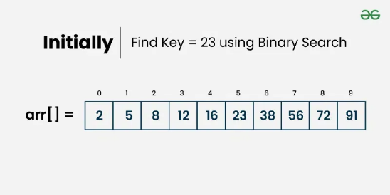
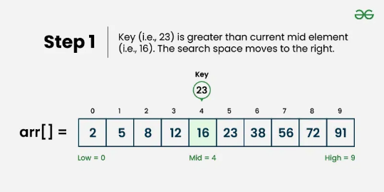

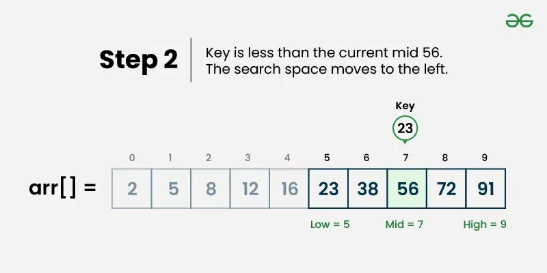
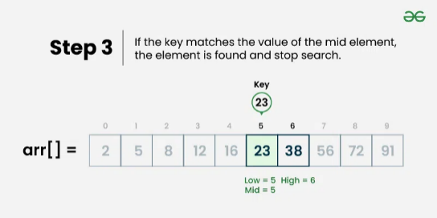

**Binary Search using the bisect**

Python provides the [<u>bisect
module</u>](https://www.geeksforgeeks.org/python/bisect-algorithm-functions-in-python/),
which offers built-in functions to maintain a list in sorted order and
perform efficient binary searches internally.

<table style="width:94%;">
<colgroup>
<col style="width: 54%" />
<col style="width: 39%" />
</colgroup>
<thead>
<tr>
<th style="text-align: left;">
import bisect

​

def binary_search_bisect(arr, x):

i = bisect.bisect_left(arr, x)

if i != len(arr) and arr[i] == x:

return i

else:

return -1

​

arr = [2, 3, 4, 10, 40]

x = 10

result = binary_search_bisect(arr, x)

​

if result != -1:

print("Element is present at index", result)

else:

print("Element is not present in array")
</th>
<th>
Output:

Element is present at index 3
</th>
</tr>
</thead>
<tbody>
</tbody>
</table>

Explanation:

- bisect_left(arr, x): finds the position where x should be inserted to
  keep arr sorted.

- Checks if x exists at that position; if yes, returns the index.

- Returns -1 if the element is not found.

**Iterative Binary Search**

This version manually performs binary search using a while loop -
efficient in both time and space.

<table style="width:98%;">
<colgroup>
<col style="width: 54%" />
<col style="width: 44%" />
</colgroup>
<thead>
<tr>
<th style="text-align: left;">
def binary_search(arr, x):

low = 0

high = len(arr) - 1

​

while low &lt;= high:

mid = low + (high - low) // 2

​

if arr[mid] &lt; x:

low = mid + 1

elif arr[mid] &gt; x:

high = mid - 1

else:

return mid

return -1

​

arr = [2, 3, 4, 10, 40]

x = 10

result = binary_search(arr, x)

​

if result != -1:

print("Element is present at index", result)

else:

print("Element is not present in array")
</th>
<th>
Output:

Element is present at index 3
</th>
</tr>
</thead>
<tbody>
</tbody>
</table>

Explanation:

- Using a while loop to implement iterative binary search .

- Initialize low and high pointers to define the search range.

- Calculates the middle index mid = low + (high - low) // 2.

- If arr\[mid\] is less than x, moves search to the right half.

- If arr\[mid\] is greater than x, moves search to the left half.

- If arr\[mid\] == x, returns the index.

- Returns -1 if the element is not found.

**Recursive Binary Search**

Recursion simplifies the logic but increases memory usage due to
function call stacks. Will be discussed more later.

<https://www.geeksforgeeks.org/python/python-program-for-binary-search/>

**c. Bubble Sort**

Bubble Sort is one of the simplest sorting algorithms. It repeatedly
compares adjacent elements in the list and swaps them if they are in the
wrong order.

How Bubble Sort Works

1.  Compare each pair of adjacent elements.

2.  If the first element is greater than the second, swap them.

3.  After each full pass, the largest unsorted element "bubbles up" to
    its correct position at the end.

4.  Repeat this process for the remaining unsorted portion of the list.

5.  The algorithm stops early if no swaps occur in a pass, meaning the
    array is already sorted.

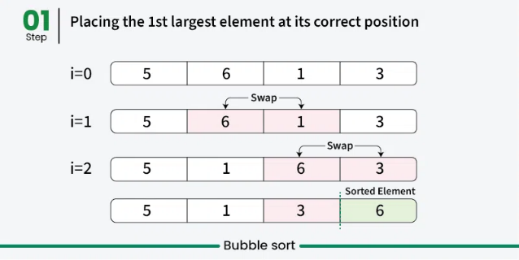
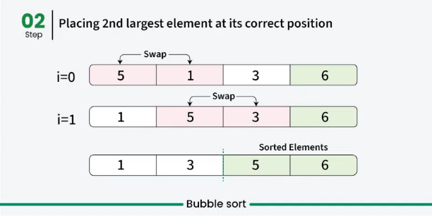

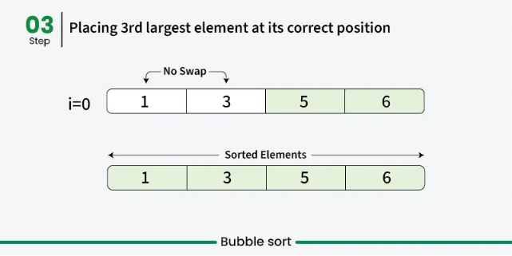

<https://www.geeksforgeeks.org/python/python-program-for-bubble-sort/>

**d. Selection Sort**

Selection Sort is one of the simplest comparison-based sorting
algorithms. It sorts an array by repeatedly finding the smallest (or
largest) element from the unsorted portion and placing it in its correct
position.

**Working of Selection Sort**

1.  Start from the first element and find the smallest element in the
    entire array by iterating over it.

2.  Swap this smallest element with the first element.

3.  Now, move to the second element find the next smallest in the
    remaining unsorted portion and swap it with the second position.

4.  Repeat this process until the entire array becomes sorted.

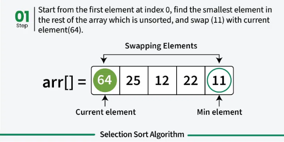
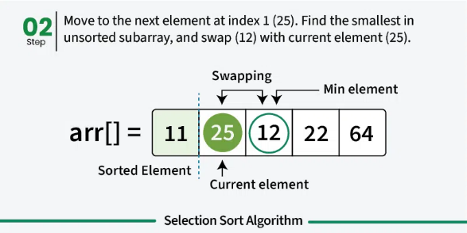

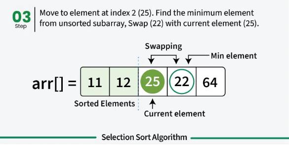
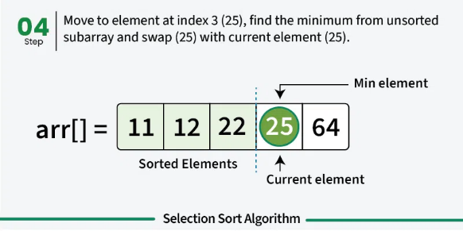

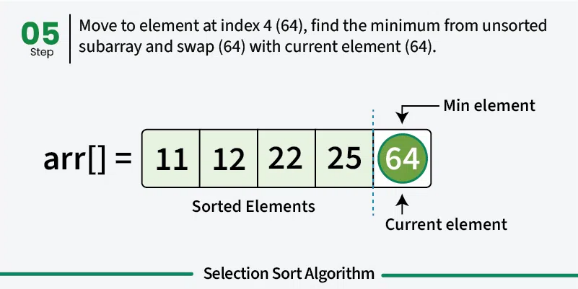
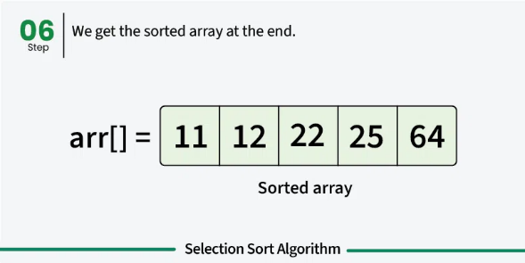

**Python Implementation**

<table style="width:99%;">
<colgroup>
<col style="width: 99%" />
</colgroup>
<thead>
<tr>
<th style="text-align: left;">
def selectionSort(array, size):

for ind in range(size - 1):

min_index = ind

​

for j in range(ind + 1, size):

if array[j] &lt; array[min_index]:

min_index = j

​

array[ind], array[min_index] = array[min_index], array[ind]

​

arr = [-2, 45, 0, 11, -9, 88, -97, -202, 747]

size = len(arr)

selectionSort(arr, size)

​

print(arr)
</th>
</tr>
</thead>
<tbody>
<tr>
<td style="text-align: left;">
Output:

[-202, -97, -9, -2, 0, 11, 45, 88, 747]
</td>
</tr>
</tbody>
</table>

Explanation:

- for ind in range(size) (Outer loop): Iterates through each index,
  treating it as the start of the unsorted portion.

- min_index = ind: Assumes the current index holds the smallest element.

- for j in range(ind + 1, size) (Inner loop): Finds the index of the
  minimum element in the unsorted part of the array.

- if array\[j\] \< array\[min_index\]: Updates min_index whenever a
  smaller element is found.

- Swap step: Exchanges the smallest found element with the first element
  of the unsorted section.

<https://www.geeksforgeeks.org/python/python-program-for-selection-sort/>

**e. Insertion Sort**

Insertion Sort is a simple and intuitive sorting algorithm that works by
building a sorted list one element at a time. It takes each element from
the unsorted portion and inserts it into the correct position in the
sorted portion.

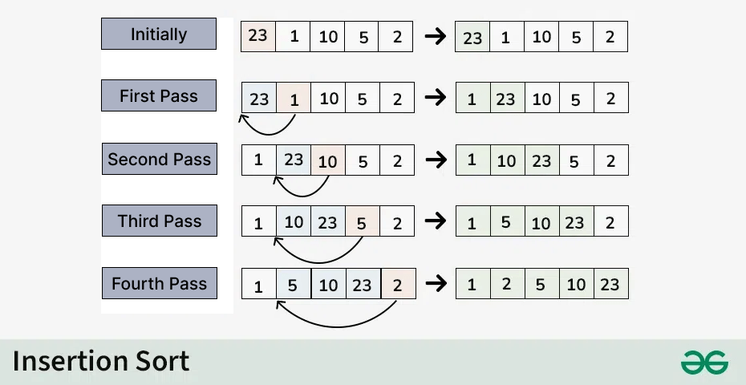

*Insertion Sort*

**How Insertion Sort Works**

1.  Start from the second element (as the first one is already
    considered sorted).

2.  Compare the current element (called key) with the elements before
    it.

3.  Shift all larger elements one position to the right.

4.  Insert the key into its correct position.

5.  Repeat until the entire array is sorted.

**f. Merge Sort**

Merge Sort is one of the most efficient and stable sorting algorithms
based on the Divide and Conquer technique. It divides an input array
into two halves, recursively sorts them, and then merges the two sorted
halves using a function called merge().

The key function, merge(arr, l, m, r), assumes that both halves
arr\[l..m\] (left half) and arr\[m+1..r\] (right half) are already
sorted and merges them into one sorted array.

How Merge Sort Works

Here’s the step-by-step breakdown:

1.  Divide: Recursively split the array into two halves until each
    subarray has only one element.

2.  Conquer: Sort each subarray individually (they’re already sorted if
    they contain one element).

3.  Merge: Combine the sorted subarrays into a single sorted array in
    the correct order.

Illustration of Merge Sort: Let’s sort the array or list \[38, 27, 43,
10\] using Merge Sort

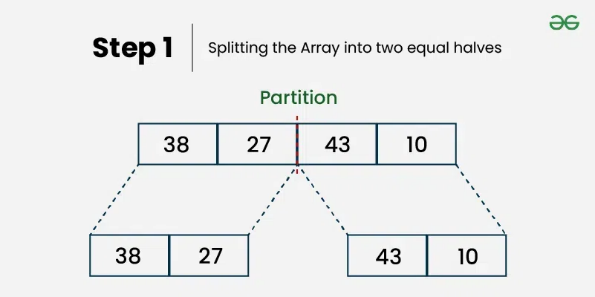
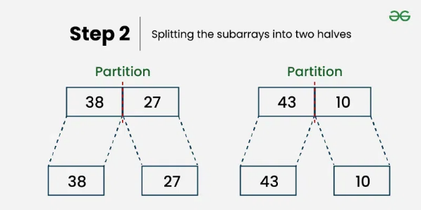

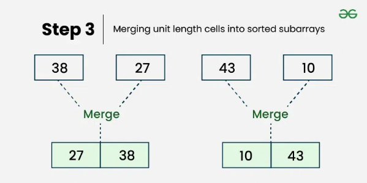
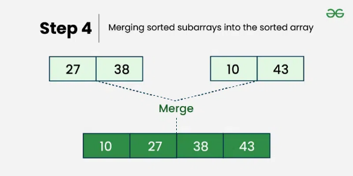

Let’s look at the working of above example:

Divide:

- \[38, 27, 43, 10\] is divided into \[38, 27 \] and \[43, 10\] .

- \[38, 27\] is divided into \[38\] and \[27\] .

- \[43, 10\] is divided into \[43\] and \[10\] .

Conquer:

- \[38\] is already sorted.

- \[27\] is already sorted.

- \[43\] is already sorted.

- \[10\] is already sorted.

Merge:

- Merge \[38\] and \[27\] to get \[27, 38\] .

- Merge \[43\] and \[10\] to get \[10,43\] .

- Merge \[27, 38\] and \[10,43\] to get the final sorted list \[10, 27,
  38, 43\]

Therefore, the sorted list is \[10, 27, 38, 43\].

Advantages of Merge Sort

- Efficient for large datasets.

- Guarantees O(n log n) performance.

- Stable sorting (preserves order of equal elements).

- Works well with linked lists.

Disadvantages of Merge Sort

- Requires additional space (O(n)).

- Slower for small datasets compared to simpler algorithms like
  Insertion Sort.

<https://www.geeksforgeeks.org/python/python-program-for-merge-sort/>

**g. Basic Comparison of Methods**

From what we learned already, here is a summary of comparison between
those methods

1.  Searching Algorithms

    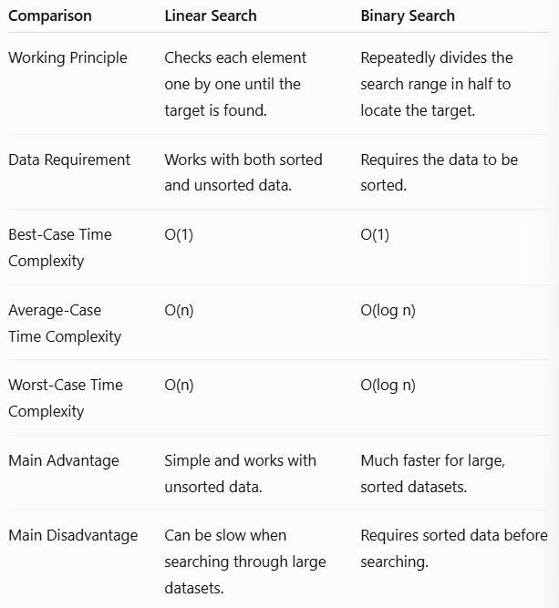

2.  Sorting Algorithms

    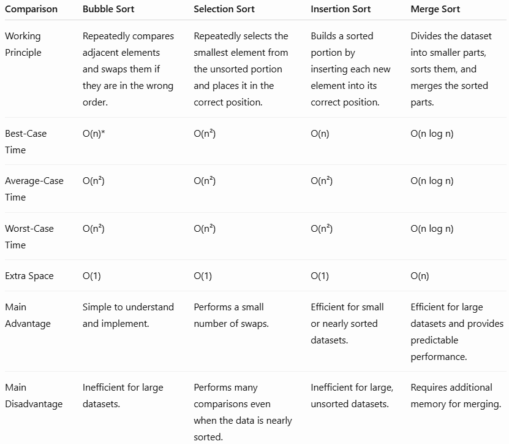

<https://www.geeksforgeeks.org/python/class-method-vs-static-method-vs-instance-method-in-python/>

**h. QnA Timeee!**

1\. What does Linear Search do?

A. Checks only the middle element\
B. Checks each element one by one until the target is found or the list
ends\
C. Requires the data to be sorted\
D. Divides the list into two halves

2\. Which searching algorithm is suitable for finding an element in a
small or unsorted dataset?

A. Binary Search\
B. Merge Sort\
C. Linear Search\
D. Selection Sort

3\. What is the main requirement for Binary Search to work correctly?

A. The data must be unsorted\
B. The data must be sorted\
C. The data must contain only strings\
D. The data must contain an even number of elements

4\. What is the first step in Binary Search?

A. Find the middle element of the search range\
B. Find the last element\
C. Sort the data randomly\
D. Compare every element one by one

5\. When can an optimized Bubble Sort stop early?

A. When the first element is the largest\
B. When no swaps occur during a complete pass\
C. After completing only one comparison\
D. When the list contains more than ten elements

6\. Which technique is Merge Sort based on?

A. Greedy\
B. Brute Force\
C. Dynamic Programming\
D. Divide and Conquer

7\. How does Bubble Sort work?

A. Finds the smallest element and swaps it with the first element\
B. Compares adjacent elements and swaps them if they are in the wrong
order, causing the largest unsorted element to move toward the end\
C. Divides the dataset into two halves and merges them\
D. Inserts each element into its correct position in the sorted portion

8\. Which sorting algorithm is generally more suitable for small or
nearly sorted datasets?

A. Merge Sort\
B. Insertion Sort\
C. Selection Sort\
D. Bubble Sort

9\. What is the average-case time complexity of Merge Sort?

A. O(1)\
B. O(n)\
C. O(n²)\
D. O(n log n)

10\. Which statement correctly compares Linear Search and Binary Search?

A. Both require sorted data\
B. Linear Search is always faster than Binary Search\
C. Binary Search requires sorted data and is generally faster for large
datasets\
D. Binary Search checks every element one by one

**Answer Key**

| 1   | B   |
|-----|-----|
| 2   | C   |
| 3   | B   |
| 4   | A   |
| 5   | B   |
| 6   | D   |
| 7   | B   |
| 8   | B   |
| 9   | D   |
| 10  | C   |
