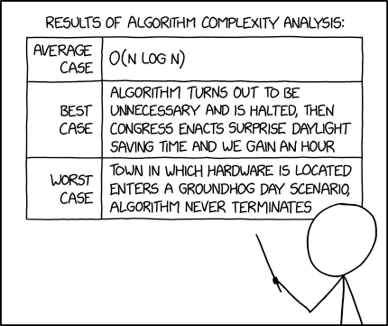

**CHAPTER 9 -- ALGORITHM ANALYSIS**

**a. Best and Worst Cases**

**1. Worst Case Analysis (Mostly used) **

- In the worst-case analysis, we calculate the upper bound on the
  running time of an algorithm. We must know the case that causes a
  maximum number of operations to be executed.

- For [Linear Search](https://www.geeksforgeeks.org/dsa/linear-search/),
  the worst case happens when the element to be searched (x) is not
  present in the array. When x is not present, the search() function
  compares it with all the elements of arr\[\] one by one.

- This is the most commonly used analysis of algorithms (We will be
  discussing below why). Most of the time we consider the case that
  causes maximum operations.

**2. Best Case Analysis (Very Rarely used) **

- In the best-case analysis, we calculate the lower bound on the running
  time of an algorithm. We must know the case that causes a minimum
  number of operations to be executed.

- For [linear search](https://www.geeksforgeeks.org/dsa/linear-search/),
  the best case occurs when x is present at the first location. The
  number of operations in the best case is constant (not dependent on
  n). So the order of growth of time taken in terms of input size is
  constant.

**3. Average Case Analysis (Rarely used) **

- In average case analysis, we take all possible inputs and calculate
  the computing time for all of the inputs. Sum all the calculated
  values and divide the sum by the total number of inputs.

**Why is Worst Case Analysis Mostly Used?**

**Average Case:** The average case analysis is not easy to do in most
practical cases and it is rarely done. In the average case analysis, we
need to consider every input, its frequency and time taken by it which
may not be possible in many scenarios

**Best Case:** Best-case analysis is of limited value, as knowing a
lower bound gives little insight when the algorithm’s worst-case running
time can be extremely large.

**Worst Case:** This is easier than average case and gives an upper
bound which is useful information to analyze software products.

**Linear search algorithm:**

<table>
<colgroup>
<col style="width: 49%" />
<col style="width: 50%" />
</colgroup>
<thead>
<tr>
<th style="text-align: left;">
# Linearly search target in arr.

# If target is present, return the index;

# otherwise, return -1

def search(arr, x):

for i in range(len(arr)):

if arr[i] == x:

return i

return -1

​

if __name__ == '__main__':

arr = [1, 10, 30, 15]

x = 30

print(search(arr, x))
</th>
<th>
Output

2
</th>
</tr>
</thead>
<tbody>
</tbody>
</table>

**Best Case:** Constant Time irrespective of input size. This will take
place if the element to be searched is on the first index of the given
list. So, the number of comparisons, in this case, is 1.

**Average Case:** Linear Time, This will take place if the element to be
searched is at the middle index (in an average search) of the given
list.

**Worst Case:** The element to be searched is not present in the list

<https://www.geeksforgeeks.org/dsa/worst-average-and-best-case-analysis-of-algorithms/>

**b. Time and Space Complexity**

To measure performance of algorithms, we typically use time and space
complexity analysis. The idea is to measure [order of
growths](https://www.geeksforgeeks.org/gate/order-o-f-growth/) in terms
of input size.

- Independent of the machine and its configuration, on which the
  algorithm is running on.

- Shows a direct correlation with the number of inputs.

- Can distinguish two algorithms clearly without ambiguity.

**Time Complexity:** The time complexity of an algorithm quantifies the
amount of time taken by an algorithm to run as a function of the length
of the input. Note that the time to run is a function of the length of
the input and not the actual execution time of the machine on which the
algorithm is running on.

The valid algorithm takes a finite amount of time for execution. The
time required by the algorithm to solve given problem is called ***time
complexity *** of the algorithm. Time complexity is very useful measure
in algorithm analysis.

It is the time needed for the completion of an algorithm. To estimate
the time complexity, we need to consider the cost of each fundamental
instruction and the number of times the instruction is executed.

Example 1: Addition of two scalar variables.

Algorithm ADD SCALAR(A, B)\
//Description: Perform arithmetic addition of two numbers\
//Input: Two scalar variables A and B\
//Output: variable C, which holds the addition of A and B\
C \<- A + B\
return C

The addition of two scalar numbers requires one addition operation. the
time complexity of this algorithm is constant, so T(n) = O(1) .

In order to calculate time complexity on an algorithm, it is assumed
that a **constant time c** is taken to execute one operation, and then
the total operations for an input length on **N** are calculated.
Consider an example to understand the process of calculation: Suppose a
problem is to [<u>find whether a pair **(X, Y)** exists in an array, A
of **N** elements whose sum is
**Z**</u>](https://www.geeksforgeeks.org/dsa/check-if-pair-with-given-sum-exists-in-array/).
The simplest idea is to consider every pair and check if it satisfies
the given condition or not.

The pseudo-code is as follows:

int a\[n\];\
for(int i = 0;i \< n;i++)\
cin \>\> a\[i\]\
\
for(int i = 0;i \< n;i++)\
for(int j = 0;j \< n;j++)\
if(i!=j && a\[i\]+a\[j\] == z)\
return true\
return false

Below is the implementation of the above approach:

<table style="width:92%;">
<colgroup>
<col style="width: 56%" />
<col style="width: 36%" />
</colgroup>
<thead>
<tr>
<th style="text-align: left;">
# Python3 program for the above
approach

​

# Function to find a pair in the given

# array whose sum is equal to z

def findPair(a, n, z) :

# Iterate through all the pairs

for i in range(n) :

for j in range(n) :

​

# Check if the sum of the pair

# (a[i], a[j]) is equal to z

if (i != j and a[i] + a[j] == z) :

return True

​

return False

​

# Driver Code

​

# Given Input

a = [ 1, -2, 1, 0, 5 ]

z = 0

n = len(a)

​

# Function Call

if (findPair(a, n, z)) :

print("True")

else :

print("False")

# This code is contributed by splevel62.
</th>
<th>
Output:

False
</th>
</tr>
</thead>
<tbody>
</tbody>
</table>

Hence, the time complexity is **O(N2)** for the above algorithm. Note
that the time complexity is solely based on the number of elements in
array **A** i.e the input length, so if the length of the array will
increase the time of execution will also increase.

**Order of growth** is how the time of execution depends on the length
of the input. In the above example, it is clearly evident that the time
of execution quadratically depends on the length of the array. Order of
growth will help to compute the running time with ease.

**Space Complexity: Definition –**

Problem-solving using computer requires memory to hold temporary data or
final result while the program is in execution. The amount of memory
required by the algorithm to solve given problem is called space
complexity of the algorithm.

The space complexity of an algorithm quantifies the amount of space
taken by an algorithm to run as a function of the length of the input.
Consider an example: Suppose a problem to find the [frequency of array
elements](https://www.geeksforgeeks.org/dsa/counting-frequencies-of-array-elements/).

It is the amount of memory needed for the completion of an algorithm. 

To estimate the memory requirement we need to focus on two parts: 

\(1\) A fixed part: It is independent of the input size. It includes
memory for instructions (code), constants, variables, etc.

\(2\) A variable part: It is dependent on the input size. It includes
memory for recursion stack, referenced variables, etc.

Example : Addition of two scalar variables

Algorithm ADD SCALAR(A, B)\
//Description: Perform arithmetic addition of two numbers\
//Input: Two scalar variables A and B\
//Output: variable C, which holds the addition of A and B\
C \<— A+B\
return C

The addition of two scalar numbers requires one extra memory location to
hold the result.

Thus the space complexity of this algorithm is constant, hence S(n) =
O(1).

<https://www.geeksforgeeks.org/dsa/time-complexity-and-space-complexity/>

**c. Big O**

Big O notation is used to describe the time or space complexity of
algorithms. Big-O is a way to express an upper bound of an algorithm’s
time or space complexity.

Big O notation is the language engineers use to describe how an
algorithm’s cost grows as the input gets bigger, and once you can read
it you stop guessing about performance and start predicting it.

Here is the everyday version. Say a user named Aditi asks you to find
her name in a phone book. If the book is sorted, you flip to the middle,
decide left or right, and keep halving. Doubling the size of the book
adds just one extra flip. Now imagine instead you read every single page
from the front. Double the book and you double the work.

Those two strategies have completely different *shapes*, and Big O is
how we name that shape. It does not care that one laptop is faster than
another. It cares about what happens when the input grows from a
thousand rows to ten million.

**What Big O Actually Measures?**

Big O describes the upper bound on how an operation’s cost scales with
the size of its input, which we call n. We deliberately throw away
constants and small terms, because they stop mattering once n is large.
A function that does 3n + 50 steps is still O(n), because when n is a
million, the 3 and the 50 vanish into the noise. What survives is the
shape of the curve.

Think of it like planning a dinner. Chopping vegetables for four guests
versus four hundred is a linear job: ten times the guests, roughly ten
times the chopping. But if every guest has to greet every other guest
before eating, the greetings do not grow linearly, they explode. That
gap between “grows steadily” and “explodes” is the whole game.

<https://technoscripts.com/python-big-o-notation/>

**d. Common Growth Rates**

Big O Notation is a mathematical notation used to describe the upper
bound on **the growth rate** of an algorithm’s time and space
complexity. It provides a high-level overview of how an algorithm’s
performance scales with input size. So, Common Growth Rates are used to
measure both time complexity and space complexity. Big-O notation
describes the worst-case performance of an algorithm as the input size
grows. It helps compare algorithm efficiency and is crucial for
technical interviews.

**Key Principle:**

Big-O describes the **growth rate**, not exact runtime. We care about
behavior as n → ∞.

<https://www.techinterview.org/big-o-cheat-sheet/>

**e. Brief Explanation on Average Cases**

Earlier, we looked at the process of analyzing the worst-case running
time of an algorithm, and the use of worst-case analysis and big-O
notation as a way of describing it.

In this section, we will look average-case complexity. Just as the
worst-case complexity describes an upper bound on the worst-case time we
would see when running an algorithm, average case complexity will
present an upper bound on the average time we would see when running the
program many times on many different inputs.

Worst-case complexity gets used more often than average-case. There are
a number of reasons for this.

- The worst-case complexity is often easier to compute than the average
  case. Just figuring out what an “average” set of inputs will look like
  is often a challenge. To figure out the worst case complexity, we only
  need to identify that one single input that results in the slowest
  running.

- In many cases, it will turn out the worst and average complexity will
  turn out to be the same.

- Finally, reporting the worst case to your boss or your customers is
  often “safer” than reporting the average.

The Input Distribution is Key

That average case complexity can vary considerably depending upon just
what constitutes an “average” set of inputs.

Utility functions that get used in many different programs may see
different input distributions in each program, and so their average
performances in different programs will vary accordingly.

<https://www.cs.odu.edu/~zeil/cs361/latest/Public/averagecase/index.html>

**f. Measuring Runtime**

Measuring the execution time of a Python program is useful for
performance analysis, benchmarking, and optimization. Python provides
several built-in modules to achieve this with ease. In this article,
we'll explore different ways to measure how long a Python program takes
to run.

ΘΘ Using the timeit Module

**timeit** module is specifically designed to measure the execution time
of small code snippets with high precision. It avoids many common timing
pitfalls.

<table>
<colgroup>
<col style="width: 63%" />
<col style="width: 36%" />
</colgroup>
<thead>
<tr>
<th style="text-align: left;">
import timeit

​

s = "from math import sqrt"

​

t = '''

def example():

mylist = []

for x in range(100):

mylist.append(sqrt(x))

example()

'''

​

print(timeit.timeit(setup=s, stmt=t, number=10000))
</th>
<th>
Output:

0.08390588600002502
</th>
</tr>
</thead>
<tbody>
</tbody>
</table>

Explanation:

- s runs once to import necessary functions.

- t defines a small function that computes square roots.

- timeit.timeit() executes the code 10,000 times and returns the total
  time taken.

***Note:** Output will vary depending on your system speed and CPU
load.*

<https://www.geeksforgeeks.org/python/python-measure-time-taken-by-program-to-execute/>

**g. Limits of Theoritical Comparisons**

Big O notation is a powerful tool in computer science, used for
describing the performance or complexity of an algorithm. However, like
any tool, it has its limitations and is not always the definitive guide
for algorithm efficiency. Let’s delve into the intricacies of Big O
notation and explore its boundaries.

Big O notation essentially provides an upper bound on the growth rate of
an algorithm’s running time or space requirements as the input size
grows. It’s a part of a family of notations known as Bachmann–Landau or
asymptotic notation. The ‘O’ in Big O stands for ‘Order’, indicating the
order of approximation of the function’s growth rate.

**The Limitations of Big O are**

Oversimplification of Real-World Performance

Big O notation focuses on the asymptotic behavior of an algorithm,
describing its performance as the input size approaches infinity. This
simplification means it doesn’t always accurately predict performance
for small or moderate input sizes.

For example, an algorithm with a higher Big O complexity might still be
faster for small datasets due to lower overhead.

Ignoring Constant Factors and Lower-Order Terms

One of the primary criticisms of Big O notation is that it disregards
constant factors and lower-order terms. This means that two algorithms
with the same Big O notation might have vastly different real-world
performance due to these ignored factors. For small input sizes, these
constants and lower-order terms can significantly affect the runtime.

Input-Dependent Performance

Big O notation often provides a worst-case or average-case analysis,
which might not reflect the actual performance in specific scenarios.
Some algorithms perform exceptionally well on certain types of input but
poorly on others. For example, the Quicksort sorting algorithm has an
average time complexity of (O(n log n)), but in a worst-case scenario,
it can have (O(n^2)) complexity.

Space Complexity Considerations

Big O notation primarily focuses on time complexity but sometimes
neglects space complexity. An algorithm might be time-efficient but
consume excessive memory, making it impractical for resource-constrained
environments.

Lack of Consideration for Hardware Specifics

Big O notation abstracts away the hardware specifics. It does not
account for the architecture of the machine on which the algorithm runs,
which can influence the actual performance. Factors such as CPU cache,
memory speed, and parallel processing capabilities are not reflected in
Big O analysis.

Theoretical Nature

Big O is theoretical and does not always represent practical
performance. It’s based on the assumption that we’re only interested in
the growth rate as the input size approaches infinity, which may not be
practical for finite and often small input sizes in real-world
scenarios.

**Alternative Metrics for Complex Algorithm Analysis**

Given the limitations of Big O notation, it’s essential to consider
alternative metrics that can provide a more nuanced view of an
algorithm’s performance.

Empirical Analysis

Empirical analysis involves running the algorithm with different input
sizes and measuring the actual running time. This method considers the
constant factors and hardware specifics that Big O notation overlooks.

Space-Time Tradeoffs

Analyzing the tradeoff between space and time complexity can offer
insights into the efficiency of an algorithm. Sometimes, an algorithm
can be optimized for space at the expense of time, or vice versa,
depending on the application’s requirements.

Graph Comparison Metrics

For data structures like graphs, metrics for graph comparison such as
spectral distances and node affinities can be used to analyze structural
similarities and differences.

<https://deepdatawithmivaa.com/what-are-the-limitations-of-big-o/>

<https://medium.com/@theodoretsori/the-limits-of-big-o-when-does-it-fall-short-a1f9ccd61702>

**h. QnA Timeee!**

1\. What does worst-case analysis measure?\
A. The minimum number of operations\
B. The maximum number of operations\
C. The average memory used\
D. The exact running time on a specific computer\
\
2\. In linear search, when does the worst case occur?\
A. The target is the first element\
B. The target is the middle element\
C. The target is not in the array\
D. The array is already sorted\
\
3\. Why is average-case analysis often difficult?\
A. It only considers the largest input\
B. It requires considering possible inputs, their likelihood, and their
running times\
C. It cannot be used for sorting algorithms\
D. It depends only on the computer’s processor\
\
4\. Why is worst-case analysis commonly used?\
A. It provides a useful upper bound and is easier to calculate than
average-case analysis\
B. It always gives the exact running time\
C. It measures only the best possible performance\
D. It does not depend on the input\
\
5\. What does time complexity describe?\
A. The exact number of seconds an algorithm takes on one machine\
B. How an algorithm’s running time grows with the input size\
C. The cost of buying a computer\
D. The number of lines in the progra\
\
6\. What does Big O notation describe?\
A. An algorithm’s exact runtime on a specific computer\
B. The growth rate of an algorithm’s time or space requirements\
C. The number of lines in an algorithm\
D. The programming language used to write an algorithm\
\
7\. What does the “O” in Big O stand for?\
A. Operation\
B. Output\
C. Optimization\
D. Order

8\. What does Big O notation describe?\
A. An algorithm’s exact runtime on every computer\
B. An upper bound on how an algorithm’s time or space requirements grow\
C. The number of instructions in the source code\
D. The amount of memory available on a computer\
\
9\. Why might Big O notation not accurately predict performance on small
datasets?\
A. It focuses on behavior as input size becomes very large\
B. It measures only the algorithm’s source-code length\
C. It always assumes the algorithm uses no memory\
D. It includes hardware details in its calculations\
\
10\. Why can hybrid algorithms be difficult to analyze with a single Big
O expression?\
A. They use more than one programming language

B. They cannot be tested on real computers\
C. Their behavior may change depending on the input\
D. They always have constant-time performance\
\
11\. Why should space complexity also be considered?\
A. An algorithm may use too much memory, even if it runs quickly\
B. Big O cannot describe memory use\
C. Memory use is always more important than runtime\
D. Space complexity measures CPU speed\
\
12\. Which hardware factor may affect actual performance but is not
reflected in Big O analysis?\
A. The algorithm’s name\
B. The number of comments in the code\
C. The file extension\
D. CPU cache

Answer Key\
\
1\. B\
2\. C\
3\. B\
4\. A\
5\. B

6\. B

7\. D

8\. B

9\. A

10\. C

11\. A

12\. D
