CHAPTER 18 – BUBBLE SORT

We already studied about Bubble Sort before, now it’s the implementation
project!

Follow these steps :D

1)  Create a new folder 🡪 “BubbleSortProject”

    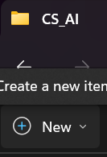
    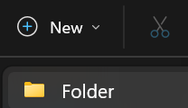
    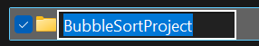

2)  Create a New File in VS Code 🡪 “main.py”

    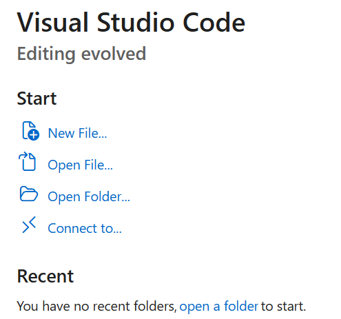
    

    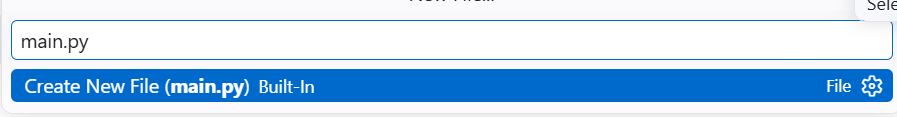

3)  Enter Title

    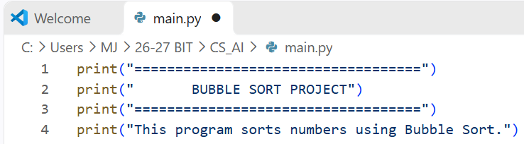

    Output:

    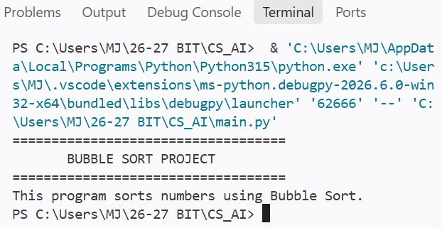

    Explanation

- print() displays text in the terminal.

- The lines of equal signs make the program title easier to distinguish.

- This is the introduction displayed whenever the program starts.

4)  Enter Numbers

    Add codes as below:

    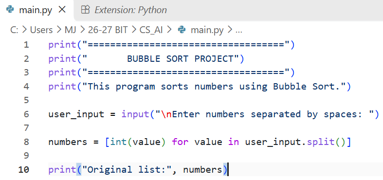

    Output:

    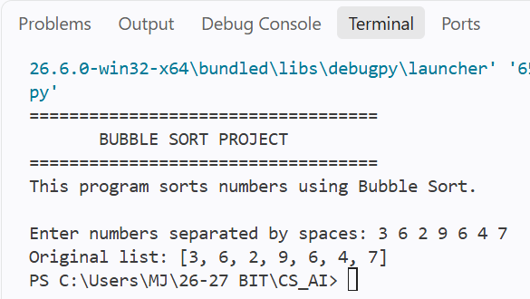

    Explanation:

- input() receives information entered by the user.

- split() separates the numbers whenever there is a space.

- int() converts each input into an integer.

- The list comprehension stores the converted numbers in a Python list.

5)  Ask user to choose sorting order

    2 choices : Ascending order (smallest to largest) and Descending
    order (largest to smallest)

    Add codes as below:

    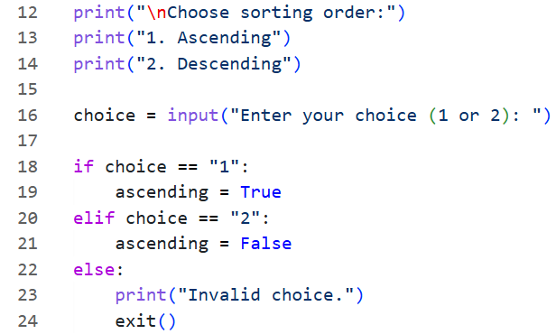

    Explanation:

    The if and elif statements check which option the user selects.

- ascending = True tells the sorting function to arrange numbers from
  smallest to largest.

- ascending = False tells it to arrange numbers from largest to
  smallest.

- exit() ends the program if the user enters an invalid option.

6)  Define Bubble Sort function

    Add codes as below:

    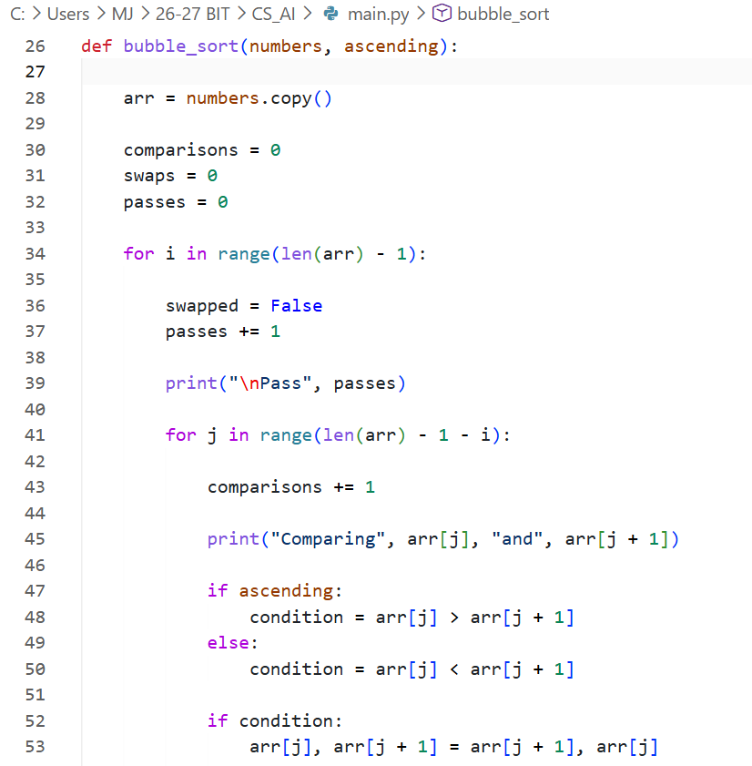

    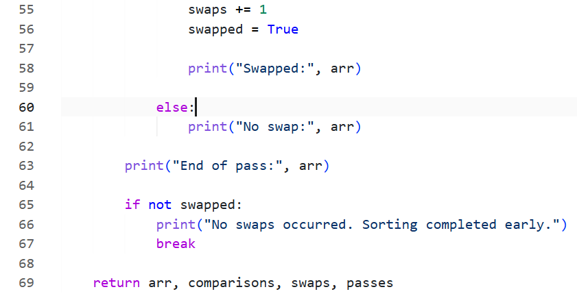

    This is the main function of our project now 🡪 the function that
    will process numbers and sort it with Bubble Sort

    Explanation:

- Create the copy of the original list

  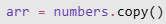

- Initialize the counters

  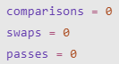 These variables keep track
  of how many comparisons, swaps, and passes are performed.

- Outer loop

  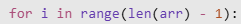 🡪 Controls how many passes
  the algorithm performs

  A list with n elements, maximum number of passes is n-1

- Inner Loop

  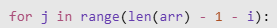 The inner loop compares
  adjacent elements.

  The - i part reduces the number of comparisons after each pass because
  the elements at the end of the list are already in their correct
  positions.

- Compare Elements

  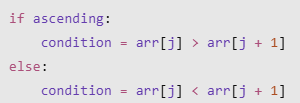

  The program checks whether the two adjacent elements are in the wrong
  order.

  For ascending order, swap if the left element is greater.

  For descending order, swap if the left element is smaller.

- Swap the Elements

  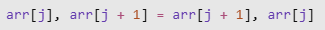

- Stop when no swaps occur

  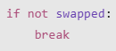

7)  Display Final Result

    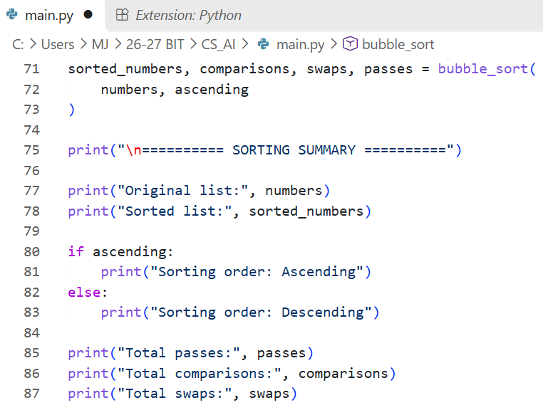

    Explanation:

- bubble_sort(numbers, ascending) calls the sorting function.

- The function returns four values: the sorted list, comparisons, swaps,
  and passes.

- The program displays the final results and performance statistics.

8)  Combine All the Codes!!! Then Click Run and Debug to run the codes

    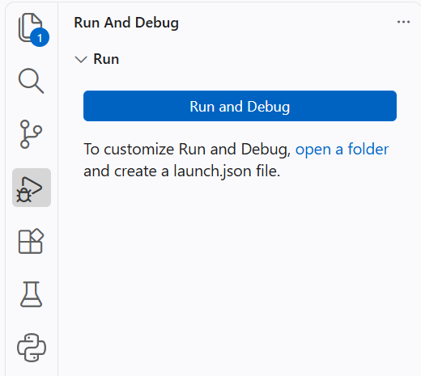

9)  The Result/Output

    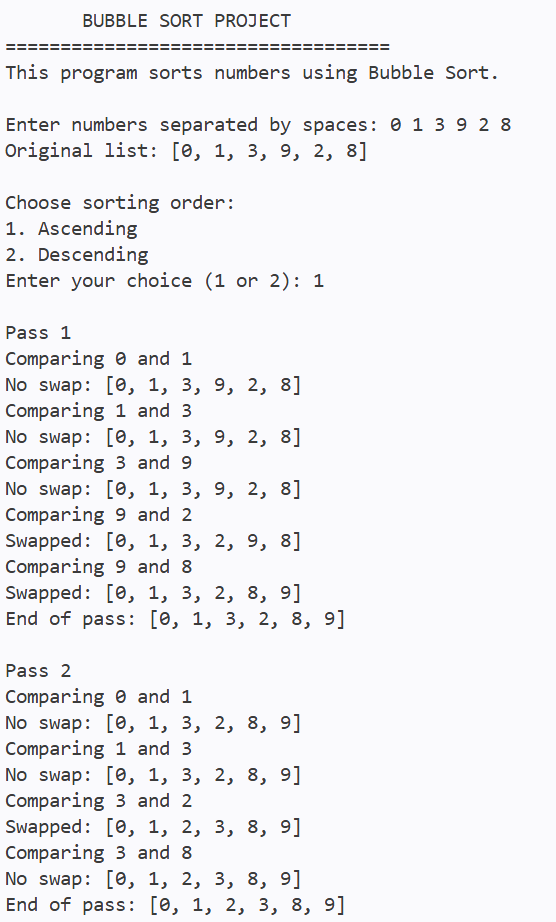

    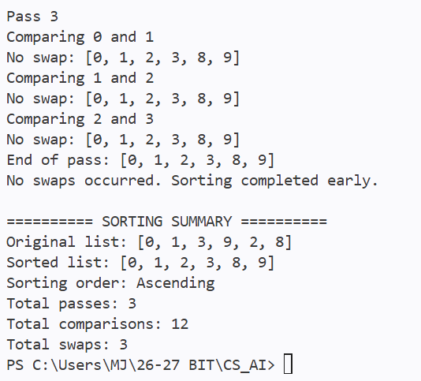

    CONGRATZZZZ!!!

    You have completed a Bubble Sort project using Python :D

    The project demonstrates how an algorithm can be translated into a
    working program through loops, conditional statements, functions,
    and lists.
