CHAPTER 19 – BFS MAZE EXPLORER

We already studied about Breadth-First Search (BFS) before, now it’s the
implementation project!

Follow these steps :D

1)  Create a new folder 🡪 “BFSMazeExplorer”

    
    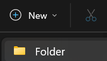
    

2)  Create a New File in VS Code 🡪 “main.py”

    
    

    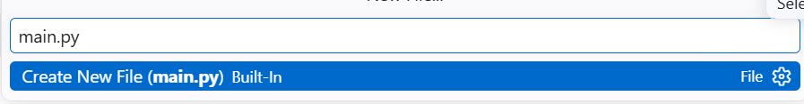

3)  Enter Title

    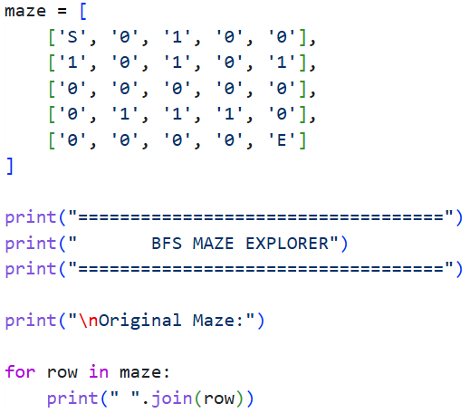

    Output:

    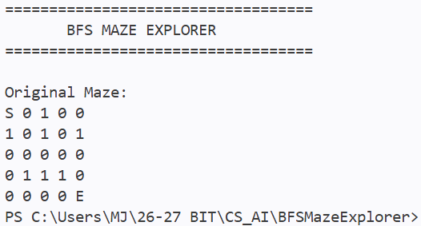

    Explanation

- Each symbol represents a different type of cell:

  - S: Starting position.

  - E: Exit position.

  - 0: An open cell that the program can move through.

  - 1: A wall that blocks movement.

  - \*: A cell that belongs to the shortest path (displayed later).

- The maze is stored as a two-dimensional list, meaning that it contains
  rows and columns.

- For example: maze\[0\]\[0\]

- Accesses the cell in the first row and first column, which contains S.

- The for loop displays each row of the maze.

4)  Find the Starting Position and Exit

    Add codes as below:

    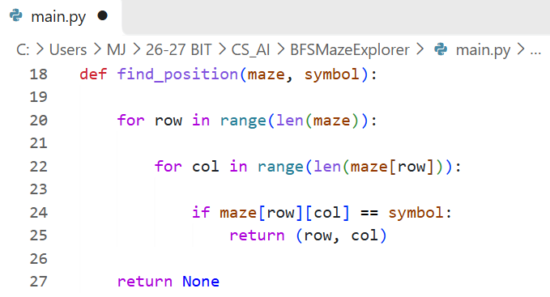

    Explanation:

    **A. Define the function**

    - def find_position(maze, symbol):

    - This function searches for a particular symbol in the maze.

      1.  maze is the two-dimensional list.

      2.  symbol is the character we want to find, such as S or E.

    **B. Create the nested loops**

    - for row in range(len(maze)):

      for col in range(len(maze\[row\])):

    - The outer loop checks each row, while the inner loop checks each
      column in that row.

    **C. Check the cell**

    - if maze\[row\]\[col\] == symbol:

      return (row, col)

    - If the cell contains the requested symbol, the function returns
      its position as a tuple.

    - For example, the starting position is: (0, 0)

    - The exit position is: (4, 4)

    **D. Return None if the symbol is not found**

    - return None

    - If the function finishes searching without finding the requested
      symbol, it returns None.

5)  Create BFS Algorithm

    Add this statement at the very beginning of main.py

    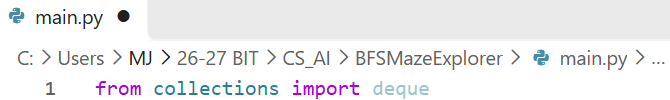

    Create a function of BFS at the bottom as below:

    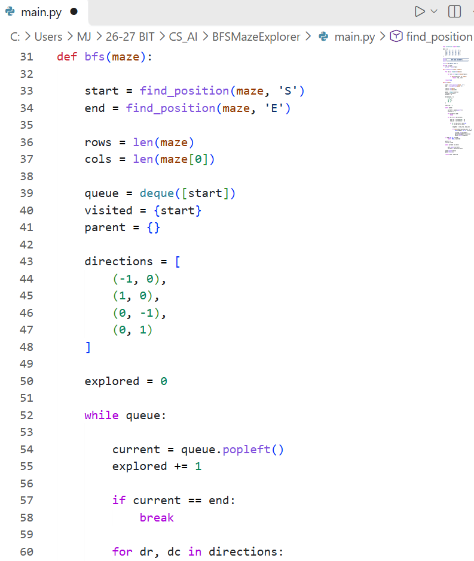

    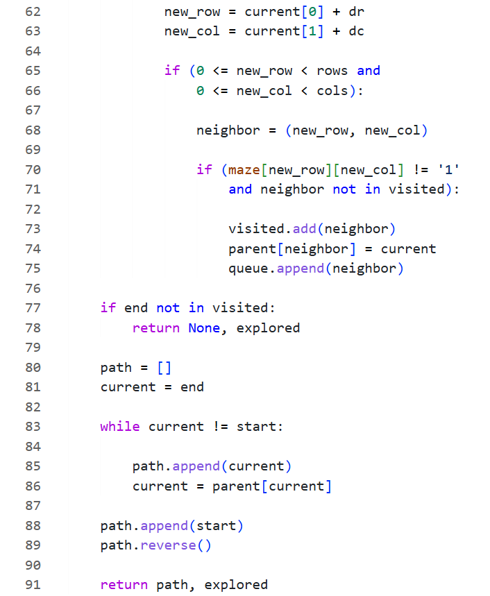

    Explanation:

    **A. Find the starting point and exit**

    start = find_position(maze, 'S')

    end = find_position(maze, 'E')

    These statements call the function from Step 3 to obtain the
    coordinates of the starting point and exit.

    **B. Initialize the queue**

    queue = deque(\[start\])

    The queue stores positions that still need to be explored.

    We use deque because it allows us to efficiently remove the first
    element using popleft(). For example:

    queue = deque(\[(0, 0)\])

    The starting position is added to the queue first.

    **C. Create the visited set**

    visited = {start}

    The visited set records all positions that the algorithm has already
    discovered.

    This prevents the program from visiting the same cell repeatedly.

    A position is marked as visited when it is added to the queue,
    rather than waiting until it is removed.

    **D. Create the parent dictionary**

    parent = {}

    The parent dictionary records how the algorithm reached each
    position.

    For example:

    parent\[(1, 1)\] = (0, 1)

    This means that the program reached position (1, 1) from position
    (0, 1).

    We will use this information later to reconstruct the shortest path.

    **E. Define the movement directions**

> directions = \[
>
> (-1, 0),
>
> (1, 0),
>
> (0, -1),
>
> (0, 1)
>
> \]

The program can move in four directions:

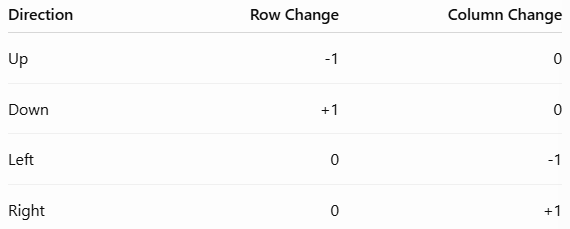

For example, if the current position is (2, 2), moving up changes it to
(1, 2).

**F. Start exploring the maze**

> while queue:
>
> current = queue.popleft()
>
> explored += 1

The while loop continues as long as the queue is not empty.

popleft() removes and returns the first position in the queue. This is
the position that BFS explores next.

The explored variable counts how many positions have been removed from
the queue for exploration.

**G. Check whether the exit has been reached**

> if current == end:
>
> break

If the current position is the exit, the search stops because BFS has
found the shortest path.

**H. Check neighboring cells**

> for dr, dc in directions:
>
> new_row = current\[0\] + dr
>
> new_col = current\[1\] + dc

The loop checks the four possible movement directions and calculates the
coordinates of each neighboring cell.

**I. Check whether the movement is valid**

> if (0 \<= new_row \< rows and
>
> 0 \<= new_col \< cols):

This condition makes sure that the new position is inside the maze.

Next, we check whether the cell is a wall or has already been visited:

> if (maze\[new_row\]\[new_col\] != '1'
>
> and neighbor not in visited):

A neighboring cell can be explored only if:

- It is not a wall.

- It has not already been visited.

**J. Add the valid position to the queue**

> visited.add(neighbor)
>
> parent\[neighbor\] = current
>
> queue.append(neighbor)

These three statements:

1.  Mark the neighboring position as visited.

2.  Record its parent position.

3.  Add it to the queue for future exploration.

**K. Reconstruct the shortest path**

After the search finishes, the program checks whether the exit was
reached.

> if end not in visited:
>
> return None, explored

If the exit was never visited, there is no available path.

Otherwise, we reconstruct the path:

> path = \[\]
>
> current = end
>
> while current != start:
>
> path.append(current)
>
> current = parent\[current\]
>
> path.append(start)
>
> path.reverse()

The program starts from the exit and follows the parent dictionary
backward until it reaches the starting point.

Because the positions are collected in reverse order, reverse() changes
them into the correct order: from the start to the exit.

Finally:

return path, explored

The function returns the shortest path and the number of explored
positions.

6)  Display the Shortest Path

    Add codes below bfs():

    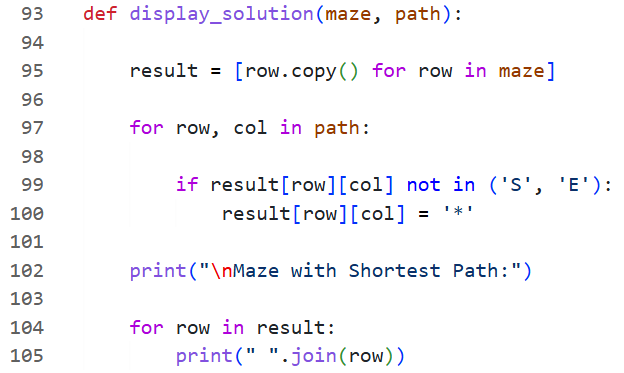

    Explanation:

    **A. Create a copy of the maze**

    result = \[row.copy() for row in maze\]

    This creates a separate copy of the maze.

    We use a copy so that displaying the path does not change the
    original maze.

    **B. Mark the shortest path**

> for row, col in path:
>
> if result\[row\]\[col\] not in ('S', 'E'):
>
> result\[row\]\[col\] = '\*'

The loop visits every position in the shortest path.

Each position is marked with \*, except for the starting point and exit.

**C. Display the result**

> for row in result:
>
> print(" ".join(row))

This displays the maze with the shortest path marked.

7)  Display Final Result

    Remember the first print() code we make? We want to define the main
    function so we will delete these codes first!

    

    Then we will make a new code function at that place

    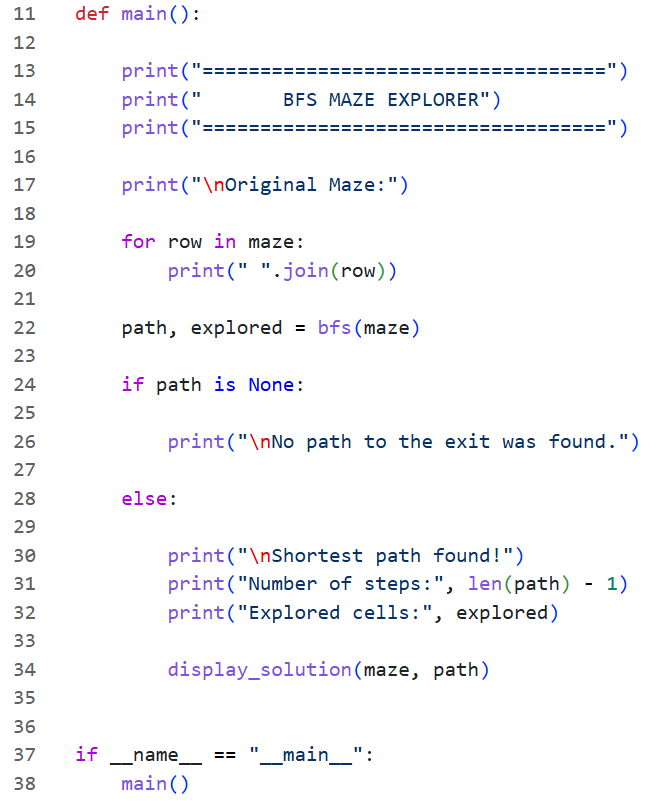

    Explanation:

    **A. Define the main function**

    def main():

    The main() function organizes the program and calls the other
    functions in the correct order.

    **B. Display the original maze**

    The for loop displays the maze before the search begins.

    **C. Call the BFS function**

    path, explored = bfs(maze)

    This runs the BFS algorithm and receives two returned values:

- path: The shortest path from the start to the exit.

- explored: The number of explored cells.

**D. Check the search result**

> if path is None:
>
> print("\nNo path to the exit was found.")

If BFS cannot reach the exit, the program displays a message.

Otherwise, it displays the number of steps, the number of explored
cells, and the maze with the shortest path.

**E. Run the main function**

> if \_\_name\_\_ == "\_\_main\_\_":
>
> main()

This ensures that the main() function runs when the Python file is
executed directly.

8)  Combine All the Codes!!! Then Click Run and Debug to run the codes

    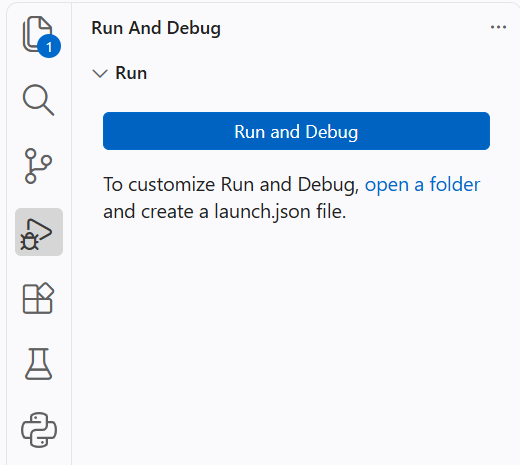

9)  The Result/Output

    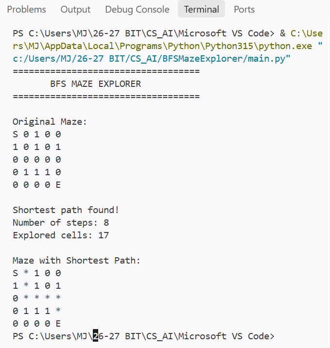

    CONGRATZZZZ!!!

    You have completed a BFS Maze Explorer project using Python :D

    The project demonstrates how Breadth-First Search can be applied to
    solve a maze by exploring neighbouring cells systematically.
