CHAPTER 20 – NEURAL NETWORK CLASSIFIER

We already studied about Neural Network before, now it’s the
implementation project!

We will use the **Iris dataset**, a commonly used dataset in machine
learning. It contains measurements of three different Iris flower
species:

- Setosa

- Versicolor

- Virginica

Follow these steps :D

1)  Create a new folder 🡪 “NeuralNetworkClassifier”

    
    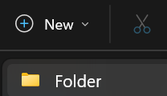
    

2)  Create a New File in VS Code 🡪 “main.py”

    
    

    

3)  Install Required Libraries

    Open VS Code terminal and enter : pip install scikit-learn

    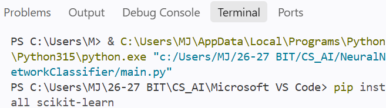

    If it’s done downloading, it will show an output like this

    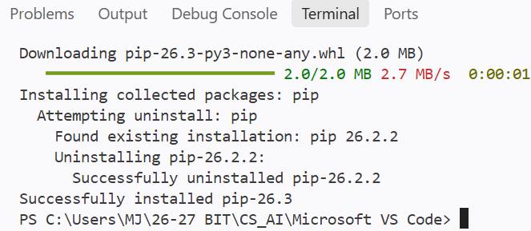

    We will use the following components from scikit-learn:

- load_iris(): Loads the Iris flower dataset.

- train_test_split(): Divides the dataset into training and testing
  sets.

- StandardScaler(): Scales the input features.

- MLPClassifier(): Creates a neural network classifier.

- accuracy_score(): Calculates the accuracy of the model.

- classification_report(): Displays detailed classification results.

- confusion_matrix(): Shows the correct and incorrect classifications.

4)  Import Required Libraries

    Add codes as below:

    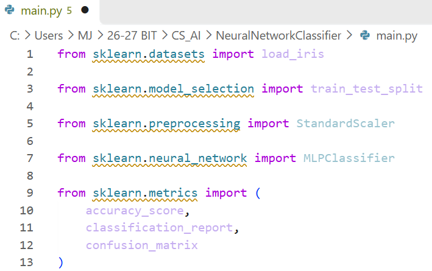

    Explanation:

    **A. Load the dataset**

    from sklearn.datasets import load_iris

    This allows us to access the Iris dataset, which contains flower
    measurements and their corresponding species.

    **B. Split the dataset**

    from sklearn.model_selection import train_test_split

    This allows us to divide the dataset into two parts:

- Training data: Used to teach the neural network.

- Testing data: Used to evaluate how well the trained model performs on
  data it has not seen during training.

**C. Scale the input features**

from sklearn.preprocessing import StandardScaler

This provides a tool to standardize the numerical measurements before
training.

**D. Create the neural network**

from sklearn.neural_network import MLPClassifier

MLPClassifier stands for Multi-Layer Perceptron Classifier.

It is a neural network model that can learn patterns from input data and
use them to classify new examples.

**E. Evaluate the model**

> from sklearn.metrics import (
>
> accuracy_score,
>
> classification_report,
>
> confusion_matrix
>
> )

These tools help us evaluate the model's predictions using accuracy, a
classification report, and a confusion matrix.

5)  Load Iris Dataset

    We need the dataset for our neural network to learn

    Add codes as below

    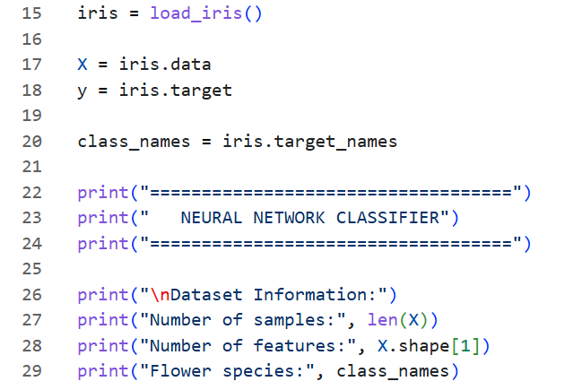

    Output:

    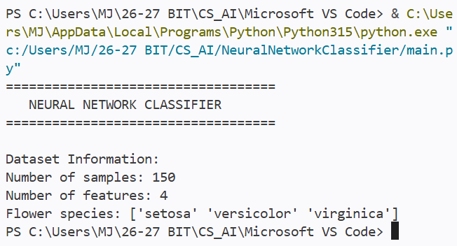

    Explanation:

    **A. Load the dataset**

    iris = load_iris()

    This loads the Iris dataset into the variable iris.

    The dataset contains 150 flower samples from three different
    species.

    **B. Separate the input features**

    X = iris.data

    X contains the measurements used by the neural network to make
    predictions.

    Each flower has four numerical features:

| Feature      | Description         |
|--------------|---------------------|
| Sepal length | Length of the sepal |
| Sepal width  | Width of the sepal  |
| Petal length | Length of the petal |
| Petal width  | Width of the petal  |

**C. Separate the target labels**

y = iris.target

y contains the correct species labels for each flower.

The dataset represents the three species using numbers:

| Number | Flower Species |
|--------|----------------|
| 0      | Setosa         |
| 1      | Versicolor     |
| 2      | Virginica      |

These numbers are the answers that the neural network will learn to
predict.

**D. Get the species names**

class_names = iris.target_names

This stores the actual names of the three flower species so that we can
display readable predictions instead of only numerical labels.

**E. Display dataset information**

> print("Number of samples:", len(X))
>
> print("Number of features:", X.shape\[1\])

- len(X) returns the number of flower samples.

- X.shape\[1\] returns the number of features for each flower.

6)  Divide the Dataset into Training and Testing Data

    Add codes:

    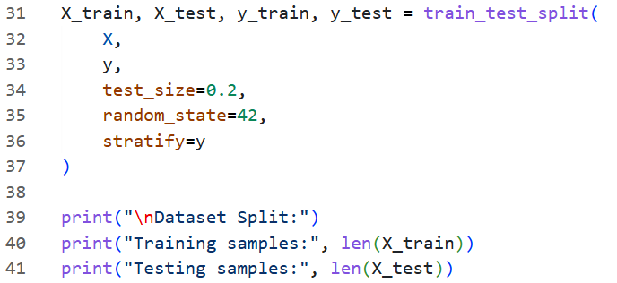

    Output:

    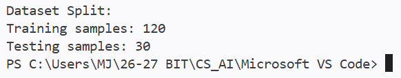

    Explanation:

    **A. Use train_test_split()**

> X_train, X_test, y_train, y_test = train_test_split(
>
> X,
>
> y,
>
> test_size=0.2,
>
> random_state=42,
>
> stratify=y
>
> )

This function divides the dataset into training and testing data.

The four returned variables are:

- X_train: Input features used for training.

- X_test: Input features used for testing.

- y_train: Correct labels corresponding to the training data.

- y_test: Correct labels corresponding to the testing data.

**B. Understand the test size**

test_size=0.2

This means that 20% of the dataset will be used for testing, while the
remaining 80% will be used for training.

Since the Iris dataset contains 150 samples:

- Training data: 120 samples.

- Testing data: 30 samples.

**C. Understand random_state**

random_state=42

This sets a fixed random seed so that the dataset is divided
consistently whenever the program runs.

**D. Understand stratify**

stratify=y

This helps maintain approximately the same proportion of each flower
species in both the training and testing sets.

7)  Scale Input Features

    Before training the neural network, we should standardize the input
    measurements.

    Different features may have different numerical ranges. Scaling
    helps put them on a comparable scale, which can make neural network
    training more effective.

    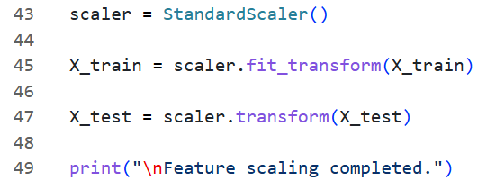

    Output:

    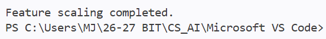

    Explanation:

    **A. Create the scaler**

    scaler = StandardScaler()

    This creates a standardization tool.

    Standardization transforms numerical values so that each feature has
    approximately:

- A mean of 0.

- A standard deviation of 1.

**B. Scale the training data**

X_train = scaler.fit_transform(X_train)

fit_transform() performs two operations:

1.  fit() calculates the mean and standard deviation from the training
    data.

2.  transform() uses those values to standardize the training data.

**C. Scale the testing data**

X_test = scaler.transform(X_test)

We use transform() instead of fit_transform() because the testing data
must use the same scaling values calculated from the training data.

This prevents information from the testing data from influencing the
training process.

8)  Create Neural Network Model

    Add codes:

    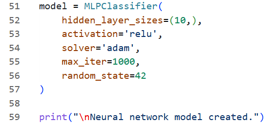

    Output : Neural network model created.

    Explanation

    **A. Create the model**

    model = MLPClassifier(...)

    MLPClassifier creates a Multi-Layer Perceptron neural network.

    A basic neural network consists of three main types of layers:

<!-- -->

1.  Input layer: Receives the input features.

2.  Hidden layer: Processes information and learns patterns.

3.  Output layer: Produces the classification result.

For this project, the network has:

- 4 input neurons, corresponding to the four flower measurements.

- 1 hidden layer containing 10 neurons.

- 3 output neurons, corresponding to the three flower species.

**B. Set the hidden layer size**

hidden_layer_sizes=(10,)

This creates one hidden layer containing 10 neurons.

The comma is important because Python uses a tuple to represent the
hidden layer configuration.

For example:

hidden_layer_sizes=(10,)

means one hidden layer with 10 neurons.

Meanwhile:

hidden_layer_sizes=(10, 5)

would create two hidden layers, containing 10 and 5 neurons
respectively.

**C. Choose the activation function**

activation='relu'

ReLU stands for Rectified Linear Unit.

It is an activation function that introduces non-linearity into the
neural network.

Its mathematical expression is:

> \[\
> f(x)=\max(0,x)\
> \]

This means:

- If the input is positive, the output is the same value.

- If the input is negative, the output is 0.

**D. Choose the optimization algorithm**

solver='adam'

Adam is an optimization algorithm used to update the neural network's
weights during training.

It helps the model adjust its parameters to reduce prediction errors.

**E. Set the maximum number of iterations**

max_iter=1000

This allows the model to perform up to 1000 training iterations.

It does not necessarily mean that the model will use all 1000
iterations. Training may stop earlier if its stopping conditions are
satisfied.

**F. Set the random seed**

random_state=42

This helps make the model's initialization and training behavior
reproducible.

9)  Train the Neural Network

    Add codes:

    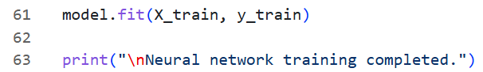

    Output: Neural network training completed.

    Explanation

    **A. Train the model**

    model.fit(X_train, y_train)

    The fit() method trains the neural network using the training data.

    During training, the model:

<!-- -->

1.  Receives the flower measurements as inputs.

2.  Processes the information through its neural network.

3.  Produces predictions.

4.  Compares its predictions with the correct labels.

5.  Adjusts its weights to reduce prediction errors.

This process allows the neural network to learn patterns that help
distinguish the three flower species.

**B. Understand the training process**

The neural network does not memorize a list of fixed answers.

Instead, it adjusts its internal weights during training so that it can
recognize relationships between the flower measurements and their
corresponding species.

10) Evaluate the Neural Network

    After training, we need to check how well the model performs on the
    testing data.

    Add codes:

    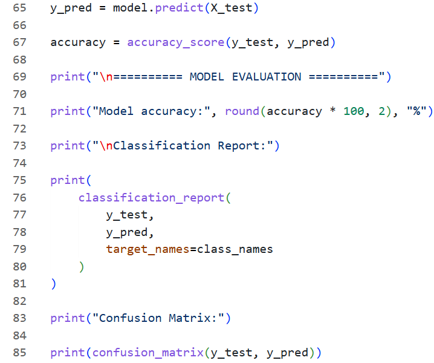

    Explanation

    **A. Make predictions**

    y_pred = model.predict(X_test)

    The predict() method uses the trained neural network to predict the
    species of the flowers in the testing dataset.

    The predicted labels are stored in y_pred.

    **B. Calculate accuracy**

    accuracy = accuracy_score(y_test, y_pred)

    Accuracy measures the proportion of correct predictions out of all
    predictions.

    Its formula is:

> \[\
> \text{Accuracy}=\
> \frac{\text{Correct Predictions}}\
> {\text{Total Predictions}}\
> \]

For example, if the model correctly classifies 27 out of 30 flowers:

> \[\
> \text{Accuracy}=\frac{27}{30}\times100=90%\
> \]

**C. Display the classification report**

> print(
>
> classification_report(
>
> y_test,
>
> y_pred,
>
> target_names=class_names
>
> )
>
> )

The classification report provides additional information about the
model's performance.

It includes:

- Precision: How many predictions for a particular species were correct.

- Recall: How many actual flowers of a particular species were correctly
  identified.

- F1-score: A combined measure of precision and recall.

- Support: The number of actual testing samples belonging to each
  species.

**D. Display the confusion matrix**

print(confusion_matrix(y_test, y_pred))

The confusion matrix compares the actual flower species with the model's
predictions.

Each row represents the actual class, while each column represents the
predicted class.

For example, a value in row 1 and column 1 represents the number of
Setosa flowers correctly classified as Setosa.

Values outside the main diagonal represent incorrect classifications.

11) Test Model with a New Flower

    Add codes:

    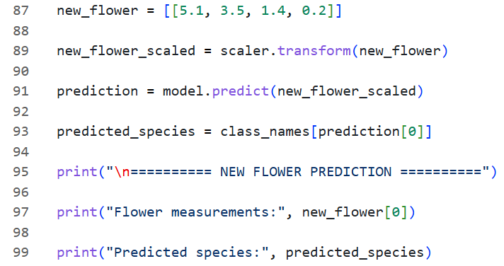

    Explanation

    **A. Enter the new flower measurements**

    new_flower = \[\[5.1, 3.5, 1.4, 0.2\]\]

    This represents a new flower with four measurements:

| **Feature**  | **Measurement** |
|--------------|-----------------|
| Sepal length | 5.1             |
| Sepal width  | 3.5             |
| Petal length | 1.4             |
| Petal width  | 0.2             |

These values are provided in the same order as the original dataset's
features.

**B. Scale the new measurements**

new_flower_scaled = scaler.transform(new_flower)

The new measurements must be standardized using the same scaler that was
fitted on the training data.

**C. Predict the flower species**

prediction = model.predict(new_flower_scaled)

The trained neural network analyzes the measurements and predicts the
flower's species.

**D. Convert the prediction into a readable name**

predicted_species = class_names\[prediction\[0\]\]

The model returns a numerical label:

- 0 represents Setosa.

- 1 represents Versicolor.

- 2 represents Virginica.

We use class_names to convert that number into the corresponding species
name.

For the example measurements, the predicted species should be setosa.

12) Combine All the Codes!!! Then Click Run and Debug to run the codes

    

13) The Result/Output

    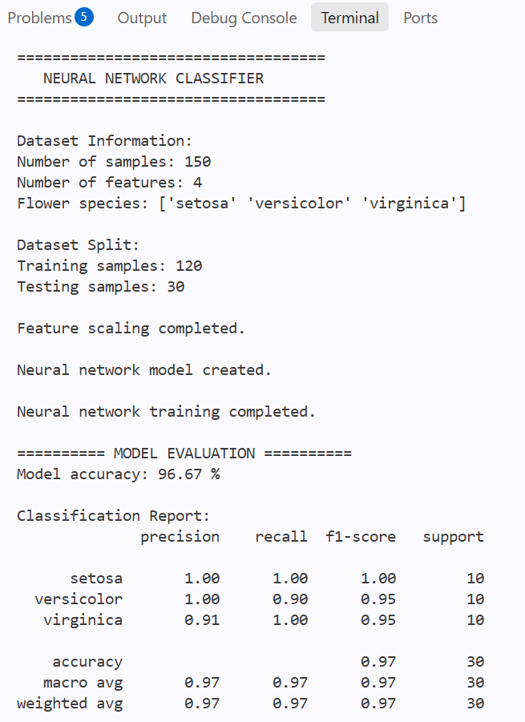

    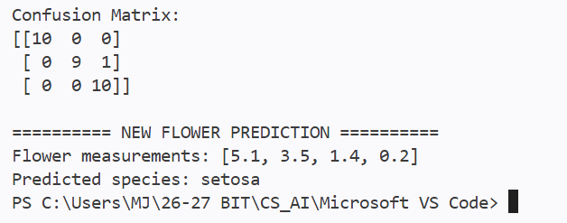

    CONGRATZZZZ!!!

    You have completed a Neural Network Classifier project using Python
    :D

    The project demonstrates how an artificial neural network can learn
    patterns from numerical data and use those patterns to classify new
    examples.
